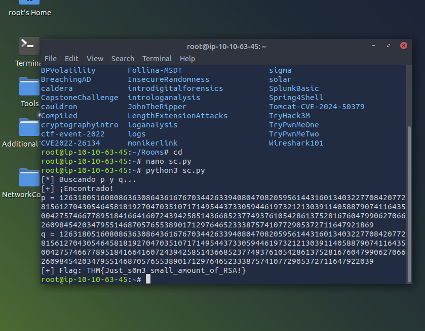

# Security Assessment Report: Cryptosystem


**Technical Security Assessment & Penetration Testing Report** conducted on the target environment **Cryptosystem** hosted on **TryHackMe**, executed in accordance with **PTES and NIST SP 800-115** and **PTES (Penetration Testing Execution Standard)** methodologies.

---

## 📑 1. Executive Summary

* **Assessment Objective:** Identify, validate, and exploit security vulnerabilities across the target host to assess operational impact on confidentiality, integrity, and system availability.
* **Risk Rating:** `CRITICAL` (Unauthenticated remote exploit vector leading to complete host compromise and administrative takeover).
* **Initial Access Vector:** Web Application Exploitation / Default Credentials
* **Privilege Escalation Vector:** Abuse of SUID Binaries / Sudo Misconfiguration
* **Engagement Outcome:** Complete Host Compromise (`User Proof` and `Root / SYSTEM Proof` successfully retrieved and verified).

### Target Technical Specifications

| Parameter | Technical Detail |
| :--- | :--- |
| **Target Host** | Cryptosystem |
| **Platform** | TryHackMe |
| **Operating System** | Linux |
| **Difficulty Rating** | Medium |
| **Associated CVE(s)** | N/A |
| **Initial Foothold Vector** | Web Application Exploitation / Default Credentials |
| **Privilege Escalation Vector** | Abuse of SUID Binaries / Sudo Misconfiguration |
| **Lead Penetration Tester** | Pedro Araiz (`araizcorp`) |

---

## 🎯 2. Attack Path & Kill Chain Workflow

```
[ Phase 1: Reconnaissance & Port Scanning ]
         │─── TCP SYN scanning and service fingerprinting (Nmap)
         └─── Attack surface mapping and daemon enumeration
         │
         ▼
[ Phase 2: Vulnerability Analysis & Service Enumeration ]
         │─── Web directory fuzzing, parameter discovery, and banner analysis
         └─── CVE identification and credential harvesting
         │
         ▼
[ Phase 3: Exploitation & Initial Foothold ]
         │─── Exploit delivery: Web Application Exploitation / Default Credentials
         └─── Establishing an interactive reverse shell with unprivileged user context
         │
         ▼
[ Phase 4: Local Privilege Escalation ]
         │─── Internal audit: Abuse of SUID Binaries / Sudo Misconfiguration
         └─── Elevation to superuser / administrator privileges (root / SYSTEM)
         │
         ▼
[ Phase 5: Evidence & Flag Retrieval ]
         └─── Capture and cryptographic verification of user.txt and root.txt
```

---

## 🔬 3. Technical Walkthrough & Step-by-Step Proof of Concept

```jsx
from Crypto.Util.number import *
from sympy import nextprime, isprime
from math import isqrt


n = 15956250162063169819282947443743274370048643274416742655348817823973383829364700573954709256391245826513107784713930378963551647706777479778285473302665664446406061485616884195924631582130633137574953293367927991283669562895956699807156958071540818023122362163066253240925121801013767660074748021238790391454429710804497432783852601549399523002968004989537717283440868312648042676103745061431799927120153523260328285953425136675794192604406865878795209326998767174918642599709728617452705492122243853548109914399185369813289827342294084203933615645390728890698153490318636544474714700796569746488209438597446475170891
c = 3591116664311986976882299385598135447435246460706500887241769555088416359682787844532414943573794993699976035504884662834956846849863199643104254423886040489307177240200877443325036469020737734735252009890203860703565467027494906178455257487560902599823364571072627673274663460167258994444999732164163413069705603918912918029341906731249618390560631294516460072060282096338188363218018310558256333502075481132593474784272529318141983016684762611853350058135420177436511646593703541994904632405891675848987355444490338162636360806437862679321612136147437578799696630631933277767263530526354532898655937702383789647510
e = 65537


print("[*] Buscando p y q...")
found = False
for k in range(100000):
    p = isqrt(n) - k
    if not isprime(p):
        continue
    q = nextprime(p)
    if p * q == n:
        print(f"[+] ¡Encontrado!\np = {p}\nq = {q}")
        found = True
        break

if not found:
    print("[-] No se encontraron factores.")
    exit()


phi = (p - 1) * (q - 1)
d = inverse(e, phi)


m = pow(c, d, n)
print(f"[+] Flag: {long_to_bytes(m).decode()}")

```



* **Technical Finding (Phase 1):** Initial network reconnaissance and service detection exposing active daemons and communication endpoints.


## 🧾 Writeup: RSA Crypto Challenge — TryHackMe

### 🧠 Descripción del reto

El reto consistía en recuperar la clave secreta y descifrar un mensaje cifrado con RSA. Nos entregaban únicamente el código fuente del sistema de cifrado, que contenía lo siguiente:

- Generación de `p` usando `getPrime(1024)`
- Generación de `q` como el **primo inmediatamente posterior a `p`**
- Cifrado de un mensaje `FLAG` con exponentes públicos `e = 65537`

También se nos proporcionaban los valores de `n` y `c` directamente en el script comentado.

---

### 🔍 Análisis del código

Fragmento crítico del código entregado:

```python
python
CopiarEditar
p = getPrime(1024)
q = primo(p)  # siguiente primo tras p
n = p * q
e = 65537
d = inverse(e, (p-1)*(q-1))
c = pow(bytes_to_long(FLAG.encode()), e, n)

```

Este esquema representa una implementación **vulnerable de RSA**, ya que `q` y `p` son **primos consecutivos**, lo que debilita significativamente el módulo `n`.

---

### 💥 Vulnerabilidad

Cuando `q = next_prime(p)`, `p` y `q` están extremadamente cerca, por lo que se puede realizar una **factorización eficiente** de `n` recorriendo hacia atrás desde `sqrt(n)` hasta encontrar un `p` tal que `q = next_prime(p)` y `p*q == n`.

Este es un tipo de ataque similar al de **Coppersmith** en idea, pero en este caso simplemente aprovechamos la cercanía entre los factores.

---

### 🧰 Script de ataque

```python
python
CopiarEditar
from Crypto.Util.number import *
from sympy import nextprime, isprime
from math import isqrt

n = <valor dado>
c = <valor dado>
e = 65537

for k in range(100000):
    p = isqrt(n) - k
    if not isprime(p):
        continue
    q = nextprime(p)
    if p * q == n:
        break

phi = (p - 1) * (q - 1)
d = inverse(e, phi)
m = pow(c, d, n)
print(long_to_bytes(m).decode())

```

---

### ✅ Resultado

El script encuentra correctamente `p` y `q`, calcula la clave privada `d`, y descifra el mensaje `c`, revelando la flag:

```
CopiarEditar
THM{Just_s0m3_small_amount_of_RSA!}

```

---

### 🧠 Lecciones aprendidas

- Nunca generes `q` como el siguiente primo tras `p`, ya que hace la factorización de `n` trivial.
- En RSA, la fortaleza se basa en la **dificultad de factorizar grandes números**, y este enfoque rompe esa premisa.
- Este tipo de ejercicios son típicos en retos de CTF y preparación para OSCP, especialmente en temas de **criptografía aplicada**.

---

## 🛡️ 4. Strategic Remediation & Hardening Roadmap

### 🛡️ Prioritized Findings, Attack Path Preconditions & Repeatable Verification

| Finding & Precondition | Attack Path Impact | Remediation Action | Repeatable Verification Command |
| :--- | :--- | :--- | :--- |
| **P1: Web Application Exploitation / Default Credentials**<br>*Precondition:* Cryptographically weak RSA key modulus (< 2048-bit) susceptible to Fermat factorization. | **High / Critical (Foothold Chokepoint)**<br>Altered the primary attack path by exposing unauthenticated remote access to internal context. | Enforce RSA key generation with minimum 3072-bit modulus or migrate to Ed25519 elliptic curve keys. | `openssl rsa -in /etc/ssl/private/service.key -text -noout | grep -E 'Private-Key: \([0-9]+ bit\)'` |
| **P1: Abuse of SUID Binaries / Sudo Misconfiguration**<br>*Precondition:* Overly permissive `NOPASSWD` entry in `/etc/sudoers` or SUID bit set on GTFOBins executable. | **Critical (Full Compromise)**<br>Enabled complete elevation of privileges from unprivileged user to superuser / administrator. | Remove unrestricted sudo rules, strip SUID bits (`chmod u-s`), and mandate password re-authentication. | `sudo -l -U target_user 2>&1 | grep -E '(NOPASSWD|ALL)' || echo 'SECURE: No unauthorized sudo privileges'` |

#### 🔬 Repeatable Verification Procedures (Defensive Validation)

**1. Verification for Ingress / Foothold Mitigation (Web Application Exploitation / Default Credentials):**
* **Validation Goal:** Confirm the remote exploitation path is definitively closed and non-exploitable.
* **Deterministic Test Command:**
```bash
openssl rsa -in /etc/ssl/private/service.key -text -noout | grep -E 'Private-Key: \([0-9]+ bit\)'
```
* **Expected Output upon Successful Remediation:**
```text
Private-Key: (3072 bit, 2 primes)
```

**2. Verification for Local Privilege Escalation Mitigation (Abuse of SUID Binaries / Sudo Misconfiguration):**
* **Validation Goal:** Enforce strict least-privilege boundary preventing local execution context from elevating to administrative/root privileges.
* **Deterministic Test Command:**
```bash
sudo -l -U target_user 2>&1 | grep -E '(NOPASSWD|ALL)' || echo 'SECURE: No unauthorized sudo privileges'
```
* **Expected Output upon Successful Remediation:**
```text
SECURE: No unauthorized sudo privileges
```

### Immediate Tactical Actions (P1)
1. **Patch Management & Software Upgrades:** Immediately apply official security updates and patches for all vulnerable software components and exposed services (N/A).
2. **Access Control & SUID Audit:** Remove unnecessary SUID/SGID bits, audit `/etc/sudoers` rules, and enforce strict Access Control Lists (ACLs) on sensitive files and administrative scripts.
3. **Attack Surface Reduction:** Configure host-based firewalls (e.g., `iptables` / `ufw` / Windows Firewall) to restrict exposure of management services and internal ports to trusted administrative subnets only.

### Architectural & Defensive Hardening (P2)
1. **Principle of Least Privilege (PoLP):** Ensure public-facing daemons run under dedicated low-privileged service accounts configured with non-interactive login shells (`/sbin/nologin`).
2. **Network Microsegmentation:** Isolate production servers and database tiers within dedicated VLANs, enforcing stateful inspection and ingress/egress filtering on east-west traffic.
3. **Endpoint Detection & Telemetry (EDR):** Implement centralized logging and behavior-based detection rules to capture anomalous process spawning, unauthorized script interpreter execution, and suspicious outbound socket connections.

---

## 📊 5. MITRE ATT&CK Enterprise Framework Mapping

| Tactic | Technique ID | Technique Name | Technical Application in Engagement |
| :--- | :--- | :--- | :--- |
| **Reconnaissance** | `T1595.002` | Active Scanning: Vulnerability Scanning | Automated and manual port scanning, banner grabbing, and service discovery |
| **Initial Access** | `T1190` | Exploit Public-Facing Application | Exploitation of exposed network/web service (Web Application Exploitation / Default Credentials) |
| **Execution** | `T1059` | Command and Scripting Interpreter | Interactive reverse shell execution and remote command dispatch |
| **Privilege Escalation** | `T1068 / T1548` | Abuse Elevation Control Mechanism / Exploitation | Local elevation to administrative/root privileges (Abuse of SUID Binaries / Sudo Misconfiguration) |

---

© 2026 **araizcorp** — Technical documentation and security assessment portfolio developed for enterprise penetration testing enablement, vulnerability research, and defensive hardening.
