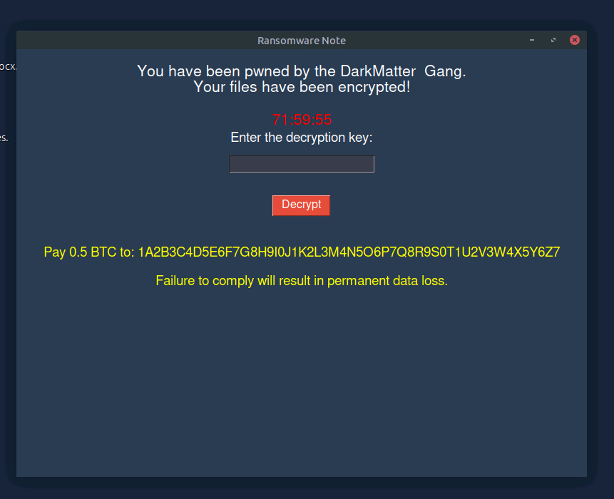
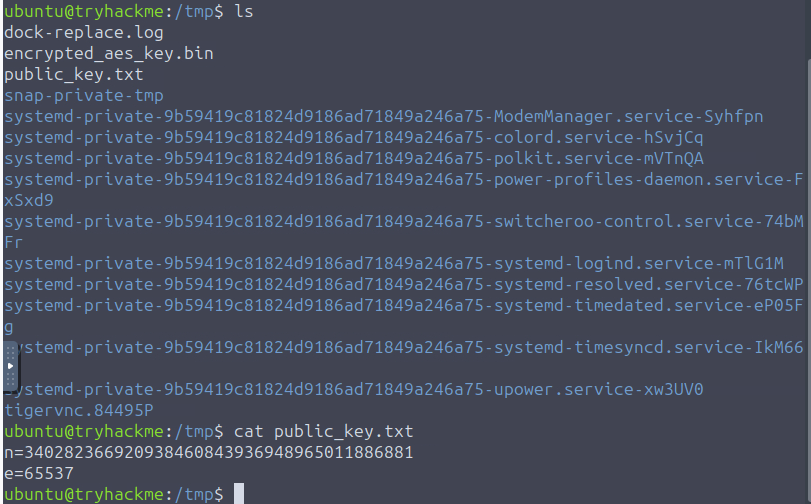
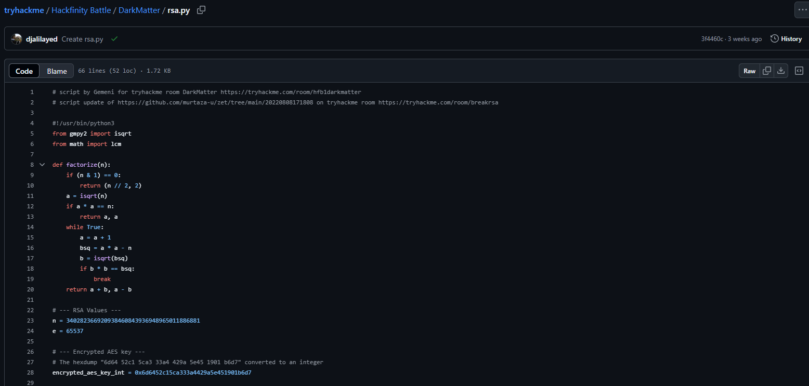
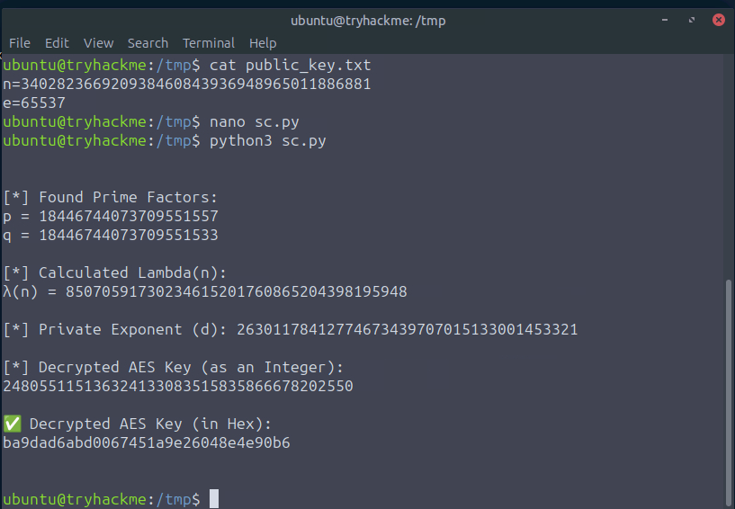
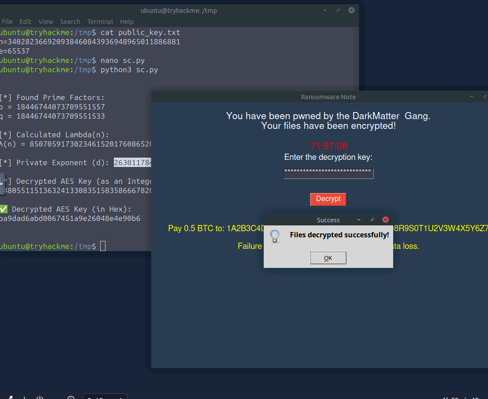

# DarkMatter — TryHackMe Walkthrough & Writeup


-informational?style=for-the-badge)

Guía completa y walkthrough paso a paso para resolver la máquina **DarkMatter** en la plataforma **TryHackMe**, incluyendo reconocimiento, explotación de vulnerabilidades y escalada de privilegios para obtener todas las flags.

---

```bash


#!/usr/bin/python3
from gmpy2 import isqrt
from math import lcm

def factorize(n):
    if (n & 1) == 0:
        return (n // 2, 2)
    a = isqrt(n)
    if a * a == n:
        return a, a
    while True:
        a = a + 1
        bsq = a * a - n
        b = isqrt(bsq)
        if b * b == bsq:
            break
    return a + b, a - b


n = 340282366920938460843936948965011886881
e = 65537


encrypted_aes_key_int = 0x6d6452c15ca333a4429a5e451901b6d7


p, q = factorize(n)


lambda_n = lcm(p - 1, q - 1)


d = pow(e, -1, lambda_n)

print("\n")
print(f"[*] Found Prime Factors:")
print(f"p = {p}")
print(f"q = {q}\n")


lambda_n = lcm(p - 1, q - 1)
print(f"[*] Calculated Lambda(n):")
print(f"λ(n) = {lambda_n}\n")

print(f"[*] Private Exponent (d): {d}\n")


decrypted_key_int = pow(encrypted_aes_key_int, d, n)

print(f"[*] Decrypted AES Key (as an Integer):")
print(f"{decrypted_key_int}\n")


decrypted_key_hex = format(decrypted_key_int, 'x')

print(f"✅ Decrypted AES Key (in Hex):")
print(f"{decrypted_key_hex}")
print("\n")
```

### En resumen: ¿qué debes hacer la próxima vez?

1. **Busca pistas en la máquina** (código, .py, .json, .pem).
2. Si ves `n`, `e` y un valor cifrado → **esto es RSA**.
3. Intenta factorizar `n`. Si es fácil, **puedes romper RSA**.
4. Si se descifra algo → probablemente es una **clave AES**.
5. Pruébala como "decryption key" en el binario, GUI o web de la máquina.











